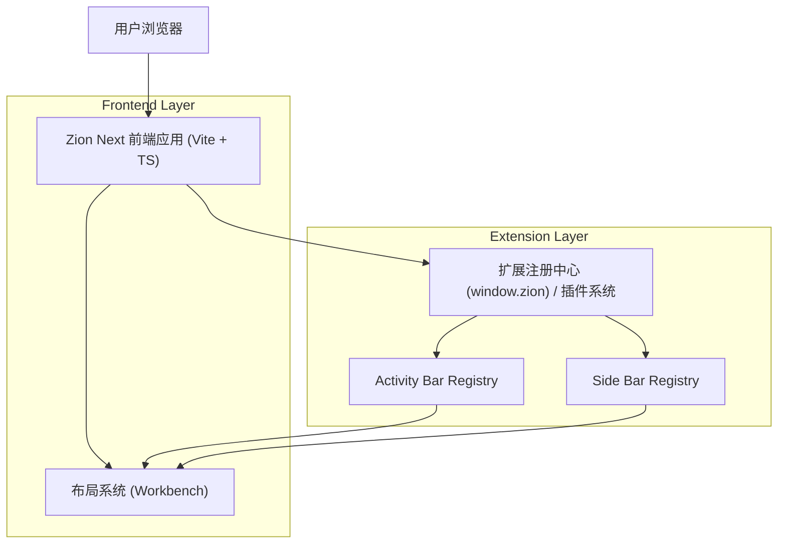

## 1.Architecture design


## 2.Technology Description
- Frontend: TypeScript + Vite + CodeMirror 6（当前项目形态）
- Backend: None

## 3.Route definitions
| Route | Purpose |
|-------|---------|
| / | 单页应用入口：工作台（未来接入 Activity Bar + Sidebar 的承载页面） |

## 4.API definitions (If it includes backend services)
Backend: None

## 6.Data model(if applicable)
本需求不引入数据库。

---

# 附录：Activity Bar + Side Bar「目标接入结构」(建议)
> 该结构用于把 docs/layout 的“规范”落到代码层；不代表已实现。

## A.1 建议目录结构（src）
```text
src/
  ui/
    workbench/
      WorkbenchRoot.ts
      layout.css
      state.ts                  # activeItemId/activeViewId/sidebarVisible 等
    activity-bar/
      ActivityBar.ts
      ActivityBarRegistry.ts     # registerItem/getItems/activateItem
      types.ts
    side-bar/
      SideBar.ts
      SideBarRegistry.ts         # registerView/getViews/activateView
      types.ts
    shared/
      when-evaluator.ts          # 解析 when 表达式（若需要）
      persistence.ts             # localStorage/state 持久化（若需要）

src/types/
  zion.d.ts                      # 补齐 window.zion.activityBar / window.zion.sideBar

src/ext/
  registry.ts                    # 暴露对外 API：activityBar/sideBar
```

## A.2 核心对象（结构定义，不涉及实现细节）
- ActivityBarItem
  - id, pluginId, icon, tooltip, order, when
  - sideBarViewId（本次接入重点）
- SideBarView
  - id, pluginId, title, icon, order, when
  - component（render(container) -> dispose）

## A.3 联动状态（建议 state key）
- ui.activityBar.activeItemId
- ui.sideBar.activeViewId
- ui.sideBar.visible
- ui.sideBar.width

## A.4 关键联动规则（最小闭环）
1. 点击 ActivityBarItem：
   - 设置 activeItemId
   - 若 item.sideBarViewId 存在：
     - sideBar.visible = true
     - sideBar.activeViewId = item.sideBarViewId
2. 在 SideBar 内切换视图（tabs）：
   - sideBar.activeViewId 更新
   - 若存在反向映射（viewId -> itemId）：同步 activeItemId

## A.5（可选）类型系统对齐
当前 src/types/zion.d.ts 未声明 activityBar/sideBar；建议补充：
- window.zion.activityBar.registerItem/activateItem/getItems/show/hide/toggle
-