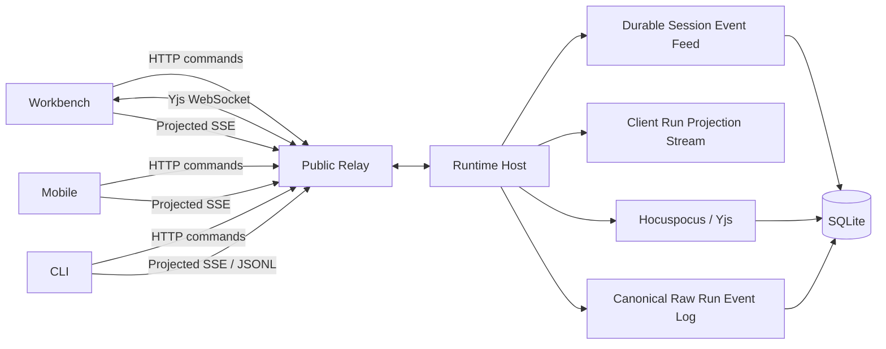

# ADR-0002：Runtime 实时会话与协同文档

- 状态：Accepted
- 日期：2026-09-04
- 范围：Workbench、CLI、Mobile、Runtime Host、Relay
- 依赖：[ADR-0001-MODULAR-MONOLITH-AGENT-RUNTIME.md](./ADR-0001-MODULAR-MONOLITH-AGENT-RUNTIME.md)

## 背景

Workbench Session 已由 Runtime SQLite 持久化，但客户端仍每 30 秒检查一次全局
revision，并在变化后下载完整 snapshot。`BroadcastChannel` 只能覆盖相同 origin，
不能覆盖 `localhost` 与 `127.0.0.1`、不同浏览器、CLI 或 Mobile。Run SSE 又只允许
已经知道 `runId` 的客户端订阅。

Zion 后续需要同时支持：

- 多个 Workbench 实时看到 Session 创建、更新、删除和运行状态；
- CLI 按 Session 进入正在运行的对话，并支持可恢复的 JSONL 输出；
- Mobile 经公网 Relay 观察和继续 Session；
- 多个客户端并发编辑文档；
- 断线、离线编辑和重连后自动收敛；
- 已执行 Run 的输入保持不可变、可审计。

## 决策

采用三条互相独立的客户端协议和一份内部原始日志，不把所有状态塞入一种同步机制：



### Durable Session Event Feed

Runtime 在 Workbench state transaction 内写入递增序号事件。客户端先读取 snapshot，
再以 cursor 订阅 SSE；断线后从最后一个 event sequence 继续。事件只携带定位和版本
信息，大型文档通过按 Session 查询或协同协议获取。

事件至少覆盖：

- `session.created`
- `session.updated`
- `session.deleted`
- `tree.updated`
- `kv.updated`
- `document.checkpointed`
- `run.started`
- `run.completed`
- `run.failed`
- `run.aborted`

30 秒轮询保留为断线和旧 Runtime 的降级路径，不再是正常同步机制。

### Client Run Projection Stream

Runtime 的原始 Run Event Log 保留完整 token、reasoning、tool、usage 和 checkpoint
事件，用于审计与恢复；交互客户端默认不直接消费它。

`GET /v1/runs/{runId}/projection/stream` 在 Runtime 侧合并连续
`message.delta`/`reasoning.delta`，并以最后一个原始 event sequence 作为 SSE id。
客户端断线后仍从原始 sequence 恢复，不会因合批丢失位置。raw
`/events/stream` 只用于诊断和明确要求原始事件的 CLI。

客户端可以按能力选择 `reasoning=stream|summary|none`。Runtime 写 SSE 时遵守
backpressure，共享客户端使用有界队列，避免慢客户端形成无界内存积压。

### Collaborative Document

Session 可编辑正文使用 Yjs CRDT。Runtime Host 内嵌 Hocuspocus WebSocket 服务，
Workbench 使用 CodeMirror 6 binding，浏览器使用 IndexedDB 作为离线缓存。

不自行实现字符操作变换、冲突合并、Presence 或 WebSocket 房间协议。

初始文档模型：

```text
Y.Doc(sessionId)
├── Y.Text("content")
├── Y.Map("annotations")
├── Y.Map("blocks")
└── Y.Map("runs")
```

第一阶段只要求 `content` 实时协同；annotations 和 blocks 保持现有格式，并在后续迁移
到稳定 ID。`runs` 记录 Runtime 已提交的 Run sequence、最终 output 和 terminal
status。同一 Workbench 内，同一 Session 的所有分屏 View 共享一个 `Y.Doc` 和一个
provider；已绑定 Yjs 的 View 不再经过旧 `SessionSync` 做第二次文本复制。

正在生成的 assistant output 不进入 Yjs。Workbench 使用 CodeMirror decoration
显示临时内容，Mobile 使用普通消息组件，CLI 写 stdout；`message.completed` 或
Run 终态后，Runtime Host 才通过已注册的 Session Document Projector 把最终
assistant block 提交到 Yjs。

Runtime Core 不理解 `user `、`assistant `、隐式首段或尾部空输入行。它只提供
Yjs 房间、持久化、Run 事件顺序和 Document Projector 注册/调用接口。
`dev.session-manager/runtime.js` 在 Runtime Host 内注册
`dev.session-manager.chat-document`，由该插件解释 Workbench 文档语义并执行：

- Run 开始前幂等补齐本次 user block 和唯一 assistant anchor；
- 以 Workbench 传入的 Yjs `RelativePosition` 解析触发位置，并仅在无法解析时使用
  带前后文校验的 offset fallback；
- 将无角色前缀的首段识别为隐式 user，避免重复插入显式 `user `；
- 以 `message.completed.content` 作为 assistant 正文权威值；
- 仅在缺失 `message.completed` 时用 `run.completed.output` 恢复；
- 任意位置插入且后方仍有内容时，写入不可见的 continuation boundary，保证终态
  assistant 投影和卡片 marker 都不能吞掉后文。

Workbench 不得与 Runtime 插件并发执行终态文档 finalization；协同连接未就绪时也
只能显示临时 decoration，禁止退化为 token 级整文写回。临时回答和自动跟随都绑定
到本 Run 的 assistant anchor，不能无条件滚动或插入到文档末尾。
空 `user ` 输入行只允许作为 Workbench 本地交互状态，禁止持久化进 Yjs。流式
decoration 使用实时 Markdown DOM 和独立尾锚点；自动跟随与“最新回答”按钮必须定位
该尾锚点，而不是持久文档末尾。

thinking/tool marker 遵循单 document writer 原则。发起 Run 的 Workbench 可以创建
marker；其他 Workbench 只缓存卡片元数据并等待同 ID marker 经 Yjs 到达，不能根据
annotation 自行补写文档。这样多 View 和多 Workbench 都只渲染同一份协同结果。

协同 WebSocket 和交互 Run 请求携带相同的 Workbench realtime protocol version。
Runtime 拒绝旧协议客户端继续连接或发起 Run，防止升级前页面把旧 CRDT/终态逻辑
重新写回权威文档。当前协同协议为 v4；v4 客户端会拒绝将晚到的 HTTP Session
snapshot 或 seed 通过已绑定的 CodeMirror/Yjs 文档重新写回 Runtime。

### Canonical Transcript

Canonical Transcript 与 Collaborative Document 保持分离：

- Transcript 是不可变的模型输入和执行记录；
- Collaborative Document 是用户可编辑的展示与创作表面；
- Run 创建时记录输入对应的文档版本或 state vector；
- Run 开始后的协同编辑不追溯修改该 Run 的输入；
- Runtime 负责提交模型最终输出，发起 Run 的 Client 不能成为唯一持久化 owner。
- 正在生成的输出是可重建的临时 projection，不是协同文档状态。

### Transport

- HTTP：命令和查询。
- SSE：耐久 Session 事件与合批 Run projection，支持 cursor 和 catch-up。
- WebSocket：Yjs update 与 Awareness。
- Relay：认证、路由、限流和断线转发，不解释 Session 或 CRDT 业务语义。

Workbench、CLI 和 Mobile 依赖同一个 Client SDK，不各自实现协议。

## 技术选择

- `yjs`：CRDT 和 state vector。
- `@hocuspocus/server`：Runtime WebSocket 协同服务。
- `@hocuspocus/provider`：Web/Mobile JavaScript 客户端。
- `y-codemirror.next`：CodeMirror 6 binding。
- `y-indexeddb`：浏览器离线文档缓存。
- `y-protocols/awareness`：在线成员、光标和选区。

Automerge Repo 保留为备选，但当前 Zion 使用 CodeMirror 6，Yjs 的编辑器 binding、
WebSocket Provider 和服务端生态更直接。

## 一致性与安全

- 每个 Workbench/CLI/Mobile 连接有稳定 `clientId`，用于忽略自己的回声。
- Runtime/Yjs 模式不启用旧 `BroadcastChannel` 冲突提示；该提示只服务于没有
  CRDT 的 browser fallback，避免把正常协同更新误报为外部覆盖。
- 非 CRDT 写入必须携带 `expected_session_revision` 或 `If-Match`。
- Presence 不持久化，文档 update 和业务事件必须持久化。
- 客户端不能把 Bearer token 放入 URL；认证通过 header、WebSocket upgrade 或首帧完成。
- 协同房间按 Space/Session 授权，读者和编辑者权限分离。
- Runtime 对 update 大小、连接数、房间数和速率设置上限。
- 模型输出按小批次发送给 Client，但只在完成时提交 CRDT。
- 客户端不得把 `message.delta` 或 `reasoning.delta` 保存到本地 Run Ledger。
- 不活动的页面不应消费正文与 reasoning 流。
- 本地交互目标：Session 发现 p95 小于 300ms；Workbench 正文 projection
  最大延迟 50ms、最多每秒 20 次；reasoning UI 合批到最多每秒 4 次。

## 分阶段交付

1. Durable Session Event Feed、SSE catch-up、Workbench 实时列表和文档失效。
2. CLI `session watch/attach` 与运行中 Run 发现。
3. Hocuspocus/Yjs Server、SQLite persistence 和 CodeMirror binding。
4. Runtime Client Projection Stream 与模型终态协同文档 transaction。
5. Public Relay、Mobile 离线恢复和推送通知。
6. annotations/tool cards 迁移到稳定 CRDT 锚点。

## 当前实现状态

本地 Runtime 已完成阶段 1-4：

- SQLite durable Session Event Feed、JSON catch-up、SSE `Last-Event-ID` 和
  cursor expiry reset；
- Workbench 实时 Session 更新、活动 Run 自动 attach，以及 CLI
  `session attach/watch`；
- Runtime 内嵌 Hocuspocus、Yjs SQLite state、CodeMirror 6 binding 和浏览器
  IndexedDB 离线副本；
- Runtime 合并原始 token 后向 Client 发送 projection，Workbench、CLI 和未来
  Mobile 使用同一共享协议；
- Workbench 使用临时 CodeMirror decoration 显示流式回答，Runtime 仅在消息完成
  或 Run 终态时把 assistant block 提交到协同文档；
- Session Manager Runtime 插件持有 Workbench 文档投影语义，Runtime Core
  不解析角色行格式；
- 同 Session 分屏复用一个 Y.Doc/provider，Run 锚点使用 RelativePosition，
  observer 等待 Yjs marker 后再渲染 thinking/tool card；
- reasoning 按时间/字符合批，浏览器 Run Ledger 不保存 token 级事件；
- Hocuspocus 更新在安静窗口后只发布一个 `document.checkpointed`；
- 自动测试覆盖多客户端并发编辑、断线重连、Runtime 重启恢复和 SQLite 收敛。

阶段 5 已按
[ADR-0003](./ADR-0003-REMOTE-ACCESS-AND-DEVICE-PAIRING.md)
开始交付 Access foundation：一次性配对、每设备 credential、设备吊销、同源
Workbench Cookie 会话以及 Resource credential 到 Node 的绑定已经进入实现。
公网 durable Relay、Mobile 后台推送、设备持钥 proof、远程 Approval，以及阶段 6
的结构化 `annotations`/`blocks` Yjs Map 仍是后续工作。未启用 Access Control 时，
WebSocket 继续只允许 loopback origin。

## 不采用

- 缩短全量 snapshot 轮询：延迟、流量和冲突问题仍然存在。
- 仅使用 `BroadcastChannel`：无法跨 origin、浏览器、设备和 CLI。
- 自研 OT/CRDT：风险和维护成本不合理。
- 所有状态都放入 Yjs：权限、任务调度和审计语义会变得模糊。
- 让每个 Client 直接消费原始 token log：会重复实现合批、恢复和背压，并放大
  浏览器持久化与渲染成本。
- 每个插件或 Session 启动独立进程：没有必要，Runtime Host 可以承载多个协同房间。
