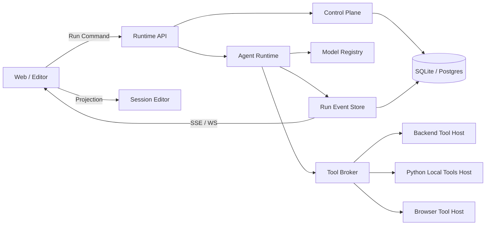

# Agent Runtime 边界与仓库整合方案

> 状态：建议方案，待决策  
> 日期：2026-07-26  
> 关联：[SCHEDULED-TASKS-DESIGN.md](./SCHEDULED-TASKS-DESIGN.md)
> 多端拓扑：[MULTI-SURFACE-AGENT-PLATFORM.md](./MULTI-SURFACE-AGENT-PLATFORM.md)

## 1. 结论先行

当前问题不是简单的“前后端分离”，而是以下四种职责没有形成稳定边界：

1. **Control Plane**：Task、Run、Session、权限和配置的权威状态。
2. **Agent Runtime**：模型调用、多步循环、reasoning、工具调度、重试和压缩。
3. **Capability Plane**：文件、终端、邮件、MCP、浏览器上下文等工具执行环境。
4. **Presentation Plane**：编辑器、工具卡片、运行历史、确认和通知。

现状把 Agent Runtime 放在浏览器插件中，把部分 Capability 放在
`zion-local-tools`，又把调度 Control Plane 放到后端。全局
`chat.tools` / `chat.toolHandlers` 和浏览器事件总线承担了事实上的内部协议，因此代码
看似分仓，实际仍通过隐式状态强耦合。

建议采用：

> **单仓库模块化单体 + deployment-neutral Agent Core + 多 Runtime 宿主 + 可分布式 Tool Host。**

- 不重写为 Next.js。
- 保留当前 Vite PWA 和 CodeMirror 编辑器。
- 将两个仓库合并为一个 monorepo，统一版本、协议、测试和开发命令。
- 将 Agent Runtime 抽成无 DOM 依赖的 TypeScript package；先运行在 Node Local Runtime，
  后续同一 Core 运行于 Desktop、CLI standalone 和 Cloud Worker。
- Python `zion-local-tools` 先作为同仓 sidecar，继续负责 SSH、文件、终端、邮件和 MCP。
- 浏览器不只是展示层，还保留确认 UI 和 browser-only Tool Host。
- Web、Desktop、CLI 都是 Client；Desktop 和 CLI 也可以承载本地 Runtime 或 Tool Host。
- 后端持久任务只能使用不依赖浏览器在线的工具；浏览器工具通过明确的 availability
  和 lease 协议参与交互式运行。

这条路线同时减少跨仓修改和运行时耦合，并避免 Desktop、Cloud、CLI 各复制一套 Agent。
迁移成本也明显低于把现有 JS Runtime 重写成 Python，或把整个 SPA 重写成 Next.js。

---

## 2. 当前耦合从哪里来

### 2.1 Agent loop 与 UI 写入混在同一模块

`extensions/dev.langchain-chat/main.js` 同时负责：

- 从编辑器解析消息；
- 选择模型和工具；
- 调用 `runStream`；
- 执行多步 tool loop；
- 写入 assistant token；
- 发出 reasoning 和工具卡片事件；
- 记录 usage；
- 更新 Session 状态；
- 控制滚动、焦点和尾部 `user` block。

其中 `runStep` 和多步循环位于同一浏览器插件内，导致 Runtime 无法在没有 DOM、
CodeMirror 和 `window.zion` 的环境中复用。

### 2.2 模型协议解析直接依赖浏览器事件

`extensions/dev.langchain-chat/chat-service.js` 负责 OpenAI、Claude、Gemini 等协议解析，
同时直接发出：

- `chat/reasoningStart`
- `chat/reasoningToken`
- `chat/reasoningEnd`

这使“模型适配”和“UI 事件”不可独立测试或部署。后端迁移时不能只移动 HTTP 请求，
还必须移动 provider normalization 和 reasoning 生命周期。

### 2.3 工具注册是无类型全局状态

至少以下插件直接读写 `chat.tools` 或 `chat.toolHandlers`：

- agents
- editor-config
- fs-manager
- langchain-chat
- mail
- memory
- session-manager
- skills
- task-panel
- terminal-enhanced
- terminal-manager
- tools

工具 schema、执行 handler、可用性、权限和展示逻辑没有统一的 Tool Registry。当前约定是：

```text
插件写 chat.tools
插件写 chat.toolHandlers
Chat 插件读取并调用 handler
Tools 插件监听事件并生成 UI
```

任何一步的字段变化都可能需要修改多个插件。

### 2.4 Message Contributor 是任意浏览器函数

Skills、Memory、Terminal Context、Context Compression、Comments 等插件通过
`window.zion.messages.registerContributor()` 修改模型消息。Contributor 可以直接读取
浏览器 state、编辑器和任意插件数据。

这类函数无法直接放到后端执行，也无法序列化。迁移 Runtime 前必须把 Contributor 分为：

| 类型 | 处理方式 |
|---|---|
| 纯消息转换 | 抽成共享 Runtime package |
| 需要持久数据 | 后端 Context Provider |
| 需要浏览器状态 | 显式 Context Resource，由前端上传快照 |
| 纯 UI 行为 | 不再允许修改 Runtime 消息 |

### 2.5 后端目前是能力集合，不是 Agent Runtime

`zion-local-tools` 具备 FastAPI、文件、Bash、SSH、邮件、搜索、MCP 和 Scheduler，但缺少：

- provider credential vault；
- 标准化模型适配器；
- Agent state machine；
- Tool Registry / Tool Broker；
- canonical transcript；
- Session/Run 事件存储；
- Runtime 插件加载；
- confirmation token；
- usage 和上下文压缩策略。

因此当前 `service-backed` 只能持久化触发和待执行 Run，不能在浏览器关闭后完成模型推理。

---

## 3. 仓库边界和进程边界是两个问题

### 3.1 单仓库不等于单进程

Monorepo 解决：

- 一次提交可以同时修改协议、前端和服务端；
- 共享 TypeScript 类型和 JSON Schema；
- 统一 CI、版本和 release；
- 插件可以作为一个 package 发布；
- 本地一条命令启动完整系统。

Monorepo 不会自动解决：

- 谁拥有 Run 状态；
- 工具在哪个进程执行；
- 浏览器断线时如何恢复；
- 插件代码是否能在后端运行；
- 权限在哪一层强制。

这些必须由协议和状态所有权解决。

### 3.2 同进程也不等于低耦合

把所有代码放入 Next.js API Route，只是把模块放进同一 Node 进程。如果 UI、Agent loop
和工具仍通过共享全局对象调用，耦合并不会下降，反而会失去明确的进程边界保护。

正确目标是：

> **代码共仓、协议显式、状态单主、执行可分布。**

---

## 4. 方案比较

| 方案 | 开发体验 | Durable Agent | 浏览器工具 | 插件体验 | 迁移成本 | 结论 |
|---|---:|---:|---:|---:|---:|---|
| 保持双仓库现状 | 低 | 低 | 高 | 低 | 低 | 不建议继续扩张 |
| 仅合并仓库，架构不变 | 中 | 低 | 高 | 中 | 低 | 只能缓解协作 |
| 全量迁入 Python FastAPI | 中 | 高 | 中 | 低 | 很高 | JS Runtime 重写成本过大 |
| Next.js 全栈重写 | 中 | 中 | 中 | 中 | 很高 | SSR 无收益，daemon 能力受限 |
| Monorepo + TS Runtime + Python Tool sidecar | 高 | 高 | 高 | 高 | 中 | **推荐** |
| Electron/Tauri 单体桌面应用 | 高 | 高 | 高 | 中 | 高 | 可作为后续桌面发行形态 |

### 4.1 为什么不推荐 Next.js 重写

Next.js 能提供：

- 同仓前后端；
- Route Handler；
- React 构建与部署；
- 部分类型共享。

但当前 Zion 的核心需求不是 SSR，而是：

- 长时间运行的 Agent；
- scheduler daemon；
- SSE/WebSocket；
- 子进程和本地文件访问；
- SSH/MCP；
- 动态插件；
- PWA 离线能力。

如果自托管 Next.js，上述能力仍需要常驻 Node 服务和 Python sidecar。如果部署到 serverless，
本地文件、进程、长连接和可靠 scheduler 更难实现。将成熟的 Vite/CodeMirror SPA 迁到
Next.js 会产生大量与目标无关的回归。

可以采用“Next.js 式的一体化开发体验”，但不必采用 Next.js 框架：

```text
pnpm dev
  -> apps/web
  -> apps/runtime
  -> services/local-tools
```

---

## 5. 推荐目标架构



### 5.1 Presentation Plane

前端负责：

- Session Editor 和输入草稿；
- Run、reasoning、工具调用和变更的投影；
- 任务配置；
- 用户确认；
- browser-only context 和工具；
- 断线重连、事件续传；
- 插件 UI。

前端不再负责：

- provider 流协议解析；
- Agent 多步循环；
- 工具调用顺序；
- canonical transcript；
- durable Run 状态；
- 权限最终裁决。

前端不是纯展示，因为浏览器仍是一个受控 Tool Host。它不再是 Runtime owner。

### 5.2 Agent Runtime

Runtime 是一个无 DOM 的状态机：

```text
accepted
  -> preparing_context
  -> model_streaming
  -> awaiting_tools
  -> model_streaming
  -> completed | failed | aborted
```

它负责：

- 构建消息；
- 调用和统一不同 provider；
- reasoning policy；
- tool loop；
- retry、timeout、abort；
- context compression；
- usage；
- 产生版本化 RunEvent；
- 写 canonical transcript。

Runtime 只依赖 `ModelAdapter`、`ContextProvider`、`ToolBroker`、`RunStore` 接口。

### 5.3 Tool Broker 和 Tool Host

工具不能简单分成“前端工具”和“后端工具”，而应声明执行 host：

| Host | 例子 | Durable 可用 |
|---|---|---|
| `runtime` | Web Search、Memory、Session query | 是 |
| `local-daemon` | 文件、Bash、SSH、邮件、MCP | 是，daemon 在线时 |
| `browser` | 当前选区、File System Access handle、剪贴板、面板状态 | 否 |

Tool Broker 负责：

- 工具发现和版本协商；
- JSON Schema 校验；
- CapabilityPolicy；
- host availability；
- invocation idempotency；
- timeout / cancel；
- result 和 artifact 标准化；
- 审计。

Durable Task 创建时就应拒绝只存在于 `browser` host 的工具。

### 5.4 Control Plane

权威对象：

- ModelProfile
- Session
- Task / TaskRevision
- Run / Attempt / Occurrence
- CapabilityGrant
- PluginInstallation

前端 IndexedDB 只保存 cache、草稿和离线 projection，不再保存权威 Run。

---

## 6. Agent Runtime 迁移清单

### 6.1 必须迁移到 Runtime

| 当前能力 | 当前位置 | 目标 |
|---|---|---|
| Provider 请求和流解析 | `chat-service.js`、provider files | `packages/agent-runtime/providers` |
| 多步 tool loop | `dev.langchain-chat/main.js` | `packages/agent-runtime/loop` |
| Programmatic Run | `programmatic-runner.js` | Runtime Run API |
| reasoning policy | `reasoning-policy.js` | Runtime provider normalization |
| tool call validation | 前端 runner / handlers | Tool Broker |
| usage 聚合 | 前端 state | Runtime RunStore |
| abort / timeout | 浏览器 controller | Runtime run controller |
| canonical messages | 编辑器解析结果 | Runtime SessionStore |
| context compression | browser contributor | Runtime ContextProvider |
| Skills / Memory 注入 | browser contributor | Runtime ContextProvider |

### 6.2 迁移到后端，但保留前端投影

| 能力 | 后端权威 | 前端保留 |
|---|---|---|
| Session transcript | canonical messages/events | 编辑器文档 projection |
| Tool calls | call/result/artifact | 工具卡片 |
| Reasoning | policy 后事件或摘要 | 折叠展示 |
| File changes | change set | diff 和撤销入口 |
| Usage | token/cost records | 状态栏和详情 |
| Task / Run | revision 和状态机 | 管理面板 |

### 6.3 必须留在浏览器

- CodeMirror 文档和 selection；
- 页面焦点、滚动和 panel；
- Clipboard；
- File System Access API handle；
- 浏览器通知；
- 用户确认交互；
- UI 插件 renderer。

这些能力通过 Browser Tool Host 或 command API 暴露，不进入 Agent loop 本身。

### 6.4 模型配置和凭证

要实现浏览器关闭后仍运行，必须迁移：

- provider base URL；
- API key / OAuth refresh token；
- model capability；
- reasoning 配置；
- rate limit；
- cost policy。

建议凭证只存后端 vault，不随 Task 或 Run 下发。前端只能看到 credential reference 和脱敏状态。

---

## 7. 插件模型：不要求每个插件同时写前后端

### 7.1 插件包结构

```text
plugins/example/
  manifest.json
  ui/
    index.ts
    renderer.tsx
  runtime/
    index.ts
    context-provider.ts
  tools/
    schemas.json
    local-daemon.py
  migrations/
```

所有 entry 都是可选的：

- 只有 `ui`：主题、面板、命令、renderer。
- 只有 `runtime`：Context Provider、模型策略。
- 只有 `tools`：后端工具，UI 使用通用工具卡片。
- `ui + tools`：需要自定义配置或结果展示的工具。

### 7.2 Manifest contribution

```json
{
  "contributes": {
    "ui": { "entry": "./ui/index.js" },
    "runtime": { "entry": "./runtime/index.js" },
    "tools": [
      {
        "name": "example.lookup",
        "schema": "./tools/lookup.schema.json",
        "host": "local-daemon",
        "risk": "read"
      }
    ],
    "renderers": [
      { "tool": "example.lookup", "entry": "./ui/renderer.js" }
    ]
  }
}
```

安装器按 entry 将组件部署到对应 host。开发者发布一个插件包，不需要手工维护两个仓库。

### 7.3 禁止的插件耦合

Runtime 插件不得：

- 读取 DOM 或 `window.zion`；
- 直接写编辑器；
- 直接持有 API key；
- 绕过 Tool Broker；
- 通过任意事件名改变 Run 状态。

UI 插件不得：

- 直接改 canonical transcript；
- 执行未授权副作用；
- 伪造 tool result 或 Run completion。

---

## 8. 推荐 Monorepo 结构

```text
zion/
  apps/
    web/                    # 当前 zion-next，Vite PWA
    desktop/                # Desktop shell + Local Runtime supervisor
    cli/                    # Headless client / standalone Runtime
    runtime/                # Node/TypeScript Local/Cloud Runtime host
  services/
    cloud-control/          # 多租户控制面，后续阶段
    local-tools/            # 当前 Python FastAPI
  packages/
    protocol/               # RunEvent、Task、Tool、Session schema
    agent-core/             # deployment-neutral provider-neutral loop
    provider-adapters/      # OpenAI / Claude / Gemini
    plugin-sdk/             # manifest、host SDK、测试工具
    ui-sdk/                 # editor projection、renderer contract
  plugins/
    core-*/
  tooling/
    dev/
    release/
```

统一命令：

```text
pnpm dev
pnpm test
pnpm lint
pnpm generate:contracts
pnpm package
```

Python 通过 OpenAPI / JSON Schema 使用 `packages/protocol` 生成的模型，禁止手写两份同名协议。

---

## 9. 最小协议

### 9.1 Runtime API

```text
POST   /v1/runs
GET    /v1/runs/{runId}
POST   /v1/runs/{runId}/abort
GET    /v1/runs/{runId}/events?after={sequence}
GET    /v1/sessions/{sessionId}/transcript
```

事件传输采用 SSE 起步，协议必须支持：

- `schemaVersion`
- `runId`
- `eventId`
- `sequence`
- `type`
- `timestamp`
- `payload`

### 9.2 Tool Host API

```text
POST /v1/tool-hosts/register
POST /v1/tool-hosts/{hostId}/heartbeat
GET  /v1/tool-hosts/{hostId}/invocations/next
POST /v1/tool-invocations/{id}/complete
POST /v1/tool-invocations/{id}/fail
```

浏览器可使用 WebSocket，但语义仍是 invocation lease，而不是任意 RPC。

### 9.3 Session projection

Runtime 保存结构化 transcript。前端 Session Editor 将其投影为当前 role-marker 文档：

```text
user ...
assistant ...
user ...
```

工具卡片、reasoning 和 artifacts 由 annotation/event projection 渲染，不重新解析为 Runtime
权威消息。用户编辑历史时，前端创建新的 Session revision 或 fork，不直接覆盖已执行 Run。

---

## 10. 渐进迁移路线

### Phase A：先合仓，不改变运行位置

1. 建立 monorepo。
2. 移入 `zion-next` 和 `zion-local-tools`，保留各自构建。
3. 新建 `packages/protocol`。
4. Scheduler API 和前端 client 改为生成类型。
5. CI 同时跑前后端契约测试。

此阶段立即解决跨仓提交和版本漂移。

### Phase B：抽离纯 Agent Core

1. 从 `chat-service.js` 抽 ProviderAdapter。
2. 从 `main.js` 抽无 DOM 的 AgentLoop。
3. 将 `programmatic-runner.js` 合并到 AgentLoop。
4. 用内存 ToolBroker 和 RunStore 在浏览器中运行，行为不变。
5. 对现有消息、tool calls、reasoning 建 golden tests。

此阶段不改变部署，只消除 `window.zion` 对 Runtime 的依赖。

### Phase C：双 Runtime 适配

1. 新增 Node Runtime service。
2. 前端增加 `RuntimeClient`。
3. 交互式会话可在 local runtime / remote runtime 间 feature flag 切换。
4. 后端事件投影到现有 Session Editor。
5. 失败时可以回退，但同一个 Run 不允许双 owner。

### Phase D：迁移 Context 和 Tool

1. Skills、Memory、Compression 迁到 Runtime ContextProvider。
2. Python 能力注册为 local-daemon Tool Host。
3. 浏览器能力注册为 Browser Tool Host。
4. CapabilityPolicy 只在 Tool Broker 裁决。
5. 移除 `chat.tools` / `chat.toolHandlers` 全局状态。

### Phase E：切换权威状态

1. Session canonical transcript 迁后端。
2. 普通聊天默认使用后端 Runtime。
3. Scheduler 的 pending Run 由 Runtime 直接执行。
4. `service-backed` 升级为真正 `durable`。
5. 删除浏览器内 provider 凭证和主 Agent loop。

---

## 11. 风险与约束

### 11.1 不要一次性迁移

当前 `main.js` 同时包含大量 UI 行为。直接“复制到后端”会把 DOM 依赖、事件顺序和 Session
语义一起带过去。必须先在原位置抽纯接口，再切换进程。

### 11.2 Reasoning 不是普通 transcript

不同 provider 对思考内容的返回、回传和存储要求不同。Runtime 应产生独立 reasoning event，
并支持：

- 不持久化；
- 仅持久化摘要；
- 加密持久化；
- 完整禁用前端展示。

前端不能再假设 reasoning token 永远存在。

### 11.3 浏览器工具破坏 durable 语义

任何依赖 selection、File System Access handle 或当前面板状态的任务，都不能承诺浏览器关闭后
执行。Task 保存时必须根据 Tool Host 类型计算：

```text
durableEligible = every(tool.host != "browser")
```

### 11.4 同仓不应变成无边界共享代码

`packages/protocol` 可以共享类型；服务实现不能互相 import 内部模块。跨进程调用必须走公开
接口。否则 monorepo 会再次退化为隐式耦合。

---

## 12. 建议决策

1. 接受 monorepo，但不采用 Next.js 重写。
2. Agent Core 使用 TypeScript；Node Local Runtime 是第一宿主，不是唯一部署形态。
3. Python local-tools 作为同仓 Tool Host sidecar，暂不重写。
4. 前端定位为 Presentation + Browser Tool Host，不是 Runtime owner。
5. 插件采用单包、多可选 entry，不要求每个插件都写两侧。
6. 先抽 `agent-core`，通过 golden tests 保持当前会话行为，再切进程。
7. 在后端 Runtime 完成前继续使用 `service-backed` 命名，不宣称 durable。
8. CLI 在 Agent Core 抽离后优先接入，用 headless 场景校验协议；Desktop 和 Cloud 按
   [MULTI-SURFACE-AGENT-PLATFORM.md](./MULTI-SURFACE-AGENT-PLATFORM.md) 演进。

这组决策可以在不推翻当前 UI 和工具积累的前提下，逐步获得真正可持续的后端 Agent Runtime。
