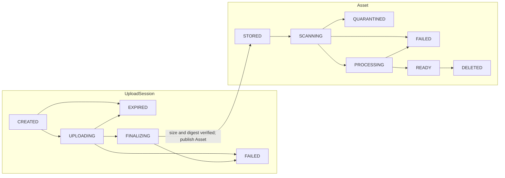

# 对话多模态资产架构

日期：2026-09-19

状态：目标架构与迁移决策；本地 filesystem CAS 图片基础集成已落地。

实施更新（2026-09-20）：当前线上仍以文字为主，图片数量有限。第一阶段采用
Runtime 本地 filesystem CAS，并保留 `BlobStore` 边界；S3-compatible 对象存储、
multipart、音视频和文档处理作为后续容量阶段。本地方案不是浏览器存储，仍由服务端
持久化和鉴权。

范围：进入对话流程的图片、音频、视频、文档及未来二进制模态；覆盖
Workbench、Browser、Runtime、Artifact Store、Agent Runner、外部 Harness 和
Provider adapter。

关系：

- [Workbench CodeMirror 对话编辑器与图片链路评审](./WORKBENCH-CONVERSATION-IMAGE-PIPELINE-REVIEW-20260919.md)
  记录当前实现缺陷；
- [Runtime and Zion Next Compatibility Contract](./RUNTIME-ZION-NEXT-COMPATIBILITY.md)
  已要求先实现外部二进制 Artifact Store，再支持 attachment；
- [Zion 分布式 Runtime 产品架构](./ZION-DISTRIBUTED-RUNTIME-PRODUCT-ARCHITECTURE.md)
  已规定 Event 只引用 Artifact ID，不复制大对象；
- `harness-integration` worktree 的
  `HARNESS-INTEGRATION-ARCHITECTURE.md`、`ExecutionBundle` 和 `AgentRunner`
  是本文 Runner 集成边界。

## 1. 决策

### 1.1 浏览器不是多模态原件的权威存储

这是本方案的首要架构不变量：

> 图片、音频、视频和其他大型原件不得以 `localStorage`、IndexedDB、Cache API
> 或 OPFS 中的浏览器副本作为权威数据。浏览器 Storage 只能保存小型元数据和有
> 明确容量上限、可随时清除的缓存。

选择文件后的默认路径是：

```text
File / Blob
  -> 临时 Blob URL 预览
  -> 分片或流式直传
  -> Runtime Attachment Service
  -> BlobStore
  -> 不可变 Asset
  -> 对话 Attachment 引用
```

它不是：

```text
File
  -> 整份复制到 IndexedDB
  -> 文档保存浏览器私有 URI
  -> 发送时再读回和 base64 编码
```

原因不只是浏览器配额不稳定。即使申请 persistent storage，浏览器 Storage 仍然：

- 受 origin 配额、设备空间、浏览器实现和清理策略约束；
- 只对当前浏览器 profile 有效，不能支撑跨设备和服务端执行；
- 大文件写入会产生额外副本、I/O、内存峰值和迁移成本；
- 不能作为 Runtime、外部 Harness 或 Provider 可验证的资源地址；
- 清站点数据、无痕环境或 profile 损坏后会丢失。

`navigator.storage.persist()` 只能降低被自动驱逐的概率，不能把浏览器变成可靠的
对象存储，也不能消除容量上限。

### 1.2 共享 Blob 基础设施，分离三个领域身份

底层字节可以共享同一个 BlobStore，但必须区分：

| 对象 | 语义 | 生命周期 |
| --- | --- | --- |
| `Asset` | 一份不可变、可校验的字节内容 | 由所有有效引用共同决定 |
| `Attachment` | Asset 在某个对话草稿、消息或上下文中的有序绑定 | 随对话绑定创建、删除 |
| `Artifact` | Run、Tool 或 Processor 产生的可追溯输出 | 随 Run 保留策略和审计策略 |

Tool 输出的 Artifact 可以通过新建 Attachment 成为下一轮输入，但不能直接把
Artifact 身份改成 Attachment，也不应复制底层字节。

### 1.3 元数据和大字节分开

```text
PostgreSQL
  -> Asset / Attachment / Artifact metadata
  -> ownership / state / digest / provenance / retention

BlobStore
  -> immutable original bytes
  -> generated derivatives
  -> temporary multipart data

Browser
  -> draft references / upload checkpoints / bounded previews
```

PostgreSQL 不存大型 `bytea`，Session 文档、Transcript、Run Event、Checkpoint 和
Execution Bundle 不存 base64 原件。它们只保存稳定 ID、校验摘要和必要元数据。

### 1.4 Provider 格式是边界适配，不是持久模型

OpenAI `image_url`、Anthropic `image.source`、Gemini `fileData`、MCP
`ContentBlock`、本地文件路径和 data URL 都是特定执行边界的物化结果。Zion 的
权威对话模型只保存 `asset_ref`，不能持久化：

- 临时签名 URL；
- Provider `file_id`；
- Runtime 临时文件路径；
- 浏览器 Blob URL；
- `app://img/...`；
- base64 data URL。

### 1.5 不支持时明确拒绝或显式转换

媒体输入能力取 Runner、模型、Provider adapter 和当前策略的交集。任何一层不支持
时，Run admission 必须在执行前返回结构化错误。

系统不能静默：

- 丢掉附件后继续发送；
- 把图片、音频或视频替换成文件名；
- 自动 OCR、转录或抽帧并假装等价于原件；
- 从 Runtime 路径退回 Browser 路径来绕过能力约束。

OCR、转录、抽帧、压缩和转码可以作为显式派生操作。用户确认或
Interaction Profile 明确允许后，系统创建带 provenance 的派生 Asset，再提交 Run。

### 1.6 当前阶段采用本地 BlobStore

当前生产形态是单 Runtime、小规模图片输入，因此先使用：

```text
ZION_RUNTIME_DATA_DIR/assets/
├── tmp/
└── blobs/sha256/<prefix>/<digest>
```

该目录位于 Runtime 持久卷、webroot 之外，并绑定当前 Runtime Space。它满足当前阶段
的跨浏览器恢复、服务端执行和避免 Browser Storage 膨胀，不要求先部署对象存储。

边界条件：

- 只支持单 Runtime 实例访问该目录；
- 必须把 Asset 目录纳入备份、磁盘容量告警和恢复演练；
- 当前只接收有严格单文件上限的安全栅格图片；
- 不承诺大视频、跨区域、多副本和高并发上传；
- 上层只依赖 `BlobStore`，后续迁往 S3-compatible backend 时不改变 Asset ID、
  对话引用和 Runner 协议。

## 2. 反模式

以下做法不进入目标实现：

1. 把原始媒体整份写进 IndexedDB，再在发送时读回。
2. 把 base64 写入 Markdown、Y.Text、Session、Transcript 或 JSON Run 请求。
3. 通过提高 Runtime JSON body 上限来“支持大文件”。
4. 在数据库中用 `bytea` 或 PostgreSQL BLOB 保存视频、音频和大图。
5. 在文档中保存签名 URL、Provider file ID 或机器本地路径。
6. 只检查文件扩展名，不校验真实 MIME、签名、大小和解码结果。
7. 先创建 Run，再依赖 Provider 的 HTTP 400 发现输入不兼容。
8. 为了“离线”默认在每个浏览器复制所有会话附件。
9. 用跨 Account 的全局 hash 查询或去重结果暴露内容是否已存在。
10. 删除一处 Attachment 时直接删除仍被 Artifact 或其他 Session 引用的字节。

## 3. 领域模型

### 3.1 Asset

`Asset` 表示已经提交到权威 BlobStore 的不可变内容。

```ts
type Asset = {
  schemaVersion: 1;
  id: string;
  ownerAccountId: string;
  authorizationScopeId: string;
  state:
    | "stored"
    | "scanning"
    | "processing"
    | "ready"
    | "failed"
    | "quarantined"
    | "deleted";
  mediaKind: "image" | "audio" | "video" | "document" | "binary";
  declaredMediaType?: string;
  detectedMediaType: string;
  byteLength: number;
  digest: {
    algorithm: "sha256";
    value: string;
  };
  blobKey: string;
  originalAssetId?: string;
  derivation?: AssetDerivation;
  createdAt: number;
  readyAt?: number;
  retentionClass: string;
};
```

约束：

- `id` 是不可猜测的业务身份，不能直接使用内容 hash；
- `blobKey` 不进入客户端协议；
- 完整 digest 由服务端读取上传内容后计算或验证；
- 同一 Asset 的字节、长度和 MIME 一旦进入 `stored` 就不可修改；
- 转码、缩略图、波形、转录和抽帧都是新 Asset，并通过 derivation 指向来源；
- 内容去重最多发生在同一加密和授权边界内，不提供跨边界存在性探测。

### 3.2 Attachment

`Attachment` 是对话中的语义对象，不等于一份文件。

```ts
type Attachment = {
  schemaVersion: 1;
  id: string;
  ownerAccountId: string;
  sessionId: string;
  draftId?: string;
  messageId?: string;
  binding:
    | {
        kind: "pending-upload";
        uploadSessionId: string;
      }
    | {
        kind: "asset";
        assetId: string;
      }
    | {
        kind: "failed-upload";
        uploadSessionId: string;
        failureCode: string;
      };
  ordinal: number;
  purpose: "model-input" | "reference" | "display";
  displayName?: string;
  alt?: string;
  selection?: {
    pageRange?: [number, number];
    timeRangeMs?: [number, number];
  };
  createdAt: number;
};
```

同一 Asset 可绑定到多个 Session 或消息。Attachment 保存顺序、用途、用户展示名和
选区，避免这些可变语义污染不可变 Asset。上传完成时，服务端以事务方式把 binding
从 `pending-upload/uploadSessionId` 推进为 `asset/assetId`，Attachment ID 不变。

草稿阶段先创建稳定 Attachment ID，以便编辑器在上传、重试和重新排序期间持有同一
引用。只有 `binding.kind === "asset"` 且 Asset 为 `ready` 的 `model-input`
Attachment 才能进入 Run。

### 3.3 Artifact

现有 `Artifact` 是 Run tool 输出的文件元数据。目标版本应增加 `assetId` 和完整
provenance：

```ts
type Artifact = {
  schemaVersion: 2;
  id: string;
  assetId: string;
  runId: string;
  attemptId: string;
  invocationId?: string;
  toolCallId?: string;
  producer: {
    kind: "tool" | "runner" | "processor" | "user-import";
    id: string;
    version?: string;
  };
  createdAt: number;
  metadata?: Record<string, unknown>;
};
```

Artifact metadata 进入 Run ledger；大字节只在 BlobStore。将 Artifact 添加到下一轮
对话时创建新的 Attachment，并保留 Artifact -> Asset -> Attachment 的来源关系。

### 3.4 UploadSession

上传会话是有期限的传输状态，不是 Asset：

```ts
type UploadSession = {
  id: string;
  ownerAccountId: string;
  clientAttachmentId: string;
  state:
    | "created"
    | "uploading"
    | "finalizing"
    | "completed"
    | "failed"
    | "expired";
  declaredBytes: number;
  declaredMediaType?: string;
  transport: "runtime-stream" | "multipart";
  chunkSize: number;
  receivedParts: number[];
  expiresAt: number;
};
```

客户端生成稳定的 `clientAttachmentId` 和幂等键。网络重试、页面刷新和文件重选都
继续同一个 UploadSession；重复 finalize 必须返回同一个 Asset 或相同结果。

## 4. 状态机与发布边界



发布规则：

1. `CREATED` 和 `UPLOADING` 只对上传者的草稿可见。
2. `finalize` 验证实际长度、part 完整性和 checksum 后，创建 Asset 并原子发布
   `STORED`；在此之前不存在可消费的 Asset。
3. `SCANNING` 前不能把资源交给模型或外部 Harness。
4. `PROCESSING` 生成必要的安全衍生物和媒体元数据。
5. 只有 `READY` 能编译为模型输入。
6. `FAILED`、`QUARANTINED`、`EXPIRED` 都保留可操作原因，但不创建 Run。
7. 临时 part 和失败上传由短期清理任务删除，不参与长期引用计数。

不是所有资源都要等待昂贵的完整分析。处理策略按 MIME 和用途定义最小 readiness
gate，例如图片需完成安全解码，视频可在元数据、病毒扫描和目标输入策略满足后
READY，额外转录可以继续异步生成。

## 5. 浏览器策略

### 5.1 默认不持久化原件

选择文件后：

1. 同步校验声明大小、扩展名和基础类型；
2. 使用原始 `File` 创建 Blob URL 供当前页面预览；
3. 创建 UploadSession；
4. 使用 `File.slice()` 分片，或使用流式 request body 上传；
5. 页面只保存 attachment/upload metadata；
6. 完成、取消或卸载后及时 `URL.revokeObjectURL()`。

禁止为了算 hash、生成 data URL 或上传而先执行整文件 `arrayBuffer()`。服务端在
流式接收时计算权威 SHA-256；客户端可以计算 part checksum，但不能产生与文件等大
的中间副本。

视频和音频预览使用浏览器原生媒体元素：

- 视频默认 `preload="metadata"`，不主动解码完整视频；
- 服务端 READY 后使用 Range request 播放；
- 波形、poster、缩略图使用小型 derivative；
- 图片解码前检查像素上限，避免压缩很小但展开极大的资源。

### 5.2 Browser Storage 允许保存什么

| 内容 | 默认策略 |
| --- | --- |
| Attachment ID、Asset ID、状态、进度 | IndexedDB，可重建 |
| UploadSession ID、已完成 part | IndexedDB，有过期时间 |
| 小型缩略图、poster、波形 | 有界 LRU cache，可清除 |
| 原始图片、音频、视频 | 不持久化 |
| base64/data URL | 不持久化 |
| Provider file ID、签名 URL | 不持久化 |

浏览器缓存必须具备：

- 独立总预算和单项上限；
- high/low watermark 驱动的 LRU 淘汰；
- `navigator.storage.estimate()` 仅作提前收缩信号，不作容量保证；
- 写入失败不影响权威 Asset；
- “清除本地缓存”后 Session 和附件仍可从服务端恢复。

目标默认值是**原件持久缓存为 0**。缩略图预算应是小型、可配置的固定上限，而不是
按历史会话无限增长。

### 5.3 OPFS 与离线

OPFS 仍属于浏览器 Storage，不能改变权威归属。它只可用于显式开启的离线暂存：

- 有单独预算、过期时间和 LRU；
- UI 明确表示“等待上传”，不能表示“已保存”；
- 恢复联网后上传到权威 BlobStore；
- 超过离线预算的大视频默认拒绝暂存，要求联网直传；
- 清除 OPFS 只使未上传草稿需要重选，不损坏已 READY 的附件。

File System Access handle 可作为渐进增强，让用户授权后从本地文件恢复上传。它不是
跨浏览器基线能力，权限也可能失效。

页面刷新后若没有有效 handle，用户重新选择同一文件即可续传。客户端先用
`name + size + lastModified` 发现候选会话，再通过已上传 part checksum 和服务端
finalize 校验确认；这些弱元数据不能作为安全或完整性依据。

## 6. 上传和 BlobStore

### 6.1 API 形态

当前图片基础切片：

```text
POST   /v1/assets
GET    /v1/assets/:id
GET    /v1/assets/:id/content
HEAD   /v1/assets/:id/content
```

`POST /v1/assets` 直接流式写入本地临时文件，校验大小、SHA-256 和图片签名后原子发布
到 filesystem CAS。它不经过普通 JSON request body，也不产生浏览器持久副本。

未来对象存储和大媒体目标接口：

```text
POST   /v1/asset-uploads
GET    /v1/asset-uploads/:id
PUT    /v1/asset-uploads/:id/parts/:partNumber
POST   /v1/asset-uploads/:id/finalize
DELETE /v1/asset-uploads/:id

GET    /v1/assets/:id
GET    /v1/assets/:id/content
GET    /v1/assets/:id/derivatives
```

创建上传会话时先执行认证、配额、声明大小、类型和并发限制。每个 part 有 checksum，
finalize 再验证实际总长度和完整 digest。API 返回稳定 Asset/Attachment ID，不返回
底层 bucket key。

### 6.2 分阶段部署

`BlobStore` 使用统一接口：

```ts
interface BlobStore {
  createUpload(input: CreateUploadInput): Promise<BlobUpload>;
  writePart(input: WritePartInput): Promise<PartReceipt>;
  completeUpload(input: CompleteUploadInput): Promise<StoredBlob>;
  abortUpload(uploadId: string): Promise<void>;
  openRead(key: string, range?: ByteRange): Promise<ReadableStream>;
  delete(key: string): Promise<void>;
}
```

当前单机和早期线上部署：

- 使用 webroot 之外的本地 filesystem CAS；
- 上传先进入受限临时目录，服务端边读边 hash；
- 校验完成后 `fsync` 并原子发布到 digest 路径；
- 元数据仍通过数据库事务发布；
- Runtime 进程不把完整文件读入内存。

后续达到以下任一条件时迁往 S3-compatible object store：

- Runtime 需要多实例或跨主机调度；
- 音频、视频和大文档进入常规工作流；
- 本地容量、备份窗口或出站流量成为瓶颈；
- 需要跨区域容灾、独立生命周期和存储审计。

对象存储阶段：

- 使用 S3-compatible object store；
- 浏览器通过短期 presigned multipart URL 直接上传 part；
- Runtime 只创建会话、签发受限 URL、验证 receipt 并 complete；
- 使用 object-store checksum、服务端加密和生命周期规则；
- 下载支持 Range，避免播放视频时读取完整对象。

直接上传不等于客户端可任意写 bucket。URL 必须绑定对象 key、part、大小、方法和短期
有效期；finalize 后仍执行服务端完整性与安全处理。

远程 URL 不能直接成为 durable Attachment。导入 URL 时由服务端受限 fetcher 执行：

- 只允许 `https` 和策略允许的来源；
- DNS 解析前后阻断 loopback、link-local、内网和 metadata endpoint；
- 限制 redirect 次数，并对每次跳转重新校验目标；
- 限制响应 bytes、时间、MIME 和压缩展开；
- 不转发用户 credential、cookie 或任意请求 header；
- 下载、扫描并固化为 Asset 后，Attachment 才能进入 Run。

这样可以避免 URL 内容变化、Provider 无法访问、授权泄漏和 SSRF。原 URL 只作为受限
provenance metadata，不作为执行期访问地址。

### 6.3 去重

内容寻址用于存储优化和完整性，不作为公开身份：

```text
authorization scope + encryption domain + sha256 -> blobKey
```

先完整上传、验证，再在允许的边界内去重。不能向客户端提前回答“这个 hash 已存在”，
否则会形成跨用户内容存在性侧信道。

## 7. 对话文档与编译

### 7.1 文档只保存稳定 Attachment 引用

Markdown 可以保留可移植的展示语法，但 destination 必须是 Attachment：

```md

```

编辑器 Decoration 通过 Attachment Service 取得 thumbnail/read lease。它不能直接
读取 IndexedDB 私有资产，也不能把签名 URL 回写文档。

显示和 Prompt Compiler 必须共享同一个 Markdown AST/Conversation IR。第一版规则：

- 保留 text -> attachment -> text 的原始顺序；
- fenced code 中的图片语法不产生 Attachment part；
- inline、独占行和 gallery 只影响显示，不改变输入身份；
- v1 只允许 user role 的 `model-input` Attachment 进入模型；
- assistant 输出中的 Markdown 图片保持输出/展示语义，除非显式创建新 Attachment；
- 删除 Markdown 节点删除绑定，不直接删除 Asset。

### 7.2 Canonical Conversation Part

```ts
type ConversationPart =
  | {
      type: "text";
      text: string;
    }
  | {
      type: "asset_ref";
      attachmentId: string;
      assetId: string;
      mediaKind: "image" | "audio" | "video" | "document" | "binary";
      mediaType: string;
      byteLength: number;
      ordinal: number;
      selection?: {
        pageRange?: [number, number];
        timeRangeMs?: [number, number];
      };
    };
```

Run request 和 durable Transcript 保存该结构。`asset_ref` 不包含字节和访问凭证。

### 7.3 发送门禁

```text
collect ordered attachment refs
-> await or reject pending uploads
-> authorize every Asset for current principal
-> require READY
-> validate size/count/media limits
-> negotiate Runner + model + adapter capabilities
-> compile ordered Conversation Parts
-> create Run and Attempt
```

任何一步失败时不创建 Run，用户文本保持原样，焦点定位到问题附件，并提供删除、重试
或显式转换操作。

## 8. ExecutionBundle 与 Runner

### 8.1 Bundle 只携带资源描述

当前 `ExecutionBundle` 只有 output-oriented `artifactPolicy`，没有输入资源。目标
schema 增加：

```ts
type InputResource = {
  id: string;
  attachmentId: string;
  assetId: string;
  digest: string;
  mediaKind: "image" | "audio" | "video" | "document" | "binary";
  mediaType: string;
  byteLength: number;
  ordinal: number;
  purpose: "model-input" | "reference";
  selection?: {
    pageRange?: [number, number];
    timeRangeMs?: [number, number];
  };
};

type ResourcePolicy = {
  maxResources: number;
  maxTotalBytes: number;
  allowedMediaKinds: string[];
  allowedMaterializations: Array<
    "provider-file" | "signed-url" | "local-readonly-file" | "inline-bounded"
  >;
  maxInlineBytes: number;
};

type ExecutionBundleV2 = ExecutionBundle & {
  schemaVersion: 2;
  resources: InputResource[];
  resourcePolicy: ResourcePolicy;
};
```

Bundle 可以被 digest 和审计，但不包含 bearer URL、Provider credential、Provider
file ID 或本地临时路径。访问能力通过 Attempt-scoped Resource Lease 在执行时授予。

### 8.2 能力协商

Runner capability 扩展为可演进名称：

```text
input.asset-ref
input.image
input.audio
input.video
input.document
resource.provider-file
resource.signed-url
resource.local-readonly-file
resource.inline-bounded
```

Model Profile 另外声明：

```ts
type ModelInputCapabilities = {
  modalities: Array<"text" | "image" | "audio" | "video" | "document">;
  maxAssetBytes?: Partial<Record<string, number>>;
  maxAssetCount?: Partial<Record<string, number>>;
};
```

有效能力为：

```text
requested media requirements
  intersect Runner capabilities
  intersect selected model capabilities
  intersect Provider adapter capabilities
  intersect Run/Account policy
```

Runner 能读取本地文件不代表所选模型支持视频；模型文档声称支持图片也不代表当前
Runner adapter 已实现正确协议。两者必须分别表达。

### 8.3 Resource Materializer

Zion 在 Runner 边界提供独立 Materializer：

```ts
interface ResourceMaterializer {
  materialize(
    resource: InputResource,
    target: MaterializationTarget,
    attempt: AttemptIdentity
  ): Promise<ResourceLease>;
}
```

`ResourceLease`：

- 只属于一个 Attempt；
- 权限最小化且有到期时间；
- 可以是 Provider file ID、短期签名 URL 或只读临时文件；
- 结束或 abort 后回收临时文件和访问凭证；
- 不写回 Session、Bundle 或 Run Event。

一个 Attempt 仍只能由一个 Runner 拥有。切换 Harness 时必须创建新 Run/Attempt，
重新 admission 和 materialization，不能把旧 Attempt 的 lease 交给新 Runner。

### 8.4 外部 Harness

外部 Harness 常见输入边界不同：

| Harness 能力 | Zion 物化 |
| --- | --- |
| 接受 SDK 原生 media block | adapter 从 Asset 构建 provider block |
| 接受 Provider file ID | 服务端上传/复用 provider file mapping |
| 接受 URL | 发放短期、只读、Attempt-scoped URL |
| 接受本地路径 | 写入 Attempt 私有只读临时目录 |
| 不支持该模态 | admission 拒绝或请求显式派生 |

本地路径必须位于 Attempt sandbox 中。不能把 BlobStore 路径、用户原始文件路径或其他
Run 的临时目录直接暴露给 Harness。

## 9. Provider 物化

Provider adapter 的职责是把 `asset_ref` 变成当前 API 的合法输入，并维护服务端缓存：

| Provider 类型 | 首选策略 | 小对象兼容策略 |
| --- | --- | --- |
| 支持 upload-once/use-many | 上传并缓存 Provider file ID | bounded inline |
| 支持远端 URL | 短期只读 URL，确认 Provider 可访问 | bounded inline |
| 支持原生媒体 SDK | SDK file/media object | bounded inline |
| 只支持 inline | 严格总量上限内临时 base64 | 超限明确拒绝 |

Provider file mapping 至少按以下边界隔离：

```text
account/authorization scope
+ provider profile
+ credential identity
+ asset digest
+ provider region/API variant
```

mapping 保存于服务端，有 expiry 和删除任务。它不是 Asset 身份，也不能暴露给浏览器。

具体适配原则：

- OpenAI-compatible adapter 根据具体 endpoint 支持 URL、base64 或 file reference，
  不假设所有兼容服务都具有同一多模态能力；
- Anthropic adapter 使用合法的 image/document source 或 Files API，不透传
  OpenAI `image_url` block；
- Gemini 的大音频和视频优先使用 Files API，并等待远端 file state 可用；
- MCP image/audio/resource block 只作为协议边界，内联 base64 不进入 Zion 持久层；
- Provider 请求日志只记录 Asset ID、MIME、bytes、digest 前缀和映射类型，不记录
  字节、完整签名 URL 或 file token。

`inline-bounded` 是兼容出口，不是默认数据路径。其上限同时受 Bundle policy、
Runtime request budget 和 Provider 限制约束，任一超限都拒绝。

## 10. 音频与视频处理

音视频比图片多出异步处理、随机访问和时间选区，不能复用“图片转 data URL”思路。

目标处理图：

```text
Original Asset
  -> safe metadata probe
  -> poster / thumbnails
  -> waveform
  -> optional normalized proxy
  -> optional transcript
  -> optional keyframes / clips
```

每个输出都是独立 Asset，并记录：

- processor ID/version；
- 参数；
- source asset digest；
- 时间范围；
- 创建时间和失败原因。

默认保留原件。转码代理用于预览或 Provider 兼容，不能悄悄替换证据原件。模型只需要
一个时间范围时，Attachment selection 表达范围；Materializer 可以生成最小 clip，
但必须保留 derivation。

对于不支持原始视频的模型，UI 可以提供：

- 选取时间范围；
- 抽取关键帧；
- 生成转录；
- 转换为受支持格式；
- 改选支持该模态的模型/Runner。

这些都是用户可见的执行选择。

## 11. 安全与隔离

### 11.1 上传验证

按 OWASP 文件上传原则执行：

- MIME allowlist、扩展名和 magic bytes 联合校验；
- 声明大小、实际大小、像素、页数、时长、压缩展开比均设上限；
- 服务端生成对象名，不信任用户文件名和路径；
- 临时区与发布区分离，均位于 webroot 外；
- 图片、媒体、PDF 和压缩格式由受限进程解析；
- 按风险接入 AV、sandbox 或 CDR；
- SVG、HTML 等主动内容默认作为下载或经过净化，不直接同源执行；
- 失败解析不能回退为“普通 binary 后照常发给模型”。

### 11.2 授权

每次 metadata、thumbnail、content、Range、materialize 和 delete 都重新校验：

```text
principal
-> Account ownership / capability grant
-> Attachment/Artifact binding
-> Asset authorization scope
-> requested operation
```

个人资源默认私有。Team/Task 协作通过明确 Attachment binding 和 Capability Grant
授权，不通过知道 Asset ID 获得访问。越权资源统一返回不可探测响应。

### 11.3 内容访问

- 签名 URL 短期有效、只读、限定 method/object，必要时限定 content disposition；
- 浏览器下载文件名经过 header 编码和控制字符过滤；
- 媒体响应支持 Range，但每次 Range 仍鉴权或使用受限签名；
- BlobStore credential 只存在服务端；
- Provider 无需长期访问时，不发放长期公网 URL；
- quarantined Asset 只允许受限管理流程访问。

## 12. 配额、保留和 GC

### 12.1 配额

至少控制：

- 单 Asset 声明和实际 bytes；
- 每条消息、每个 Session 的 Attachment 数量；
- 每次 Run 的媒体总量；
- Account 总逻辑存储量；
- 并发 UploadSession 和 multipart part 数；
- derivative 放大倍数；
- Provider upload cache；
- 出站和下载流量。

创建 UploadSession 时先按声明大小预留配额；finalize 按实际大小结算。去重节省的是
物理成本，不应让用户通过 hash 推断别人的内容。

浏览器缓存预算与 Account 云端存储配额完全分离，不能因为服务端仍有配额就继续写满
浏览器 Storage。

### 12.2 引用与删除

有效 root 包括：

- Session/Message Attachment；
- Run Artifact；
- active Attempt lease；
- active UploadSession；
- export/backup manifest；
- retention 或 legal hold；
- 尚未过期的 processor/provider mapping。

删除 Attachment 只移除绑定。GC 使用 mark-and-sweep 或引用表加周期性校验：

```text
unreferenced
-> tombstoned
-> grace period
-> delete derivatives/provider mappings
-> delete Blob
-> retain minimal audit tombstone
```

不能只依赖同步引用计数，因为失败事务、导入导出和异步 processor 都可能造成漂移。

建议默认策略：

- 未完成 upload part：短期过期；
- 未发送草稿 Attachment：有限保留期；
- 已发送 Attachment：随 Session 保留策略；
- Artifact：随 Run/审计策略；
- derivative：来源仍有效且仍有用途时保留；
- browser cache：任何时间可清除。

## 13. UX

编辑器中的附件状态只表达用户需要处理的事实：

```text
准备中 -> 上传 42% -> 处理中 -> 可发送
                    \-> 失败（重试 / 移除）
                    \-> 不受支持（转换 / 换模型 / 移除）
```

要求：

- 选择后立即用 Blob URL 显示预览，不等待完整上传；
- 上传中允许继续编辑和重排，但发送必须等待或阻断；
- 关闭页面前提示仍有未上传的大文件；
- 刷新后从服务端恢复状态，必要时提示重选原文件继续；
- 已 READY 的附件换浏览器后仍可显示和发送；
- 删除、替换、下载、alt、时间范围和页范围使用稳定 Attachment ID；
- 不向用户展示 bucket、Space、Provider file ID 或内部多租户概念；
- 网络或 Provider 失败不删除用户文本和 Attachment。

大文件不应显示虚假“已插入成功”。在权威上传完成前，它只是对话草稿中的待上传
附件。

## 14. 可观测性

允许记录：

- upload/scan/process/materialize latency；
- bytes、part 数、MIME、media kind；
- Asset/Attachment/Run 的不透明 ID；
- digest 的短前缀用于同一请求关联；
- cache hit、provider upload reuse、Range 和失败码；
- browser cache 当前预算和淘汰数量。

禁止默认记录：

- 原始字节或 base64；
- 完整签名 URL；
- Provider file token；
- 用户文件正文、OCR 或 transcript；
- 未净化文件名；
- BlobStore key 和 credential。

统一失败码至少包括：

```text
ASSET_UPLOAD_INCOMPLETE
ASSET_TOO_LARGE
ASSET_TYPE_UNSUPPORTED
ASSET_NOT_READY
ASSET_QUARANTINED
ASSET_ACCESS_DENIED
MEDIA_CAPABILITY_UNSUPPORTED
MEDIA_MATERIALIZATION_UNSUPPORTED
MEDIA_PROVIDER_LIMIT_EXCEEDED
MEDIA_PROCESSING_FAILED
```

## 15. 分阶段迁移

### Phase 0：封住当前错误路径

1. 禁止 `app://img`、Blob URL 和 data URL 进入 Runtime。
2. Run admission 校验 image capability 和 pending/error 状态。
3. 修复当前 Claude/Gemini adapter contract。
4. 小图 Browser inline fallback 仅作为有严格上限的短期兼容。
5. 增加跨边界 payload 和失败门禁测试。

### Phase 1：图片垂直切片

1. 实现 BlobStore 接口和本地 filesystem CAS。
2. 实现 UploadSession、Asset metadata、鉴权和 GC。
3. Workbench 改为 Blob URL 预览加流式/分片上传，不再写原图到 IndexedDB。
4. 文档使用稳定 Attachment ref，共享 AST/Conversation IR。
5. Runtime adapter 将图片 materialize 为一个真实 Provider payload。
6. 完成跨刷新、跨浏览器和跨账号隔离测试。

当前基础集成只覆盖第 1 项、图片上传/读取、稳定 Asset URI 和 OpenAI-compatible
执行边界物化。Attachment 完整模型、旧 `app://img` 自动迁移、图片处理流水线和
全面能力协商仍属于本 Phase 的后续工作。

### Phase 2：Runner/Provider 通用化

1. 扩展 `ConversationPart`、`ExecutionBundle`、`ResourcePolicy` 和 Runner capability。
2. 实现 Attempt-scoped Resource Materializer。
3. 实现 Provider file mapping、expiry 和删除。
4. 接入 Native Runner 和第一个外部 Harness 的同一图片 golden fixture。
5. Artifact 输出通过新 Attachment 无复制地进入下一轮。

### Phase 3：音频、视频和文档

1. 增加 Range read、poster、waveform 和安全 metadata probe。
2. 接入异步 processor 与 derivation provenance。
3. 增加 time/page selection。
4. 按真实 Provider 能力接入 audio/video/document adapter。
5. 实现大文件断点续传和重选文件恢复。

### Phase 4：导入、导出和离线增强

1. Session export 使用版本化 manifest 加可选二进制包。
2. 导入先校验 manifest/digest，再发布 Attachment。
3. 增加显式 offline staging 和预算控制。
4. 增加 retention、quota 和管理员可观测面。

### Phase 5：对象存储

1. 实现 S3-compatible BlobStore contract。
2. 引入 presigned multipart、part checksum、abort 和生命周期清理。
3. 将 filesystem CAS 中的对象按 digest 迁移并校验，保持 Asset ID 不变。
4. 灰度切换读取后端，完成双读校验后停止本地新写入。
5. 完成多实例、Range、备份恢复和故障注入测试后移除本地权威副本。

## 16. 现有 `app://img` 迁移

现有字节只存在各浏览器 IndexedDB，服务端无法主动迁移。迁移必须在仍持有字节的
浏览器中执行：

```text
enumerate app:// refs
-> read local Blob
-> create UploadSession
-> upload and finalize Asset
-> create Attachment
-> atomically replace document ref
-> verify render and compiler
-> delete old local Blob after grace period
```

约束：

- 每次替换使用文档版本/事务，不能覆盖并发编辑；
- 同一 local image ID 可在当前授权边界内复用一次上传；
- 上传失败保留旧引用和原 Blob，允许重试；
- IndexedDB 已缺失时标记 `missing-local-asset`，不能伪装迁移成功；
- 多设备分别持有同名 ID 时不能假设字节相同，最终以 digest 判定；
- 迁移完成并经过宽限期后，删除旧 object store，而不是长期维护双栈 resolver。

## 17. 验收标准

实现完成至少满足：

1. 选择一个数 GB 视频不会把原件复制到 IndexedDB、Cache API 或 OPFS。
2. 上传期间浏览器内存不会随完整文件大小线性产生第二份副本。
3. 页面刷新后可查询上传进度；必要时重选同一文件可续传。
4. 已 READY 的附件清除浏览器站点数据后仍可恢复。
5. 文档、Session、Transcript、Run Event 和数据库中没有 base64 原件。
6. PostgreSQL/PostgreSQL 只保存 metadata，不保存大型媒体 bytes。
7. 对象上传支持 part checksum、完整 digest、幂等 finalize 和失败清理。
8. text-image-text、多个附件和时间/页选区顺序在 Provider payload 中不变。
9. unsupported Runner/model 在创建 Run 前返回结构化错误。
10. 未经确认不会丢附件、OCR、转录、抽帧或改换执行路径。
11. 同一 Asset 可由 Artifact 和多个 Attachment 引用，删除一处不会误删字节。
12. 跨 Account/授权边界知道 Asset ID、digest 或 URL 也无法读取内容。
13. 外部 Harness 只能看到 Attempt-scoped lease 或 sandbox 临时文件。
14. 音视频播放使用 Range，不要求客户端下载整个对象。
15. browser cache 超预算会自动淘汰，且不影响权威数据。
16. observability 中没有原始字节、完整签名 URL 和 Provider token。
17. 本地 filesystem BlobStore 与 S3-compatible BlobStore 通过同一 contract suite。
18. 从 File 到 Provider fake endpoint 至少有一条图片和一条大文件闭环测试。

建议加入容量回归：

```text
2 GiB sparse video
-> multipart upload
-> finalize
-> process metadata
-> attach
-> range preview
-> explicit unsupported-model rejection
```

测试同时断言 Browser Storage 增长只包含 metadata 和有界 preview cache。

## 18. 仍需通过实测确定的参数

架构边界已经确定，以下数值应通过 Provider contract test 和容量压测配置化，而不是
写死在领域模型中：

- image/audio/video/document 单项与单 Run 上限；
- multipart part size 和并发数；
- upload、draft、provider mapping 和 derivative 的保留期；
- thumbnail cache 固定预算；
- `inline-bounded` 的极小兼容上限；
- 各媒体 READY gate；
- 各 Provider file API 的过期、区域和删除行为。

无论参数最终取值如何，都不能放松“浏览器非权威、原件不进数据库、协议只存稳定
引用、执行时按能力物化”这四条约束。
