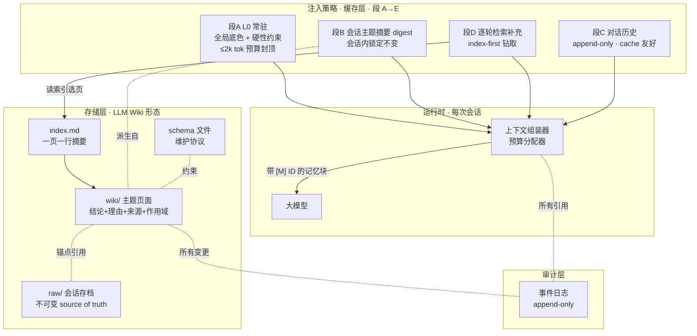
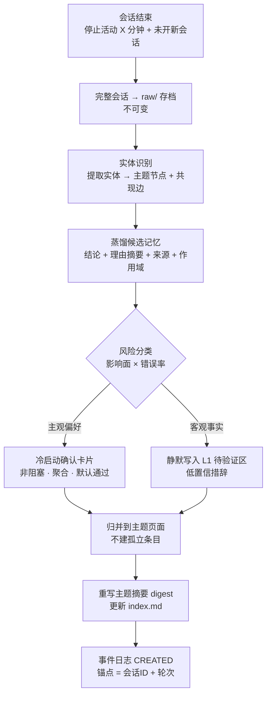
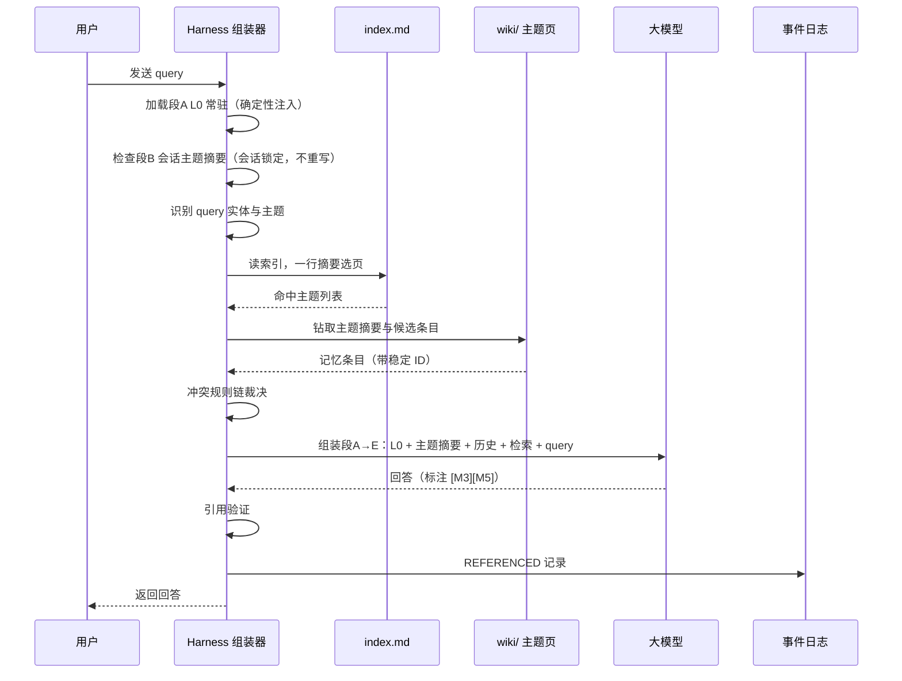
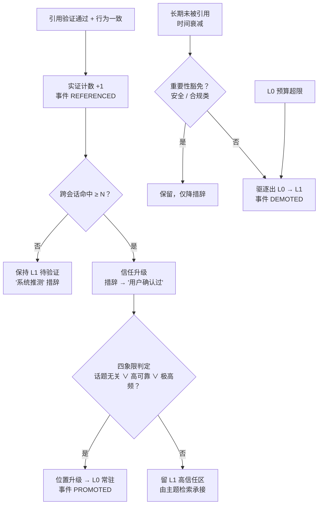
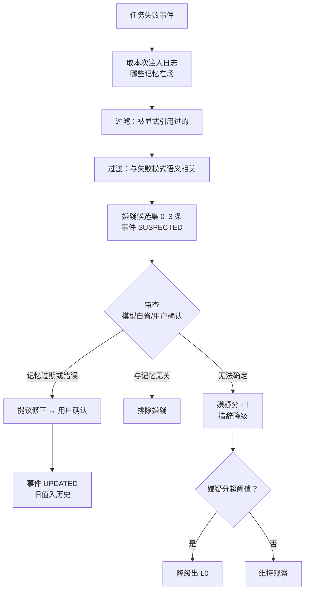
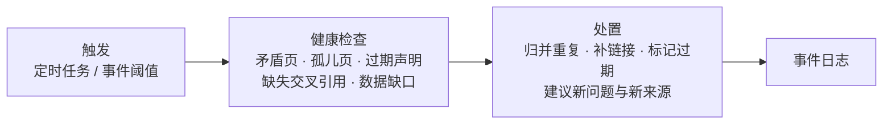

# LLM Harness 记忆系统设计文档

> 状态：设计提案（Design Draft）v1.1 | 最后更新：2026-08-03
>
> 本文档源于对 zion-next (memory-panel 分支) harness 记忆系统的一次概念设计讨论，
> 覆盖：分层模型、记忆形态、作用域、准入/淘汰、可归因性、自省闭环、溯源日志、
> 介入哲学、冷启动体验与落地路径。目标是成为后续实现（v1）的依据。
>
> **v1.1 修订说明**（2026-08-03）：基于对 Letta Code / Mastra 两个外部记忆系统的缺陷
> 调研，对原提案做四项收敛与补强：
> 1. v1 范围收敛为五件事 + 评估协议（引用语义比对、失败归因闭环推迟到 v2）；
> 2. 新增第 18 节《评估协议》，补上"实证优先"哲学的自洽性缺口；
> 3. 修复代码场景（引用标注 off 档）下晋升信号断链问题，引入"工具参数引用"作为
>    不依赖模型自我报告的机械验证强信号（6.2、8.5）；
> 4. 引用标注从"使用证据主信号"降级为辅助信号，缓解自我报告的过度/漏标偏差（8.5）；
> 5. 冷启动增加"批量播种"，缩短纯实证晋升带来的低信任期（12.1）。

---

## 目录

1. [问题定义](#1-问题定义)
2. [设计原则](#2-设计原则)
3. [分层模型：L0 / L1 / L2](#3-分层模型l0--l1--l2)
   - 3.1 [长会话内的"记住"三层](#31-长会话内的记住三层)
   - 3.2 [注入顺序与 KV Cache](#32-注入顺序与-kv-cache)
4. [记忆形态：结论 + 理由 + 来源 + 作用域](#4-记忆形态结论--理由--来源--作用域)
   - 4.3 [存储三层：raw / wiki / schema](#43-存储三层raw--wiki--schema)
5. [作用域建模](#5-作用域建模)
6. [准入与晋升](#6-准入与晋升)
   - 6.4 [升级机制的三层拆分](#64-升级机制的三层拆分)
7. [淘汰与失效](#7-淘汰与失效)
8. [可归因性：引用标注协议](#8-可归因性引用标注协议)
9. [自省闭环：失败归因与渐进处置](#9-自省闭环失败归因与渐进处置)
10. [溯源事件日志](#10-溯源事件日志)
11. [介入哲学与权限分级](#11-介入哲学与权限分级)
12. [冷启动与信任建立](#12-冷启动与信任建立)
13. [反模式清单](#13-反模式清单)
14. [落地路径 v1/v2/v3](#14-落地路径-v1v2v3)
15. [模拟案例](#15-模拟案例)
16. [系统工作流](#16-系统工作流)
17. [开放问题](#17-开放问题)
18. [评估协议](#18-评估协议)
19. [v1 复杂度预算与验收门槛](#19-v1-复杂度预算与验收门槛)

---

## 1. 问题定义

LLM harness 记忆系统的常见误区是把问题定义为"怎么存、怎么取"。在 harness 场景下，
**存储是廉价的，上下文是昂贵的**。因此真正的定义是：

> **在给定的 token 预算下，如何让"值得被记住的信息"以最低熵的形式进入上下文，
> 并在信息变化时保持正确。**

由这一定义推导出的三个设计重心：

1. **上下文预算分配器（而非存储系统）**——设计主体是"什么进上下文、以什么形态进、
   待多久"，文件系统只是底层实现细节。
2. **写入决策比检索决策更难**——"该记的没记、不该记的记了"是主要失败模式。
3. **正确性比容量重要**——一条过期的记忆比没有记忆更有害（它会自信地误导模型）。

## 2. 设计原则

| 原则 | 含义 |
|---|---|
| 介入是税 | 用户介入成本要压低；目标不是零介入，而是压缩到高杠杆时刻 |
| 效果是价值 | 记忆系统存在的唯一理由是让后续会话更准确、更少重复交代 |
| 实证优先 | 晋升、扩展作用域都必须有使用证据，不信任模型单次总结 |
| 可逆渐进 | 所有自动化处置都可逆：降级 ≠ 删除，嫌疑 ≠ 定罪 |
| 结构消解冲突 | 冲突应在注入前被优先级规则静默消化，而非留给运行时 |
| 结论非过程 | 记忆存"结论 + 理由"，不存"过程回放" |
| 评估是准绳 | 晋升阈值、预算值、确认 N 值等所有设计参数必须有标定依据；没有数据的决策点全部显式标记为"待标定"（见第 18 节） |

## 3. 分层模型：L0 / L1 / L2

按**访问模式**分层（而非存储位置），因为访问模式决定注入策略：

| 层 | 访问模式 | 特征 | 注入方式 |
|---|---|---|---|
| L0 常驻 | 每次都在 | 用户偏好、项目规则、安全约束；**总量必须极小（预算封顶，建议 ≤ 2k tokens）** | 硬编码进 system prompt，不可检索，仅显式覆盖 |
| L1 按需 | 触发式检索 | 历史任务结论、过往决策、相关代码事实 | 语义检索 + 作用域/元数据过滤，命中才注入 |
| L2 流式 | 写后短期有效 | 当前任务中间状态、工具调用结果、临时上下文 | 跟随会话自然流转，随会话结束消亡 |

**关键规则：L0 的准入标准是"这条记忆值得为每次请求付固定税"。** 常驻层每多一条，
都是对每次请求的固定成本。宁可少而准。

**准入四象限（满足其一才进 L0）：**

| 记忆 | 话题相关？ | 频率 | 可靠性要求 | 归属 |
|---|---|---|---|---|
| 用户偏好简洁回答 | 否（任何话题适用） | 极高 | 高 | **L0 常驻** |
| las-pdf-parse-doubao 走火山引擎 | 是（聊到该服务才需要） | 中 | 中 | **主题检索** |
| 生产环境不能删数据 | 是，但绝不能漏 | 低 | 极高 | **L0 常驻**（可靠性压倒话题性）|
| las-service 部署在腾讯云 | 是 | 中 | 中 | **主题检索** |

**常驻 = 话题无关 ∨ 高可靠性 ∨ 极高频；其余交给主题检索。**
背景性偏好（语言、风格、身份）没有主题词可触发检索（"话题驱动" vs "存在驱动"）；
高可靠性信息（安全约束、硬性要求）需要确定性注入，不能交给概率检索；
极高频信息常驻比每次检索更便宜更可靠（热数据经济学）。

L0/L1/L2 与作用域层级统计上强相关（L0 多为全局偏好，L1 多为项目事实，L2 为任务状态），
但**两个维度保持正交**：项目级事实可进 L0（长期单一活跃项目），全局偏好可放 L1（低频偏好）。

### 3.1 长会话内的"记住"三层

长会话（问题排查 / 新特性开发）内部有三种不同生命周期的"记住"：

| 层 | 记什么 | 生命周期 | 触发时机 |
|---|---|---|---|
| 上下文 | 全部交互细节 | 随会话 | 一直在 |
| 会话内压缩摘要 | 早期轮次的决策/状态/待办 | 会话内，滚动更新 | 上下文预算耗尽时 |
| 会话结束蒸馏 | 决策级、踩坑级、状态级结论 | 跨会话 | 任务边界 |

判断一条信息是否该成为跨会话记忆的唯一标准：
**它超出当前任务后是否仍然有效。**
"我们试过方案 A 不行" → 无效，消亡；"缓存层选了 LRU，因为读多写少" → 有效，成为记忆。

### 3.2 注入顺序与 KV Cache

上下文组装不是简单的"所有命中内容拼在一起"——**KV cache 是硬约束**。
内容按变化频率从低到高排序，稳定内容占好位置，易变内容让位给 cache：

```
段 A  system prompt + L0 常驻        跨会话稳定      → cache 长命中
段 B  会话主题摘要 digest            会话内不变      → 会话内命中
段 C  对话历史                        append-only    → 增量命中
段 D  逐轮检索补充                    随 query 变化   → 贴最新 query 前，体积小
段 E  当前 query                      新增
```

三条硬规则：

1. **逐轮检索内容必须放在对话历史之后（段 D）**——放前面 = 每轮全前缀重算。
   语义上开头位置 attention 权重高，但经济性上不可行。
   折中："高权重且稳定"的内容（L0、会话主题摘要）占段 A/B 的好位置；
   "易变的搜索结果"放段 D 维持 cache 友好。
2. **会话级主题锁定**：会话开始时识别主题，摘要注入段 B，**会话中不重写段 B**。
   中途新主题走段 D 补充。仅当主题漂移超阈值才重注段 B——主动付出一次 cache miss 换相关性。
3. **记忆变更只影响下一次注入，绝不回溯修改历史消息**——晋升、修正、降级改的是
   "下次组装什么"，不改"已经发出去过什么"。历史 append-only = cache 友好。

两个隐含场景的 cache 视角：

- **会话内压缩** = 重写历史 = 主动一次全量重算，换后续每轮前缀变短。
  长会话里划算（一次成本 vs 每轮省），但要意识到它是 cache 全清。
- **provider 适配**：Anthropic 显式 `cache_control` 断点（标在段 A/段 B 末尾），
  OpenAI 自动 prefix 匹配。设计抽象为"稳定段边界"，provider 适配层各自实现。

KV cache 约束反向验证了按访问模式分层的正确性——变化频率不仅决定该不该常驻，
还决定注入位置。分层和注入顺序是同一枚硬币的两面。

## 4. 记忆形态：结论 + 理由 + 来源 + 作用域

记忆不是孤立事实，而是四元组：

```text
记忆 = {
  结论:       事实本身（当前有效值）
  理由摘要:   "为什么是这个结论"（影响面大的决策必带）
  来源:       用户手写 > 模型总结 > 工具返回（决定信任分级与更新权限）
  作用域:     在什么条件下为真（见第 5 节）
}
```

### 4.1 理由摘要（rationale）

- **不保存完整讨论（过程），只蒸馏理由摘要（why）**，约 20–30 tokens。
- 按影响面配比：高影响决策（架构选型、技术栈、安全约束）必带；
  中影响（代码风格约定）可带可不带；琐碎结论不带。
- **理由会过期——理由过期 = 结论该被重审。** 当新陈述与理由前提矛盾时，
  触发"结论是否要重审"检测。这是记忆自我纠错的触发器之一。

### 4.2 来源与信任分级

| 来源 | 初始信任 | 注入措辞 | 自动更新权限 |
|---|---|---|---|
| 用户手写 | 高 | "用户要求…" | 仅显式覆盖 |
| 模型总结（已实证） | 中→高 | "用户确认过…" | 用户确认后可自动 |
| 模型总结（未实证） | 低 | "系统推测，可能不准确" | 禁止自动 |
| 工具返回 | 中 | 按工具可信度 | 随工具结果刷新 |

信任分级直接体现在注入文本中——同样的信息，证据强度不同，表述不同。这是防污染的软性护栏。

### 4.3 存储三层：raw / wiki / schema（LLM Wiki 形态）

记忆的磁盘形态采用 LLM Wiki 三层结构：

```text
raw/    会话存档（不可变，source of truth）—— 我们语境下的"原始源文档"
wiki/   主题页面（LLM 维护，人可读可编辑，Obsidian 兼容）
        主题 = wiki 页面；结论级记忆挂在主题页面下
schema  维护协议文件（蒸馏规则 / 归并规则 / lint 规则 / frontmatter 约定）
        —— 实战经验中"全系统最重要的文件"，决定维护纪律
```

两个承重文件：

- **index.md**：全量目录，一页一行摘要，按主题分类。**L1 检索的第一跳**——
  读索引选页，再钻进页面，而非 embedding 相似度。~200 页内可靠；
  超过后引入 BM25/向量混合检索作为索引的补充（支持层，不改变记忆本体）。
- **log.md / 事件日志**：见第 10 节（溯源事件日志），记录每一条记忆的完整生命史。

## 5. 作用域建模

### 5.1 本质

记忆的完整形态是"**在什么条件下为真的事实**"。作用域建模的本质是
把记忆从"事实"升级为"事实 + 适用条件 + 证据"三元组。

```text
(条件: 默认)          → pnpm      [L0 常驻]
(条件: 项目 == 客户X) → npm       [L1 按需]
```

加上条件后，两者不冲突。作用域是记忆定义的一部分，不是附加属性。

### 5.2 形态选择

| 形态 | 机制 | 结论 |
|---|---|---|
| A. 标签过滤 | 记忆带 scope 标签过滤 | 覆盖关系无定义，否决 |
| B. 层级树 + 继承 | 全局 → 项目 → 任务，子覆盖父 | **采用为骨架** |
| C. 条件-事实谓词 | 每条带条件表达式 | 条件判断依赖 LLM，确定性丧失，否决 |
| D. 动态上下文匹配 | 项目作检索键 | **采用为检索实现** |

**决策：B 为骨架，D 做检索实现。**

- 存储上维护作用域层级（全局 > 项目 > 任务），定义覆盖与继承
- 检索时用当前会话上下文键（工作目录、打开文件、话题）动态匹配作用域
- **覆盖规则是静态、确定性的（内层优先）；只有"当前会话属于哪个作用域"允许推断的不确定性**

排除 C 的理由：条件-事实对把"条件是否成立"外包给 LLM，等于把确定性决策交还给黑盒。
作用域判定可以模糊（推断），覆盖规则必须确定（硬编码）。

### 5.3 冲突解决规则链

多条记忆同时命中时，按固定顺序裁决：

```text
1. 作用域深度：内层 > 外层
2. 同层时间：新陈述 > 旧记忆
3. 同层同时：来源可信度 用户手写 > 模型总结
4. 仍无法裁决 → 高杠杆介入时刻，问用户
```

**核心价值：作用域建模把冲突从"运行时冲突"变成"结构上不冲突"。**
绝大多数表面矛盾在注入前被规则 1/2/3 静默消化，用户被真正打扰的次数趋近于零。

### 5.4 作用域本身需要实证

- **作用域收缩是默认的**：模型总结时默认条件是"全局"是假设，不是证据。
  若被引用历史全部出现在单项目会话中，先收缩为项目作用域。
- **扩展必须由反例驱动**：出现其他项目也命中且无异议，才扩展为全局。

作用域高估的代价是污染其他作用域会话；低估的代价只是多一次检索。宁可低估。

## 6. 准入与晋升

### 6.1 核心机制：有反馈的缓存系统

把记忆系统视为**有反馈的缓存系统**（L0=L1 缓存，L1=主存，L2=写缓冲），
直接采用缓存领域的经典结论：

> **准入可以宽松，淘汰必须持续且严格，预算封顶是硬约束。**

- 准入宽松：好东西容易进来（自动晋升门槛低）
- 预算封顶：L0 固定 token 上限，新条目必须挤掉旧条目——**淘汰本身就是权衡机制**
- 持续淘汰：每次上下文组装时检查，最差/最不热的被驱逐

准入错误代价低（可撤回），而"该进没进"（准入过严）的代价是隐性的、不可回溯的。

### 6.2 晋升信号（代理信号）

按可靠性排序：

1. **跨会话复现率（最强）**——同一条信息在两个独立会话中都被需要
2. 同会话内高频命中 + 用户引用/复制/点赞等显式行为
3. **负反馈信号**：因缺少某信息导致任务失败后补记——最强晋升信号，说明它本应在 L0

晋升流程：候选（L1 待验证，低置信措辞注入）→ 实证命中 N 次 →
自动晋升 L0（措辞升级为"用户确认过"）。

### 6.3 模型自动总结的信任边界

- LLM 总结"看起来合理但不可验证"。晋升前必须有**观察期**：
  模型提议 → 信息先在 L1 待命 → 被真实使用命中过 N 次后才进 L0。
- 代价：晋升有延迟；收益：正确性有实证支撑。**延迟换可靠，值得。**

### 6.4 升级机制的三层拆分

"晋升"不是一个动作，是三层独立的工作：

1. **位置升级（L1 → L0 常驻）**——少数路径。Wiki 主题检索覆盖后，
   仅"话题无关 ∨ 高可靠 ∨ 极高频"的记忆需要位置升级。
2. **信任升级（"系统推测" → "用户确认过"）**——常态核心。
   记忆被检索出来还是常驻，与它可不可信正交；信任升级改变的是注入措辞。
3. **实证记录**——同时服务升级与淘汰。"三个月未被任何检索命中"
   是时间衰减驱逐的输入；没有使用记录，系统只增不减。

## 7. 淘汰与失效

### 7.1 淘汰信号

- 长时间未被引用（时间衰减）
- 被更新的旧版本
- 预算压力下的最低价值驱逐

**淘汰不能只看使用频率**：安全约束、合规规则可能三个月用一次但绝不能丢。
L0 淘汰需要"重要性"和"新鲜度"两个独立维度，高重要性条目豁免时间衰减。

### 7.2 三种失效机制（只增不减是死亡螺旋）

| 机制 | 触发 | 处置 |
|---|---|---|
| 覆盖 | 同 key 更新 | 旧值进事件日志，可回溯 |
| 过期 | 时间 / 任务边界 / 理由前提漂移 | 标记"可能过期"，注入措辞降级 |
| 撤回 | 用户显式删除 | 软删除，保留事件 |

降级不是删除：从 L0 驱逐回 L1 检索池，未来仍可被按需检索回来。

## 8. 可归因性：引用标注协议

### 8.1 问题

我们无法证明模型"用了"哪条记忆（LLM 是黑盒），但可以设计出可验证的
**"使用证据"交集**：

```text
使用证据 = 注入日志 ∩ 显式引用 ∩ 行为一致性
```

三者都命中时，才可负责任地标记为"确认使用"。

### 8.2 协议设计

```text
注入侧: 每条记忆带稳定 ID，如 [M3]，随内容进上下文
要求侧: 策略分档
  - strict: 推理型回答必须标注引用（默认档）
  - soft:   鼓励标注，不强制
  - off:    代码/工具调用等结构化输出，不要求
输出侧: 模型在相关段落标注 [M3][M5]
```

### 8.3 harness 侧验证（与网页引用的本质区别）

模型说"根据记忆 #3"，harness 可以核对：

1. **#3 是否真的在本次注入清单里**（防引用不存在的记忆）
2. **#3 内容是否支持论断**（语义比对，防断章取义/曲解）
3. **引用覆盖度**：涉及记忆内容时标注比例

非法引用处置：计入非法引用率；超过阈值 → 该来源记忆降级为"待人工确认"
或切回 soft 模式。**"模型可以瞎说，但 harness 能抓包。"**

### 8.4 成本与边界

- prompt 开销：标注消耗输出 token，用分档策略控制
- 过度标注：约定"引用必须与论断内容相关"，不相关标注算非法引用
- 漏标 ≠ 没用：引用是强信号但不是唯一信号，与注入日志、行为一致性合并使用
- 验证的"内容-论断"语义比对需要额外 LLM 调用 → 抽样验证而非全量验证（开放问题）

## 9. 自省闭环：失败归因与渐进处置

### 9.1 归因流程：候选集生成 + 审查，而非自动定罪

失败通常是多因素叠加（记忆错误、工具返回、模型能力、prompt 结构），
自动判定"失败是因为记忆 X"几乎必然错误。正确流程：

```text
失败事件
  → 取本次会话注入日志（哪些记忆在场）
  → 过滤：本次输出中被显式引用过的
  → 过滤：与失败模式语义相关的
  → 得到嫌疑候选集（通常 0–3 条）
  → 触发审查：模型自省 or 用户确认
  → 处置：修正 / 降级 / 标记低可信 / 维持原样
```

- 审查结论"与记忆无关，是模型能力问题"也是有效产出（清除了嫌疑）
- 记忆需要**嫌疑标记**状态：多次牵连失败则累积嫌疑分，触发降级或标记低可信
  （注入措辞改"系统推测，可能不准确"），而非一次性删除

### 9.2 渐进处置阶梯

```text
嫌疑标记 → 注入措辞降级 → 降级出 L0 → 提议用户修正 → 修正
（每级可逆，不越级）
```

## 10. 溯源事件日志

### 10.1 需求

记忆需要保留**生命史**：哪些会话产生了什么记忆、什么记忆由什么会话产生、
更新是因为什么、历史上发生过什么变化。心智模型 = git：记忆是文件，事件日志是 commit 历史。

### 10.2 事件模型（append-only）

```text
事件 = (时间戳, 记忆ID, 事件类型, 触发源, 变更快照/锚点, 原因)

事件类型:
  CREATED    由会话 #3 轮5 的用户拍板产生
  REFERENCED 在会话 #7 被模型引用标注 [M-A]
  PROMOTED   L1 → L0（跨会话命中 2 次，实证晋升）
  DEMOTED    L0 → L1（时间衰减驱逐）
  UPDATED    旧值 → 新值（原因: 用户确认 Docker 迁移）
  SUSPECTED  嫌疑标记（失败归因牵连）
  DELETED    软删除（保留事件，标记失效）
```

**关键决策：事件里存"锚点"（会话ID, 轮次号, 一句摘录），不存完整对话。**
完整对话属于会话存档子系统的职责；溯源层只负责指向它。

### 10.3 四个问题的查询

| 问题 | 查询 |
|---|---|
| 某部分会话产生了什么记忆 | 按会话ID 过滤事件 → CREATED/UPDATED 列表 |
| 什么记忆由什么会话产生 | 按记忆ID 查 CREATED 事件的触发源 |
| 记忆的更新是因为什么 | 查 UPDATED 事件的原因字段 |
| 历史上发生过什么变化 | 按记忆ID 拉全量事件 → 重建时间线 |

### 10.4 隐藏价值

1. **归因闭环完整化**：候选集、审查结论本身就是事件——下次可查"上次为什么排除它"
2. **动态信任计算**：记忆信任等级 = 来源 + 事件史（被引用/被怀疑/被更新次数）。
   静态分级可升级为动态信任积分——被反复实证引用的模型总结记忆可超过从未验证的用户手写
3. **复盘模式**：季度复盘时，事件日志是现成的决策时间线

### 10.5 边界

- 存储成本：几百字节/条，一年几千条，可接受
- 断链处理：会话存档被删 → 锚点失效 → 显示"原会话已删除"，
  **事件本身（时间/类型/快照）独立有效，不随对话删除而丢失**
- 两个消费者：用户（面板时间线 UI，可读叙事）与归因引擎（结构化查询）

## 11. 介入哲学与权限分级

### 11.1 介入时点重定义

用户介入不是"越少越好"，而是**压缩到高杠杆时刻**：

- **低杠杆时刻（全自动，静默）**：写入、晋升、降级、过期——做了无感，错了可逆
- **高杠杆时刻（必须打扰）**：冲突仲裁、敏感信息、重大不可逆操作——介入一次，
  价值远大于成本

### 11.2 自动化程度与不可逆性成反比

| 动作 | 自动化程度 | 理由 |
|---|---|---|
| 降级 / 标记低可信 | 全自动 | 可逆 |
| 修改内容 | 模型提案 + 用户一键确认（或用户设置"信任自动修正"后静默） | 中可逆 |
| 删除 | 必须用户 | 不可逆（即使软删除） |

用户第一次被"打扰"，应当是在"两条重要记忆冲突"这种真正需要人类判断的时刻，
而不是"要不要保存这段对话"。

## 12. 冷启动与信任建立

### 12.1 会话结束总结确认（唯一主动打扰的写入环节）

**辩护：确认窗口是不可逆的。** "用户是否还记得刚才会话里发生了什么"的窗口
一旦关闭就永远关闭——三天后用户无法验证总结，但错误记忆已潜伏。
"会话结束时刻"是唯一用户有能力确认的窗口，错过则只能靠实证机制慢慢自愈。

**确认范围 = 影响面 × 错误率**：只确认"影响面大 × 错误率高"的候选
（主观偏好、行为习惯）；客观事实静默写入。冷启动第一次会话 3 条候选，
筛完通常只剩 1 条需要确认。

**交互设计四个硬约束：**

1. 非阻塞：轻量通知卡片（用户下次回到 harness 时出现），不是弹窗，可忽略自动消失
2. 一次聚合：所有待确认项合在一张卡片，不逐条打断
3. 默认通过：主按钮"都记下"，修改是次要路径
4. 跳过 ≠ 惩罚：忽略确认，记忆照常进 L1 待验证区（低置信措辞），只是少了背书

### 12.2 生命周期：只存在于冷启动期

- 冷启动期（前几个会话）：记忆总量小、单条占比高；用户还不信任系统
- 稳定期：单条影响稀释，确认边际价值递减，信任已建立 → 确认变纯打扰

确认交互在冷启动期开启，用户连续 N 个会话后自动关闭，转入
"静默写入 + 面板待确认区"模式。**介入预算花在系统最脆弱、信任最需要建立的阶段。**

### 12.3 信任建立机制

总结确认卡片是信任的种子：

```text
"我记了：你用 pnpm、你喜欢简洁回答、报错贴关键行就行"
→ 被理解的感觉（aha moment）
"这条我记错了？改一下"
→ 可控感
```

信任建立是"介入少、效果好"的前提：用户信任 harness 记得准，才敢让它自动
（自动晋升、自动淘汰才不会被怀疑）。

### 12.4 会话"结束"的判定

用户不会按"结束会话"按钮。判定：停止活动 X 分钟 + 未开新会话 →
视为结束 → 生成总结卡片。卡片在用户下次回到 harness 时出现，不立刻推送打断。

## 13. 反模式清单

- ❌ 记忆平铺注入上下文，无分层无预算
- ❌ 所有记忆都走语义检索（高频偏好应常驻，走检索是浪费且可能漏）
- ❌ 模型自动总结写入但无来源标记、无用户确认
- ❌ 只增不减（无覆盖/过期/撤回）
- ❌ 把记忆系统做成"聊天记录备份"
- ❌ 保存完整讨论过程而非结论+理由
- ❌ 自动定罪式失败归因（无候选集+审查）
- ❌ 作用域全局化（无视"在什么条件下为真"）
- ❌ 全局淘汰只看使用频率（重要性豁免缺失）

## 14. 落地路径 v1/v2/v3

### v1（解决 80% 冲突，先跑起来）

- 存储三层：raw/（会话存档）+ wiki/（主题页面）+ schema 文件（维护协议）
- 记忆形态：结论 + 来源 + scope 字段（global / project:X / task:Y），挂在主题页面下
- 分层：L0 预算封顶（四象限准入）+ L1 index-first 检索（index.md 选页 → 钻取，作用域过滤）
- 注入顺序：cache 感知布局（段 A→E），逐轮检索放在对话历史之后
- 作用域：仅项目维度，自动推断（目录 + 打开文件 + 话题），冲突按规则链 1→3 静默消化
- 准入：宽松自动晋升 + 跨会话复现信号；信任升级为常态，位置升级走四象限
- 淘汰：预算压力驱逐 + 时间衰减（重要性豁免）
- 可归因性：稳定 ID 注入 + strict 引用标注 + 注入清单验证（不做语义比对）
- 溯源：append-only 事件日志（CREATED/REFERENCED/PROMOTED/DEMOTED/UPDATED/DELETED）
- 冷启动：会话结束总结确认卡片

### v2

- 作用域树可视化 + 用户可编辑（"当前作用域：客户X"可手动切换）
- 引入继承与手动创建子作用域
- 失败归因闭环（候选集 + 审查 + 嫌疑标记 + 渐进处置）
- 动态信任积分（基于事件史）
- 引用语义比对（抽样验证）
- 定期 lint（定时任务触发：矛盾页 / 孤儿页 / 过期声明 / 缺失交叉引用）

### v3（大概率不需要，真实需求出现再建）

- 通用条件模型（时间 / 环境 / 语言等作用域维度）

## 15. 模拟案例

### 15.1 冷启动用户全生命周期（林一，独立开发者）

| 时间 | 事件 | 机制 |
|---|---|---|
| 第 0 天 | 首会话，模型总结 3 条候选（低置信，进待验证区，不进 L0/L1） | 会话后总结 |
| 第 1 天 | 新会话，M1(pnpm) 被引用 [M1] 且用户无异议 | 实证命中 1/2 |
| 第 3 天 | M1 跨会话命中 2 次 → 自动晋升 L0，措辞升级 | 实证晋升 |
| 第 5 天 | 用户说"客户项目用 npm"→ 冲突检测 → 介入确认 → 生成范围限定记忆 M7(项目X) | 作用域 + 高杠杆介入 |
| 第 2 周 | 部署脚本失败 → 候选集 [M12][M15] → 审查发现 M12 过期（未随 Docker 迁移更新）→ 提议修正，用户确认 | 自省闭环 |
| 第 3 周 | M2(ES5 偏好) 21 天未引用 + 行为矛盾 → 驱逐出 L0，降回 L1 | 淘汰机制 |
| 第 4–6 周 | L0 稳定 ~6 条；"继续昨天的重构"零背景交代；新项目自动问作用域 | 稳态 |
| 第 6 周 | 模型引用 [M9] 但内容与论断不符 → 验证失败 → 计入非法引用率 | 引用验证抓包 |

### 15.2 长会话蒸馏（3 小时缓存层开发，30+ 轮）

会话内：全部细节是上下文。会话结束蒸馏出：

```text
M-A 决策级: 缓存层用内存 LRU，无外部依赖；上限 100MB
    理由: 读多写少、无外部依赖（Redis 需用户装服务）
M-B 踩坑级: API X 的 maxSize 参数 v2 语义已变，传 0=无限，勿用默认值
M-C 状态级: 缓存层开发 80%，剩边界测试；接口已改为 getOrLoad
```

消亡：Redis 被 pass 的讨论、40 分钟调试日志、失败边界案例细节——无跨会话价值。

一周后追问"为什么没选 Redis"：M-A 带理由摘要，可直接回答并支持重新决策。

## 16. 系统工作流

### 16.1 总览



### 16.2 写入流：会话结束 → 蒸馏 → 归并 → 事件



### 16.3 注入流：query 时的上下文组装（cache 感知）



### 16.4 反馈环：实证晋升与淘汰



### 16.5 失败归因闭环



### 16.6 定期维护：Lint



## 17. 开放问题

1. **引用语义验证的成本**：验证"内容-论断"是否匹配需要额外 LLM 调用。
   抽样比例 / 触发条件待定。
2. **跨会话复现的判定粒度**：多少次命中算"实证"？（v1 建议 2 次独立会话）
3. **L0 预算的默认值与配置**：2k tokens 是建议值，是否需要按模型窗口自适应？
4. **记忆迁移**：换设备 / 换 harness 时记忆如何导出与导入（跨系统可移植性）。
5. **多会话并行隔离**：同时开三个项目会话，作用域推断如何保证不串味。
6. **总结确认的 N 值**：连续几个会话后关闭确认交互？（建议 5–8 个）
7. **会话内压缩摘要的粒度**：预算耗尽时，早期轮次压缩到什么程度、保留什么
   （决策/状态/待办 vs 过程细节）——与蒸馏共用一套规则，但阈值不同。
