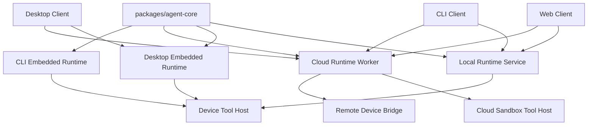
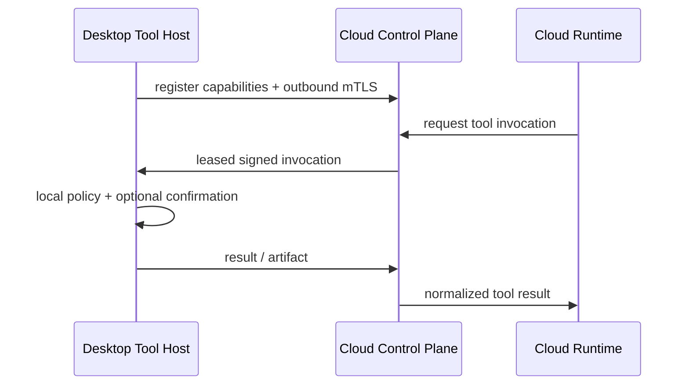

# Zion 多端 Agent Platform：Web、Desktop、Cloud 与 CLI

> 状态：建议方案，待决策  
> 日期：2026-07-26  
> 关联：[AGENT-RUNTIME-BOUNDARY-STRATEGY.md](./AGENT-RUNTIME-BOUNDARY-STRATEGY.md)

## 1. 核心判断

Zion 的目标不应是“把 Web Agent 搬到后端”，而应是：

> **建设一个与 UI、部署位置无关的 Agent Core，并允许它作为本地、桌面、CLI 或云端
> Runtime 运行。**

Web、Desktop、Cloud 和 CLI 不是四套 Agent，而是四种产品表面和执行拓扑：

| 产品表面 | Client | Runtime 位置 | Tool Host |
|---|---|---|---|
| Web PWA | 浏览器 UI | 本地服务或云端 | Browser / Device / Cloud |
| Desktop Agent | 桌面 UI | 本机 Runtime | Desktop Native / Device / Cloud |
| CLI | 终端 | 本机嵌入或远端 Runtime | Local Daemon / Cloud |
| Cloud Agent | Web/IM/API/CLI | 云端 Worker | Cloud Sandbox / Device Bridge |

因此架构中的稳定抽象应是：

1. **Client**：发起命令和展示状态。
2. **Control Plane**：身份、Session、Task、Run、策略和调度。
3. **Runtime**：执行 Agent state machine。
4. **Tool Host**：提供具体能力。
5. **Artifact Store**：保存文件、diff、报告和结构化结果。

“前端/后端”不足以描述这些角色。

---

## 2. 一个 Agent Core，多种部署形态



`agent-core` 只包含：

- provider-neutral AgentLoop；
- message 和 context pipeline；
- tool planning / invocation semantics；
- retry、timeout、abort；
- checkpoint state；
- RunEvent；
- usage；
- policy hook。

它不包含：

- HTTP server；
- DOM；
- Electron/Tauri API；
- CLI 输出；
- 云数据库 SDK；
- 本地文件实现；
- 具体 secret store。

这些由不同 adapter 提供。

---

## 3. 四种产品形态

## 3.1 Web PWA

优势：

- 零安装；
- 最快迭代；
- 跨平台；
- 适合云端 Agent 管理和轻量交互。

限制：

- 标签页生命周期不可靠；
- 无稳定后台 daemon；
- File System Access 权限依赖浏览器；
- 本地进程和系统级能力弱；
- 凭证不宜长期保存在浏览器。

合理定位：

- Cloud/Local Runtime 的 Client；
- Browser Tool Host；
- Session Editor；
- 管理和观测界面。

Web PWA 不应继续作为唯一 Runtime owner。

## 3.2 Desktop Agent

Desktop 形态适合：

- 长时间本地 Agent；
- 本地代码库和终端；
- 系统托盘和通知；
- Keychain；
- 开机启动；
- 深度 IDE/文件集成；
- 离线运行；
- 云端 Agent 的设备桥接。

推荐结构：

```text
Desktop Shell
  -> 复用 Web UI
  -> 启动/监督 Local Runtime
  -> 启动 Device Tool Host
  -> 使用 OS Keychain
  -> 提供系统托盘、通知、自动更新
```

### Electron 还是 Tauri

| 选项 | 优点 | 缺点 |
|---|---|---|
| Electron | 直接复用 Node Runtime 和当前 Web UI；插件生态简单 | 包体和内存较大 |
| Tauri | 包体小、系统集成强 | Node Runtime 需 sidecar；插件和打包复杂 |

当前 Agent Runtime 推荐 TypeScript/Node，因此 Electron 是最低迁移成本方案。若产品对体积和资源
占用有明确要求，可使用 Tauri + 独立 Runtime sidecar。Shell 选择不应改变 Runtime 协议。

Desktop Runtime 也不能承诺机器睡眠时继续运行；它只能在进程存活、设备在线时提供本地 durable。
需要跨设备和真正 24x7 时应使用 Cloud Runtime。

## 3.3 CLI

CLI 不是另一套 Agent 实现，而是 Runtime Client 和可选的本地宿主。

建议命令：

```text
zion run "分析项目"
zion run --cwd . --profile local
zion run --profile cloud --jsonl
zion run --output-schema report.schema.json
zion attach <run-id>
zion task create --schedule "0 9 * * 1-5"
zion task list
zion tools list
zion tools serve
zion auth login
```

CLI 必须支持：

- 人类可读输出；
- JSONL RunEvent；
- 非零退出码；
- stdin/stdout 管道；
- headless 认证；
- `--cwd`；
- `--output-schema`；
- `--timeout`；
- `--profile local|desktop|cloud`；
- attach/resume/abort；
- CI secret 注入；
- 禁止交互时的 confirmation policy。

执行模式：

| 模式 | 行为 |
|---|---|
| client | 连接已有 Local/Cloud Runtime |
| standalone | 在进程内加载 `agent-core`，执行结束后退出 |
| tool-host | 将当前机器能力注册给 Runtime |

CI 场景优先 standalone 或 cloud；用户终端交互优先 client。

## 3.4 Cloud Agent

Cloud Agent 提供：

- 24x7 调度；
- Webhook / IM / API 触发；
- 多设备 Session；
- 组织策略；
- 集中凭证；
- 弹性 worker；
- 云端 workspace；
- 审计和成本控制。

Cloud Runtime 不能直接使用用户本机路径。它只能使用：

- 云端 workspace volume；
- Git checkout；
- object storage artifact；
- cloud-native tool；
- 在线 Device Bridge。

执行代码的 Cloud Tool Host 必须使用隔离 sandbox，而不是与 Control Plane 共进程：

```text
Control Plane
  -> Run Queue
  -> Ephemeral Runtime Worker
  -> Sandbox Tool Host
  -> Artifact Store
```

最小安全要求：

- tenant isolation；
- network egress policy；
- secret scope；
- resource quota；
- filesystem namespace；
- process timeout；
- immutable audit；
- artifact malware scan；
- workspace lifecycle。

---

## 4. Runtime Placement

Task 和 Run 不应只使用 `local-only` / `durable` 两个布尔概念，而应显式描述 placement：

```typescript
interface ExecutionPlacement {
  mode: "browser" | "device" | "cloud" | "any";
  deviceId?: string;
  region?: string;
  requiredCapabilities: string[];
  dataResidency?: string;
  requiresOnlineClient: boolean;
}
```

Placement Resolver 根据以下信息选 Runtime 和 Tool Host：

- 用户选择；
- required capabilities；
- workspace 所在位置；
- device 在线状态；
- secret 所在位置；
- data residency；
- 网络策略；
- 成本和配额；
- deadline；
- browser-only tool；
- organization policy。

示例：

| 任务 | Placement |
|---|---|
| 总结公开网页 | cloud |
| 修改本机未提交代码 | device |
| 读取当前编辑器选区 | browser |
| 夜间跑云端仓库测试 | cloud sandbox |
| 本地离线重构 | desktop device |
| CI 代码审查 | CLI standalone 或 cloud |

如果任务需要 browser-only 工具，则不得自动降级到 cloud。系统应在保存 Task 时就给出不可用原因。

---

## 5. Workspace 不应等于绝对路径

当前许多工具使用本地绝对路径，这无法跨 Desktop、Cloud 和 CLI 漫游。

应引入：

```typescript
interface WorkspaceRef {
  id: string;
  kind: "local-path" | "git" | "cloud-volume" | "ssh";
  hostId: string;
  revision?: string;
}
```

Tool Host 负责把：

```text
workspace://ws_123/src/main.ts
```

解析为自己的实际路径。Task、Session 和插件配置不得持久化其他设备不可解释的绝对路径。

Workspace 可以有多个 replica：

```text
ws_123
  local Mac: /Users/me/project
  desktop PC: D:/project
  cloud: volume://tenant/ws_123
```

Replica 同步应使用 Git revision 或明确 snapshot，不隐式同步任意工作目录。

---

## 6. 身份、设备和凭证

多端后必须区分：

- `userId`
- `organizationId`
- `deviceId`
- `clientId`
- `runtimeId`
- `toolHostId`
- `workspaceId`
- `runPrincipal`

### 6.1 认证建议

| 端 | 认证 |
|---|---|
| Web | OAuth/OIDC session |
| Desktop | OAuth device flow + OS Keychain |
| CLI | device code / PAT / workload identity |
| Cloud Worker | short-lived workload token |
| Device Tool Host | device certificate + short-lived lease token |

### 6.2 凭证原则

- API key 不在设备间明文同步；
- Cloud secret 由 KMS/Vault 保存；
- Desktop secret 由 Keychain 保存；
- CLI 使用环境变量或 credential helper；
- Tool invocation 只获得本次调用所需的 secret reference；
- Cloud Runtime 不得获得本机通用凭证；
- Device Bridge 不得接受任意云端命令，只接受签名 invocation。

---

## 7. Device Bridge

Cloud Agent 经常需要访问用户设备上的代码、终端或企业内网。推荐使用由设备主动建立的出站连接：



必须具备：

- capability allowlist；
- workspace scope；
- command scope；
- user presence requirement；
- per-invocation signature；
- replay protection；
- timeout；
- cancel；
- audit；
- device revoke；
- offline 状态。

Cloud Task 如果依赖指定设备，应显示 `waiting_for_device`，而不是伪装成 running。

---

## 8. Session 漫游与接管

Session 与 Run 分离：

- Session 是长期对话和上下文容器；
- Run 是一次不可变执行；
- Client 可以 attach 到 Run；
- Runtime owner 在一个 attempt 内不可切换；
- checkpoint 后可以创建新的 attempt 在其他 Runtime resume。

典型流程：

```text
CLI 发起 cloud Run
  -> Web 查看事件
  -> Desktop 打开同一 Session
  -> 用户 abort
  -> Desktop fork Session，在本机 workspace 继续
```

必须保存：

- canonical transcript；
- workspace revision；
- tool host identity；
- model profile；
- policy；
- checkpoint；
- artifacts；
- sequence。

禁止直接把正在运行的内存状态从一个 Runtime 热迁移到另一个 Runtime。先 checkpoint，再创建新 attempt。

---

## 9. 多端事件和输出协议

RunEvent 必须同时满足 UI、CLI 和 API：

```typescript
interface RunEvent<T> {
  schemaVersion: 1;
  runId: string;
  attemptId: string;
  sequence: number;
  eventId: string;
  type: string;
  timestamp: number;
  actor: {
    runtimeId: string;
    toolHostId?: string;
  };
  payload: T;
}
```

同一事件可投影为：

- Web 工具卡片；
- Desktop 通知；
- CLI JSONL；
- Cloud audit；
- Session transcript；
- webhook delivery。

不得为 CLI 单独设计一套事件，也不得让 Desktop 直接消费内部 Node 对象。

---

## 10. 插件在多端中的形态

插件 manifest 应声明 target 和 host：

```json
{
  "contributes": {
    "ui": {
      "targets": ["web", "desktop"],
      "entry": "./ui/index.js"
    },
    "runtime": {
      "targets": ["local-runtime", "cloud-runtime", "cli"],
      "entry": "./runtime/index.js"
    },
    "tools": [
      {
        "name": "acme.query",
        "hosts": ["device", "cloud"],
        "entry": "./tools/query.js"
      }
    ],
    "cli": {
      "commands": ["acme"]
    }
  }
}
```

### 10.1 可移植等级

| 等级 | 内容 |
|---|---|
| portable | 纯 schema、prompt、Context Provider、通用 renderer |
| runtime-specific | 依赖 Node 或 Cloud service |
| device-specific | 依赖本地系统、二进制或 Keychain |
| ui-specific | 依赖 DOM / Desktop shell |

插件市场应展示兼容矩阵，而不是假设每个插件在所有端都可用。

### 10.2 开发者是否要写多份

不一定：

- 通用工具可只写 tool entry，所有 Client 使用通用 UI。
- 纯 Runtime 插件可同时运行在 Desktop、CLI 和 Cloud。
- 只有需要自定义 UI 且有原生能力的插件才写多个 entry。
- 平台负责 SDK、协议生成、打包和多 target 测试。

---

## 11. Monorepo 扩展结构

```text
zion/
  apps/
    web/
    desktop/
    cli/
    runtime-server/
  services/
    cloud-control/
    local-tools/
  packages/
    agent-core/
    protocol/
    runtime-sdk/
    tool-host-sdk/
    client-sdk/
    plugin-sdk/
    ui-sdk/
  plugins/
  tooling/
```

`agent-core` 被以下宿主复用：

- `runtime-server` 本地模式；
- `runtime-server` 云端 worker 模式；
- Desktop sidecar；
- CLI standalone。

不要复制 AgentLoop 到每个 app。

---

## 12. 部署拓扑

### 12.1 Personal Local

```text
Web/Desktop/CLI
  -> Local Runtime
  -> local-tools
```

数据默认留在设备，可选同步 Session metadata。

### 12.2 Personal Cloud

```text
Web/Desktop/CLI
  -> Cloud Control Plane
  -> Cloud Runtime
  -> Cloud Sandbox
  -> optional Device Bridge
```

适合定时任务和跨设备。

### 12.3 Enterprise

```text
Organization Control Plane
  -> Regional Runtime Pool
  -> Managed Sandbox
  -> Enterprise Device Fleet
  -> Audit / DLP / Secret Vault
```

需要组织 policy 覆盖用户 policy。

### 12.4 CLI / CI

```text
CI Job
  -> CLI standalone
  -> ephemeral workspace
  -> stdout JSONL + artifacts
```

或者：

```text
CI Job
  -> CLI cloud client
  -> Cloud Run
  -> wait / attach / download artifacts
```

---

## 13. 对当前推荐方案的修正

原建议“将 Agent Runtime 迁到后端”应精确改为：

1. 把 Agent 逻辑从 Presentation 中抽离为 deployment-neutral `agent-core`。
2. 先在浏览器 adapter 中复用，确保行为不变。
3. 再提供 Local Runtime、Desktop Runtime、CLI Runtime 和 Cloud Runtime 宿主。
4. Control Plane 决定 placement，Tool Broker 决定 capability host。
5. 不将 Runtime 与某个 Web framework 或 Python 服务绑定。

这比单纯“前端变薄、后端变厚”更适合长期产品形态。

---

## 14. 建议产品顺序

### 第一阶段：Local Platform

- Monorepo；
- agent-core；
- Local Runtime service；
- Python local-tools host；
- Web Client；
- CLI client；
- service-backed 升级为本机 durable。

### 第二阶段：Desktop

- Electron/Tauri shell；
- Runtime supervisor；
- Keychain；
- tray / notification；
- device identity；
- auto update；
- Device Tool Host。

### 第三阶段：Cloud

- Cloud Control Plane；
- tenant model；
- Runtime queue；
- sandbox；
- vault；
- artifact store；
- Webhook / IM；
- device bridge。

### 第四阶段：统一生态

- Session 漫游；
- Desktop/CLI/Web attach；
- plugin multi-target；
- organization policy；
- marketplace compatibility；
- usage and billing。

CLI 应在第一阶段进入，因为它能迫使 Agent Core、事件和 headless 认证尽早摆脱 UI 假设。Desktop
随后验证本地 daemon 和原生能力；Cloud 最后引入多租户和 sandbox，避免一开始承担最大复杂度。

---

## 15. 最终决策建议

1. 将目标从“Web + 后端”提升为“多 Client + 多 Runtime + 多 Tool Host”。
2. 一个 Agent Core 支持 Local、Desktop、CLI 和 Cloud，不复制实现。
3. Monorepo 保持不变，并增加 Desktop、CLI 和 Cloud app/service。
4. Runtime Core 不依赖 Next.js、FastAPI、Electron 或 Tauri。
5. Web 是 Client + Browser Tool Host。
6. Desktop 是 Client + Local Runtime supervisor + Device Tool Host。
7. CLI 是 Client，也可作为 standalone Runtime 或 Tool Host。
8. Cloud 是 Control Plane + Runtime pool + sandbox。
9. Workspace、身份、凭证和插件协议从第一天按多设备设计。
10. 先做 Local Runtime + CLI，再做 Desktop，最后做 Cloud multi-tenant。

