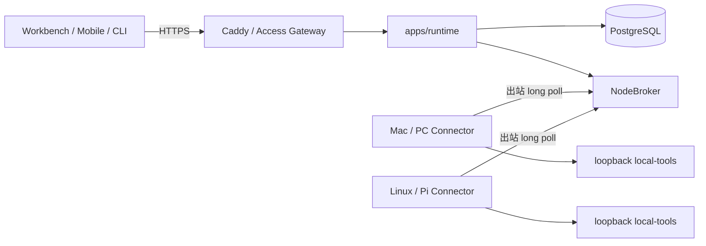
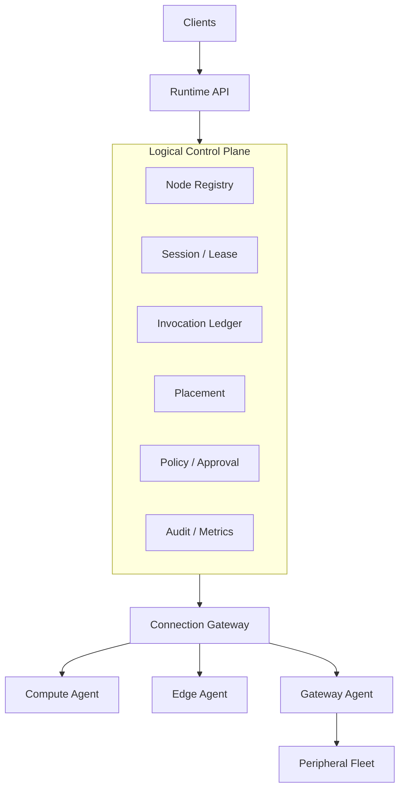
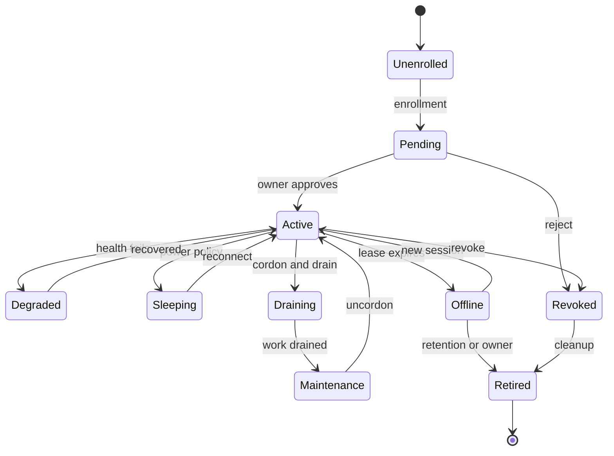

# Zion Node Control Plane 演进路线图

> 状态：Active roadmap
>
> 范围：从当前 `NodeBroker`、Device Connector、Access Control 和
> `zion-local-tools` 出发，逐步形成可安装、可注册、可恢复、可治理、可扩展的
> Node Control Plane。
>
> 目标：不推翻当前正确边界，不为尚未出现的规模提前引入分布式复杂度。

## 1. 文档定位

本文回答三个问题：

1. 当前 Runtime 和 Node 架构已经具备什么；
2. 节点类型、数量和运行时间增长后会出现什么问题；
3. 应按什么顺序演进，且每一步如何验收。

本文是当前实现到目标架构之间的执行桥梁，不重新定义远期产品角色：

- [ADR-0003：远程访问、设备配对与 Resource Host 通道](./ADR-0003-REMOTE-ACCESS-AND-DEVICE-PAIRING.md)
  定义当前远程访问和设备信任边界；
- [Multi-Node Terminal Routing](./MULTI-NODE-TERMINAL-ROUTING.md)
  定义当前多 Node 资源引用和路由约束；
- [Zion 分布式 Runtime 产品架构](./ZION-DISTRIBUTED-RUNTIME-PRODUCT-ARCHITECTURE.md)
  定义远期 Control Plane、Runtime Host、Resource Host、Relay 和 Artifact Store；
- [Zion 单租户远程部署](./REMOTE-SINGLE-TENANT-DEPLOYMENT.md)
  定义当前可执行的部署和配对流程。

## 2. 执行结论

当前架构方向正确，适合继续演进：

- Runtime 是始终可寻址的权威协调点；
- Device Connector 只建立出站连接，适配 NAT、移动网络和企业防火墙；
- `zion-local-tools` 保持 loopback 私有，不暴露公网；
- Resource credential 精确绑定 Node，Resource Host 保留本地授权的最终否决权；
- 显式 Node 或资源离线时失败关闭，不静默切换到同名目录或另一台机器；
- `node-protocol` 保持传输中立，HTTP long poll 只是当前 transport。

近期不应优先做“大规模集群化”。正确顺序是：

1. 产品化 Runtime/Node 安装和稳定设备身份；
2. 补齐 session fencing、持久化 dispatch、ACK 和 Device receipt；
3. 补齐节点生命周期、可观测性、升级和退役；
4. 治理异构能力和 Gateway/Peripheral；
5. 只有真实指标触发时，才拆 Connection Gateway 和共享存储；
6. 多租户、跨区域和 Runtime Federation 由产品需求触发。

## 3. 当前架构基线

### 3.1 当前逻辑角色

| 当前模块 | 当前职责 | 未来归属 |
| --- | --- | --- |
| `apps/runtime` | Runtime Host、部分 Control Plane、Access Gateway | 单机组合根，后续按压力拆分 |
| `NodeBroker` | Node Registry、presence、binding、路由、内存队列 | Registry、Placement、Dispatch 三个逻辑模块 |
| `PostgresNodeStateStore` | 注册、Project binding、完成 receipt | Node Registry 与 Invocation Ledger 的单机存储 |
| `node-http-handler` | 注册、poll、result HTTP transport | Connection Gateway adapter |
| `device-connector` | 出站连接、命令执行、结果回传 | `zion-node-agent` 的当前实现 |
| `zion-local-tools` | 文件、终端、SSH、邮件、MCP 等原子能力 | Resource Host implementation |
| Workbench/Mobile/CLI | 交互、管理和状态投影 | Client |

逻辑职责应先拆清，部署进程不必立即拆开。

### 3.2 当前运行拓扑



当前 `apps/runtime` 同进程承担多个逻辑角色是合理的单用户部署方式，不是必须立即消除
的技术债。

### 3.3 当前安装和注册流程

Runtime：

1. 准备 Linux、Node.js、Caddy 和服务用户；
2. 构建 Workbench/Mobile 和 Runtime；
3. 安装 `zion-runtime.service`，Runtime 只监听 `127.0.0.1`；
4. 通过 Caddy 提供同源 HTTPS；
5. 初始化 PostgreSQL、Runtime 环境和插件；
6. 创建首个 Owner 一次性配对链接；
7. 验证 `/health` 可访问、匿名业务 API 返回 `401`。

Resource Node：

1. 安装并启动 `zion-local-tools`，可选启动 Plugin Host；
2. Owner 创建 Resource 一次性配对码；
3. Node 本机启动 Device Connector 并交换专属 credential；
4. macOS credential 进入 Keychain，其他平台进入 `0600` 文件；
5. Connector 注册 `nodeId`、进程级 `instanceId`、Capability 和 Resource；
6. Runtime 校验 credential 的 `deviceId` 与注册/path 中的 `nodeId` 一致；
7. Connector 持续 long poll，Runtime 据此更新 presence 并投递调用；
8. Runtime 保存完成 receipt，Node 本地仅保存进程内 receipt。

### 3.4 已实现且必须保留的能力

- 一次性 Owner、Client、Resource 配对；
- 每设备独立 opaque credential、过期和吊销；
- 稳定 `nodeId` 与短生命周期 `instanceId` 的概念分离；
- Runtime 重启后恢复注册记录但保持 Node 离线，直到重新注册；
- versioned Capability 和 opaque Resource 注册；
- project/resource 路由和多 Node 歧义拒绝；
- Node、instance、resource、native session 组成的全局 terminal reference；
- 调用 lease、取消、Runtime-side durable receipt；
- Resource Host 本地目录、终端和敏感路径二次授权；
- 凭证撤销后的 poll 二次鉴权；
- WebRTC PTY 及 HTTP relay fallback；
- Runtime、Connector、Node Protocol 和多 Node 集成测试。

### 3.5 当前限制

| 领域 | 当前限制 | 增长后的后果 |
| --- | --- | --- |
| 安装 | 源码、npm/Python 环境、LaunchAgent/systemd/cron 路径并存 | 平台越多，安装和升级分叉越严重 |
| 身份 | 默认 `nodeId` 由 hostname 推导 | 重名、改名、镜像克隆造成冲突或漂移 |
| 会话 | 新 `instanceId` 可替换旧实例，无服务端 epoch | 重复进程或旧进程恢复时缺少严格 fencing |
| 投递 | pending 和 delivered 仅在内存中 | Runtime 重启或响应丢失后无法可靠恢复 |
| receipt | Connector receipt 仅进程内 | 双侧重启后副作用可能重复 |
| 状态 | 主要是 online/offline | 无法表达 sleep、degraded、draining、retired |
| 连接 | 默认短周期 long poll，固定重试延迟 | 节点增长或 Runtime 重启时产生空闲负载和重连风暴 |
| Inventory | 需要按 Node fan-out 查询终端和机器 | 离线 Node 增多后发现延迟线性增长 |
| 背压 | 无统一 Node capacity、queue 和 per-tool concurrency | 热点 Node 可被大量 Run 压垮 |
| 存储 | 同步 PostgreSQL 与单进程内存 ownership | 无法直接水平扩容 Runtime |
| 协议 | 严格等于 v1，Capability 风险由 Node 自报 | 异构版本和不可信能力描述难以治理 |
| 生命周期 | 缺少 retire/delete/tombstone/retention | 废弃注册和 binding 长期污染目录 |
| 可观测性 | 只有 snapshot 和进程日志 | 无法回答抖动、排队、重复、版本漂移和容量问题 |

## 4. 不可破坏的架构约束

后续实现必须持续满足：

1. Runtime 和 Node Agent 都不直接暴露 `zion-local-tools` 公网端口；
2. Node 默认主动出站连接，不依赖局域网扫描、mDNS 或公网入站；
3. 自动发现只产生候选或 presence，不等于自动信任；
4. credential、Node identity、session identity 三者必须分别建模；
5. Capability advertisement 不等于授权；
6. Resource Host 本地策略拥有最终否决权；
7. 显式目标离线、过期或冲突时失败关闭，不自动跨 Node failover；
8. 一个 Attempt 同时只有一个 Runtime Host owner；
9. Side effect 不宣称 exactly-once，只承诺幂等、补偿或 unknown outcome；
10. 大型结果进入 Artifact，不进入控制消息和 presence；
11. transport 可以从 long poll 换为 WebSocket/HTTP2，但业务状态机不能依赖 transport；
12. 不因“未来可能有很多 Node”提前引入分布式共识和复杂中间件。

## 5. 节点分类和接入边界

### 5.1 Node Profile

| Profile | 典型设备 | 运行形态 | 主要能力 |
| --- | --- | --- | --- |
| `runtime.host` | ECS、家庭服务器 | Runtime 服务 | Agent、模型、调度、权威状态 |
| `compute.full` | 笔记本、台式机、Linux 服务器 | 完整 Node Agent + local-tools | 文件、终端、插件、浏览器登录态 |
| `compute.edge` | 树莓派、Jetson、NAS | 轻量 Node Agent + 可选 local-tools | 边缘计算、局域网、GPIO Gateway |
| `gateway.device` | 树莓派、工业网关、桌面 Agent | Node Agent + driver adapters | 代表一组 Peripheral |
| `peripheral` | Arduino、ESP32、传感器、执行器 | Serial/BLE/MQTT/厂商协议 | 有限遥测和动作 |
| `client.surface` | 手机、浏览器、CLI | Client | 交互、通知、审批 |

一台机器可以承担多个 Profile。Profile 是默认配置和兼容约束，不是授权角色。

### 5.2 Peripheral 不直接伪装成 Compute Node

Arduino、ESP32 和大多数低功耗设备不运行 Node.js、Python、文件系统工具和常驻
HTTPS Connector。近期采用：

```text
Peripheral
  -> Serial / BLE / MQTT / vendor protocol
    -> gateway.device
      -> authenticated Zion Node channel
        -> Runtime
```

Gateway 将设备能力映射成窄而明确的 Capability，例如：

- `sensor.temperature.read`；
- `camera.capture`；
- `gpio.digital.write`；
- `relay.switch`；
- `robot.move`。

Peripheral 需要单独建模 sleeping、battery、telemetry、device shadow 和物理安全策略，
不能继承 `Bash`、文件系统或普通计算 Node 的默认权限。

## 6. 目标逻辑架构



在节点和流量未达到拆分门槛前，以上模块继续共处 `apps/runtime`：

- 先用接口和数据所有权拆分；
- 再用真实指标决定是否拆进程；
- Connection Gateway 首先拆出，因为它承受连接数、重连和 backpressure；
- Registry、Placement 和 Invocation Ledger 只有在 HA 或吞吐需要时才迁移共享存储。

## 7. 目标状态模型

### 7.1 Node 生命周期



`online/offline` 继续作为兼容投影，但不再承担全部生命周期语义。

### 7.2 Node session 和 fencing

每次连接由服务端签发：

```text
nodeId
sessionId
sessionEpoch
leaseExpiresAt
heartbeatInterval
desiredConfigRevision
maxConcurrentInvocations
```

约束：

- `sessionEpoch` 对同一 `nodeId` 单调递增；
- 所有 poll/stream、ACK、result 和 cancel 都携带 epoch；
- 旧 epoch 请求统一拒绝；
- Node replacement 必须通过显式 takeover 规则，而不是仅比较客户端 `instanceId`；
- Node session 与长期 credential 分离，credential 轮换不改变 Node identity。

### 7.3 Invocation Ledger

```text
queued
  -> delivered
  -> acked
  -> running
  -> succeeded | failed | cancelled | expired | unknown
```

核心语义：

- Runtime 在投递前持久化 invocation；
- Connector durable 保存 `operationId` 后才 ACK；
- read-only 幂等操作可按策略重投；
- write/execute/external-effect 必须携带稳定 `operationId`；
- 无法证明是否执行的副作用进入 `unknown`，不盲目重试；
- Runtime 和 Device receipt 都按保留策略清理，不能无限增长；
- `waiting_for_resource` 是持久状态，不是一次 HTTP 错误。

## 8. Roadmap


| 阶段 | 当前状态 | 启动条件 |
| --- | --- | --- |
| P0 守住当前基线 | 进行中 | 当前 |
| P1 安装产品化与稳定身份 | 下一阶段 | P0 基线和真实双 Node 验收完成 |
| P2 Session fencing 与可靠投递 | 待设计 ADR | P1 身份和安装契约稳定 |
| P3 生命周期、治理和可观测性 | 待实施 | P2 状态机可观测、可恢复 |
| P4 异构能力、Placement 与 Gateway | 按场景推进 | 出现第二类真实设备/能力需求 |
| P5 拆分 Connection Plane | 指标触发 | 单进程连接或存储违反 SLO |
| P6 多租户、区域与 Federation | 产品触发 | 明确公共平台或组织协作需求 |

### P0：守住当前基线

目标：先形成可回归的事实基线，不改变生产协议。

交付：

- 将本文作为 Node 演进主入口；
- 固化当前 v1 注册、撤销、replacement、离线和多 Node 路由测试；
- 为当前 Node API 增加结构化错误 code，保留现有 message 兼容；
- 建立 Node 指标命名和 cardinality 预算；
- 明确 `Device Connector` 是当前代码名，`Node Agent` 是目标产品名；
- 清理文档中互相冲突的部署步骤和已过期状态。

退出标准：

- 两台真实 Node 完成注册、终端、文件、撤销、重连和离线验证；
- 现有 v1 Connector 无行为回归；
- 每个后续阶段都有可量化验收指标。

### P1：安装产品化与稳定身份

目标：把“运行仓库源码”升级成“安装并管理 Node Agent”。

Runtime 交付：

```text
zion runtime install
zion runtime status
zion runtime doctor
zion runtime upgrade
zion runtime rollback
zion runtime uninstall
```

Node 交付：

```text
zion node install
zion node enroll
zion node resource add
zion node status
zion node doctor
zion node upgrade
zion node uninstall
```

实现要求：

- 发布 macOS、Linux x64、Linux ARM64 的签名版本包；
- Windows 在 service、credential store 和 local-tools 兼容完成后进入支持矩阵；
- 首次安装生成持久 UUID 和设备密钥，hostname 仅作为 label；
- 配对码只在 Node 本机交换，不经 Runtime 主机脚本或人工 credential 搬运；
- macOS 使用 LaunchAgent，Linux 使用 systemd user/system service；
- local-tools、Plugin Host 和 Connector 由同一 supervisor 管理健康和升级顺序；
- 安装器幂等，支持 dry run、版本锁定、回滚和完整卸载；
- Agent 上报 OS、arch、agent version 和 protocol range，不上报敏感本地路径；
- 淘汰硬编码 x64 Node 包、rsync worktree、`nohup + cron` 的正式安装路径。

退出标准：

- 一条命令可在干净的 macOS、Linux x64、Linux ARM64 主机完成安装；
- 重启、睡眠唤醒、网络切换后自动恢复；
- upgrade 失败可回滚，credential 不出现在命令历史、日志和 unit 文件；
- Node ID 不因 hostname 或工作目录变化而改变。

### P2：Session fencing 与可靠投递

目标：消除 Runtime 重启、连接切换和响应丢失时的主要不确定窗口。

交付：

- `node_sessions`、服务端 epoch、lease 和 takeover；
- 持久化 `node_invocations` 状态机；
- 显式 delivery ACK 和 running/result transition；
- Connector 本地 PostgreSQL receipt/outbox；
- `waiting_for_resource`、`unknown` 和人工 reconcile；
- 指数退避、jitter、服务端建议 heartbeat/poll 周期；
- credential 自动轮换，Node identity 与 access token 解耦；
- v1/v2 protocol negotiation，Runtime 双栈兼容期。

退出标准：

- 在 register、deliver、ACK、execute、result 各边界注入进程崩溃和断网；
- read-only 操作恢复后不丢失；
- side effect 不发生无法解释的自动重复；
- 旧 session 无法在新 epoch 下 poll、ACK 或提交结果；
- Runtime 重启后持久化 Run 可进入等待、恢复或 unknown，而不是只依赖超时失败。

### P3：生命周期、治理和可观测性

目标：让 Node 能被长期运营，而不只是“连上了”。

交付：

- `pending/active/degraded/sleeping/offline/draining/maintenance/revoked/retired`；
- cordon、drain、maintenance、rename、revoke、retire、delete；
- Node tombstone 和离线/receipt/event retention；
- Node 列表分页、过滤、标签、版本分布和增量 watch；
- 结构化 Node event：enrolled、connected、replaced、degraded、drained、revoked；
- 可观测指标、审计事件和诊断 bundle；
- Node、project、resource 的 Desired/Actual revision；
- inventory 摘要由 Agent 主动上报，详情按需查询。

最小指标：

| 指标 | 目的 |
| --- | --- |
| enrollment success/failure | 安装和信任链质量 |
| connected Nodes by profile/version | fleet 规模和版本漂移 |
| session churn/reconnect rate | 网络抖动和重连风暴 |
| heartbeat/lease expiry | presence 质量 |
| dispatch/ACK/start/result latency | 投递链路质量 |
| queue depth and oldest age | 背压和热点 |
| duplicate delivery/receipt hit | at-least-once 行为 |
| unknown outcome count | 副作用可靠性 |
| DB write latency/event-loop lag | 单进程瓶颈 |
| inventory age/fan-out timeout | 发现质量 |

退出标准：

- Owner 能判断 Node 为什么不可用、何时失联、运行什么版本、是否可安全退役；
- drain 完成前不接受新工作，完成后不遗留未归属 invocation；
- 过期 Node 不再永久污染 project binding 和歧义判断；
- 核心 SLO 可通过 dashboard 和告警验证。

### P4：异构能力、Placement 与 Gateway

目标：支持更多设备类型，而不把 `NodeBroker` 变成平台判断集合。

交付：

- Node Profile、Capability Catalog 和 protocol feature negotiation；
- Runtime 维护可信 capability risk，Node 只报告支持和实际版本；
- schema 大小、数量、版本、description 和 manifest digest 限制；
- capacity：CPU、GPU、内存、电量、网络、并发、per-tool limit；
- placement requirements：capability、data locality、trust zone、cost、power state；
- per-project quota、fairness 和 hotspot protection；
- Gateway SDK：Serial、BLE、MQTT 和 vendor driver adapter；
- Peripheral identity、device shadow、telemetry 和 actuator safety policy；
- Scheduler 从“选择具体 Node”逐步转为“声明要求，由 Placement 选择候选”；
- 模型只看到经过裁剪的候选和资源语义，不接收全量 fleet。

退出标准：

- Compute、Edge、Gateway 三类 Agent 使用同一 enrollment/session contract；
- Peripheral 不需要伪装为文件/终端 Node；
- 不可信 Capability 无法自行提升 risk 或绕过 Approval；
- Placement 对离线、容量不足和约束冲突返回稳定原因，不随机换 Node。

### P5：拆分 Connection Plane

目标：当单进程已经成为真实瓶颈时，支持水平扩展连接和投递。

只有出现以下任一信号才进入：

- 需要 Runtime/API 高可用，单进程重启窗口不可接受；
- 稳态连接、重连风暴或 poll RPS 持续压高 event-loop lag；
- PostgreSQL 写延迟、busy time 或 invocation queue latency 违反已定义 SLO；
- 单实例内存中的 connection ownership 阻碍部署和扩容；
- 真实 fleet 规模进入数百长期在线 Node，而不是短期测试数据。

交付：

- Connection Gateway 与 Runtime API 进程分离；
- Node session ownership 和 fencing 存入共享一致性存储；
- Invocation Ledger 迁移 PostgreSQL 或等价共享事务存储；
- durable mailbox/message broker 承担 at-least-once dispatch；
- Gateway 无业务语义，只做连接、presence、ACK、限流和投递；
- 按 Node/Space 做稳定分区，支持滚动升级和连接迁移；
- API、Registry、Placement 可以独立扩容；
- 建立跨进程 trace、queue lag、dead letter 和 reconcile。

退出标准：

- 任一 Gateway 下线不丢 invocation，不产生双 owner；
- Runtime API 滚动升级不要求所有 Node 同时重连；
- 故障注入下 fencing、ACK、receipt 和 unknown outcome 语义保持不变；
- 单机部署仍可使用同一接口，以 embedded adapter 运行。

### P6：多租户、区域与 Federation

目标：只在产品明确需要公共平台或多组织协作时引入。

交付：

- Space、Organization、RBAC、quota 和 billing boundary；
- workload identity、per-Space key、secret vault 和 immutable audit；
- 多区域 Registry、data residency 和 egress policy；
- Runtime Placement、sandbox pool 和 Artifact Store；
- mTLS 或 proof-of-possession credential；
- Relay E2EE、durable outbox/inbox 和 Runtime-to-Runtime Subrun；
- plugin supply-chain、签名、Install Plan 和 per-Host receipt。

退出标准由独立安全评审、租户隔离测试和区域故障演练定义。P6 不阻塞前五阶段的
单用户产品价值。

## 9. 规模策略

以下是架构包络，不是未经压测即可承诺的容量：

| 规模 | 推荐形态 | 必需能力 |
| --- | --- | --- |
| 1-20 Node | 当前单 Runtime + PostgreSQL | P1 安装身份 |
| 20-100 Node | 强化后的单进程逻辑 Control Plane | P2、P3、分页、缓存、背压 |
| 100-1000 Node | 视 SLO 拆 Connection Gateway | P4，必要时 P5 |
| 1000+ Node | 分区 Gateway、共享 Ledger、Placement | P5，按产品需要进入 P6 |

Node 数量不是唯一触发器。应以连接 churn、dispatch latency、queue age、event-loop lag、
数据库延迟、恢复时间和高可用要求作决策。

### 9.1 近期单进程优化

在拆服务前先完成：

- long poll 使用服务端允许的长等待，减少空闲请求；
- retry 使用 exponential backoff + jitter；
- 每 Node 和全局 invocation queue 上限；
- 每 Node、Resource、Tool 并发控制；
- inventory summary cache 和按需详情；
- Node API 分页和事件增量；
- receipt、event、retired Node 清理；
- PostgreSQL transaction、索引和 event-loop lag 压测；
- Runtime restart 时分批重连建议。

这些优化足以覆盖相当一段单用户和小型 fleet 生命周期。

## 10. 目标数据所有权

| 数据 | 当前 | 目标 canonical owner |
| --- | --- | --- |
| Device/credential | Access Store | Identity/Access Store |
| Node identity/profile/labels | registration JSON | Node Registry |
| Node session/epoch/lease | 内存 `connected`/`instanceId` | Session Store |
| Capability/Resource snapshot | registration JSON | Registry versioned snapshot |
| Project binding | PostgreSQL binding | Resource Registry |
| queued/delivered invocation | NodeBroker 内存 | Invocation Ledger |
| Device operation receipt | Connector Map | Device durable receipt store |
| Runtime completed receipt | PostgreSQL | Invocation Ledger |
| presence | poll 派生 + lastSeen | lease + event + eventually consistent projection |
| capacity/health | 未统一 | Agent heartbeat summary |
| audit | 分散日志 | append-only Audit Event Store |

单机阶段可以继续使用同一个 PostgreSQL 文件，但表、事务边界和 owner 必须先明确。

## 11. 协议演进策略

### 11.1 v2 注册握手

Node 请求至少包含：

```text
nodeId
identityProof
protocolMin / protocolMax
agentVersion
nodeProfile
features
capabilityDigest
resourceRevision
```

Runtime 返回：

```text
negotiatedProtocol
sessionId / sessionEpoch
leaseExpiresAt / heartbeatInterval
desiredConfigRevision
maxConcurrentInvocations
requiredUpgrade
```

### 11.2 兼容要求

- Runtime 在迁移期同时支持 v1 和 v2；
- v1 Node 明确标记为 `legacy`，不获得 v2 才有的自动恢复承诺；
- 数据库 migration 只做 additive schema，再切读路径，最后清理旧列；
- terminal reference 在迁移期继续支持 v1，v2 generation reference 另行版本化；
- Workbench 不直接依赖内部 Node 表，只依赖稳定 API；
- transport 替换不改变 invocation ID、operation ID、ACK 和 result contract；
- rollback 必须能恢复旧 Runtime，而不破坏已有 credential 和完成 receipt。

## 12. 测试和验收体系

### 12.1 功能矩阵

- OS：macOS、Linux x64、Linux ARM64，随后 Windows；
- Node：Compute、Edge、Gateway；
- 网络：正常、丢包、高延迟、代理、NAT、IP 切换、sleep/wake；
- 生命周期：首次 enroll、重复 enroll、replacement、revoke、retire、upgrade；
- 操作：read、write、execute、external-effect；
- Runtime：正常重启、崩溃、数据库恢复、滚动升级；
- 规模：空闲连接、重连风暴、热点 Node、慢 Node、大 inventory。

### 12.2 必须增加的故障注入

在以下边界 kill Runtime 或 Connector：

1. invocation 持久化前后；
2. HTTP/stream delivery 前后；
3. Connector receipt 持久化前后；
4. ACK 前后；
5. 本地副作用前后；
6. result 持久化前后；
7. session replacement 和 credential revoke 同时发生时。

验收不只看“最终成功”，还要验证：

- 是否重复执行；
- 是否进入可解释的 unknown；
- 是否错误切换 Node；
- 是否出现双 session owner；
- 是否能从日志、event 和 metric 还原事实。

### 12.3 Scale test

建立可重复的模拟 Agent：

- 可配置 Node 数、heartbeat、capability、inventory、延迟和失败率；
- 不启动真实 local-tools 即可压测注册、presence、dispatch 和 ACK；
- 单独保留少量真实设备 E2E，验证模拟器没有掩盖 OS/网络差异；
- 每个阶段记录容量基线和资源曲线，不用 Node 数作为唯一结论。

## 13. 近期三个实施增量

### Increment 1：安装与身份

建议代码范围：

- `scripts/`：Runtime/Node installer 和 doctor；
- `apps/device-connector`：持久 Node identity、version/profile；
- `deploy/systemd`、`deploy/launchd`：统一 supervisor；
- release workflow：按 OS/arch 产出签名包。

不改 invocation 语义，风险较低，可先形成真正可安装的产品入口。

### Increment 2：Session 与 Ledger

建议代码范围：

- `packages/node-protocol`：v2 handshake、epoch、ACK；
- `apps/runtime/src/node-broker.mjs`：抽出 Registry、Session、Dispatch 接口；
- `apps/runtime/src/postgres-node-state-store.mjs`：session/invocation schema；
- `apps/runtime/src/node-http-handler.mjs`：v1/v2 transport adapter；
- `apps/device-connector`：durable receipt/outbox、backoff/jitter。

这是可靠性核心，应独立设计 ADR 并进行故障注入测试。

### Increment 3：Lifecycle 与 Operations

建议代码范围：

- Runtime Node management API；
- Workbench/Mobile Node 管理页面；
- metrics、audit 和 Node event stream；
- retention、cordon、drain、retire；
- inventory summary 和分页。

完成后再根据真实 SLO 判断是否启动 P4/P5。

## 14. 当前明确不做

- 不用 mDNS、网段扫描或默认 SSH 代替 enrollment；
- 不把自动发现等同于自动授权；
- 不让所有 Peripheral 运行完整 Runtime/Connector；
- 不为几十个 Node 先上 Kubernetes、etcd 或分布式共识；
- 不只为减少 HTTP 请求就仓促换 WebSocket；
- 不让模型直接接收和选择上千 Node 的原始 inventory；
- 不在缺少 Device durable receipt 时自动重试未知副作用；
- 不把 Runtime、Resource Host 和 Control Plane 再合并成模糊的“后端”概念；
- 不让安装脚本依赖开发者个人 worktree、固定公网地址或人工搬运 credential。

## 15. Roadmap 维护规则

每个阶段开始前：

1. 建立 ADR 或协议说明；
2. 记录当前指标和故障基线；
3. 写明兼容和回滚路径；
4. 把退出标准转成自动化测试；
5. 只在前一阶段退出标准完成后提升默认行为。

每个阶段完成后更新：

- 本文阶段状态；
- [AGENT-RUNTIME-MIGRATION-CHECKLIST.md](./AGENT-RUNTIME-MIGRATION-CHECKLIST.md)；
- [RUNTIME-ZION-NEXT-COMPATIBILITY.md](./RUNTIME-ZION-NEXT-COMPATIBILITY.md)；
- Runtime 和 Device Connector README；
- 部署、升级和退役 Runbook。

Roadmap 的成功标准不是 Node 数量，而是用户能稳定回答：

- 这是什么设备，身份是否可信；
- 它现在为什么可用或不可用；
- 它能做什么，谁授权了这些能力；
- 当前有哪些工作排队、执行、完成或结果未知；
- 升级、替换、撤销和退役后是否仍能解释全部状态。
