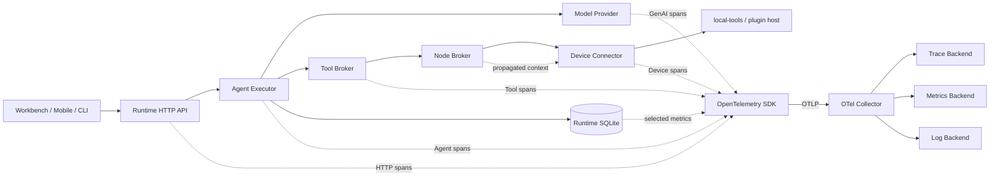

# Zion OpenTelemetry 可观测性演进路线图

> Status: Proposed
> Date: 2026-09-16
> Scope: Runtime, Agent execution, model calls, Tool Broker, Device Connector,
> local tools, Session projection, operational metrics, and correlated logs.
>
> This document does not replace the canonical Runtime, RunEvent, Session, or
> projection architecture. It defines how Zion exports operational telemetry
> around those systems.
>
> Related documents:
>
> - [ZION-DISTRIBUTED-RUNTIME-PRODUCT-ARCHITECTURE.md](./ZION-DISTRIBUTED-RUNTIME-PRODUCT-ARCHITECTURE.md)
> - [ZION-RUNTIME-PLATFORM-BLUEPRINT.md](./ZION-RUNTIME-PLATFORM-BLUEPRINT.md)
> - [AGENT-RUNTIME-MIGRATION-CHECKLIST.md](./AGENT-RUNTIME-MIGRATION-CHECKLIST.md)
> - [RUN-PROJECTION-PROTOCOL.md](./RUN-PROJECTION-PROTOCOL.md)
> - [SESSION-PERSISTENCE.md](./SESSION-PERSISTENCE.md)
> - [RUNTIME-LOCAL-TOOLS-BOUNDARY.md](./RUNTIME-LOCAL-TOOLS-BOUNDARY.md)
>
> External standards:
>
> - [OpenTelemetry overview](https://opentelemetry.io/docs/what-is-opentelemetry/)
> - [OpenTelemetry JavaScript status](https://opentelemetry.io/docs/languages/js/)
> - [OpenTelemetry Protocol](https://opentelemetry.io/docs/specs/otlp/)
> - [W3C Trace Context](https://www.w3.org/TR/trace-context/)
> - [OpenTelemetry GenAI semantic conventions](https://github.com/open-telemetry/semantic-conventions-genai/tree/main/docs/gen-ai)

## 阅读摘要

本文的核心决策是：保留 Zion 已有的 Run Ledger、RunEvent、SQLite、
checkpoint、tool receipt 和 projection，它们继续承担业务事实、恢复和产品展示；
在这些执行边界之外接入 OpenTelemetry，负责跨服务 trace、聚合 metric、日志关联
和标准 OTLP 导出。

路线分为七个成熟度阶段：

| 阶段 | 目标 |
|---|---|
| M0 | 固化语义、隐私规则、性能基线和 golden trace |
| M1 | 为 Runtime 接入 Node SDK、OTLP 和 Collector |
| M2 | 打通 Run、Attempt、模型、工具和 projection 的语义 trace |
| M3 | 通过 W3C Trace Context 打通 Device Connector 和远端工具 |
| M4 | 建立 metrics、dashboard、SLI 和 SLO |
| M5 | 收敛结构化日志和临时 debug probes |
| M6 | 完成采样、治理、保留策略和自动化隐私检查 |

第一交付切片只覆盖 Runtime、模型和逻辑工具调用，不引入浏览器 telemetry、
OTel Logs、完整 Device 传播或任何 prompt/result 内容采集。

## 1. Executive Summary

Zion already has a strong domain-level execution record:

- canonical `Run`, `Attempt`, and ordered `RunEvent` identities;
- durable Runtime SQLite storage;
- checkpoints, transcripts, tool receipts, artifacts, and change sets;
- raw diagnostic streams and bounded client projection streams;
- Workbench, Mobile, and CLI projections;
- policy decisions and context-health semantics.

This is not OpenTelemetry, and it should not be replaced by OpenTelemetry.

The recommended architecture is:

```text
Run Ledger / RunEvent
  = canonical business facts, audit, replay, recovery, and UI projection

OpenTelemetry
  = standard traces, metrics, context propagation, sampling, and export

Collector / observability backend
  = processing, retention, querying, dashboards, and alerts
```

The first implementation target is the Node.js Runtime. Workbench browser
instrumentation is deferred because:

- the authoritative execution owner is moving to Runtime;
- OpenTelemetry JavaScript traces and metrics are stable on Node.js;
- browser instrumentation remains experimental;
- sending Agent content from a browser creates a larger privacy and reliability
  surface;
- browser-local execution remains a compatibility path rather than the desired
  production owner.

The near-term outcome is not "more logs". It is the ability to answer, from one
trace:

> Was this Run slow or unsuccessful because of context preparation, model
> inference, tool policy, node routing, remote execution, result delivery,
> persistence, or Session projection?

## 2. Goals

1. Correlate one Agent Attempt across Runtime, model access, Tool Broker,
   Device Connector, local tools, and projection.
2. Reuse OpenTelemetry SDKs, W3C Trace Context, OTLP, Collector processors,
   sampling, and existing backends instead of building equivalents.
3. Preserve Run Ledger as the sole authority for execution state, ordering,
   replay, checkpointing, and recovery.
4. Produce low-cardinality operational metrics suitable for SLOs and alerts.
5. Correlate structured logs with `trace_id`, `span_id`, `runId`, and
   `attemptId`.
6. Make telemetry optional and non-blocking: exporter or Collector failure must
   never fail a Run.
7. Default to metadata-only telemetry. Prompts, reasoning, tool arguments,
   tool results, file contents, credentials, and personal data stay out of
   exported telemetry.
8. Provide a staged migration that delivers value before distributed tracing
   is complete.

## 3. Non-goals

OpenTelemetry will not:

- replace `runtime_runs` or `runtime_run_events`;
- become a Session, transcript, checkpoint, artifact, or tool-receipt store;
- drive Workbench or Mobile rendering;
- provide exactly-once Tool execution;
- replace CapabilityPolicy, approvals, or resource authorization;
- guarantee audit retention;
- store raw prompts or reasoning by default;
- make every `message.delta` or `reasoning.delta` a span or log;
- require a specific observability vendor.

## 4. Current Architecture Baseline

### 4.1 Canonical execution protocol

[`packages/runtime/src/protocol.ts`](../../packages/runtime/src/protocol.ts)
defines:

- `RunRecord` with `runId`, `attemptId`, status, model, policy, metadata,
  timestamps, output, and usage;
- `RunEvent` with schema version, event ID, Run ID, Attempt ID, sequence,
  type, timestamp, and data;
- `EngineOutputEvent` for model requests, content/reasoning deltas, tool calls,
  and usage;
- `ToolInvocation` and `ToolResult`;
- `RunStore`, `AgentEngine`, `ToolBroker`, and `ContextProvider` contracts.

[`packages/runtime/src/agent-engine.ts`](../../packages/runtime/src/agent-engine.ts)
persists each event before publishing it to consumers. The main lifecycle is:

```text
run.started
context preparation
turn.started
model.request
reasoning/message deltas
tool.requested
tool.denied or tool.completed
turn.completed
checkpoint.created
run.completed, run.failed, or run.aborted
```

This lifecycle is the best source for Zion domain semantics.

### 4.2 Durable storage and recovery

[`apps/runtime/src/sqlite-run-store.mjs`](../../apps/runtime/src/sqlite-run-store.mjs)
stores Runs, ordered events, checkpoints, transcripts, Session messages, tool
receipts, artifacts, and change sets.

Important guarantees already implemented:

- transactionally ordered event append;
- strict per-Run sequence validation;
- unique event IDs;
- WAL and full synchronous SQLite durability;
- startup reconciliation of ownerless Runs;
- same-Run/new-Attempt resume;
- idempotent tool receipts.

These guarantees are outside OpenTelemetry's responsibility and must remain in
the Runtime store.

### 4.3 Raw events and client projections

[`apps/runtime/src/run-event-projection.mjs`](../../apps/runtime/src/run-event-projection.mjs)
and
[`docs/architecture/RUN-PROJECTION-PROTOCOL.md`](./RUN-PROJECTION-PROTOCOL.md)
separate:

- the canonical raw event stream used for diagnostics and recovery;
- a bounded projection stream used by Workbench, Mobile, and CLI.

The projection layer:

- combines token-level deltas;
- preserves the canonical sequence cursor;
- supports reconnect through `Last-Event-ID`;
- replaces large model/tool payloads with summaries and detail references;
- allows reasoning to be streamed, summarized, or hidden;
- propagates transport backpressure.

OpenTelemetry must not be inserted into this path as another client projection.
It should observe execution at the operation boundaries and export independently.

### 4.4 Browser Run Ledger and log view

[`src/core/run-ledger.ts`](../../src/core/run-ledger.ts) maintains a bounded
Workbench-local index of Runs and sanitized semantic events. It intentionally
does not persist token deltas.

[`src/core/run-log-projection.ts`](../../src/core/run-log-projection.ts) and
[`src/ui/run-log-view.ts`](../../src/ui/run-log-view.ts) produce the user-facing
log view.

That view is a product surface:

- grouped by Run and source;
- safe for users to inspect;
- linked to Sessions;
- derived from Run facts;
- intentionally excludes network traces, console output, full prompts, and
  full tool data.

It should remain. A later enhancement may add a "View trace" action, but it
should not become a local APM implementation.

### 4.5 Model request inspection

[`packages/runtime/src/openai-compatible-engine.ts`](../../packages/runtime/src/openai-compatible-engine.ts)
emits `model.request` before credential acquisition and transport execution.

[`apps/runtime/src/model-request-observability.mjs`](../../apps/runtime/src/model-request-observability.mjs)
mirrors persisted model requests into the durable Workbench event feed. Run-backed
requests use a detail pointer to avoid duplicating the full payload.

[`extensions/dev.llm-payloads`](../../extensions/dev.llm-payloads) exposes a
developer inspection UI.

This is request inspection, not distributed tracing. It should remain available
for authorized local diagnostics, while exported telemetry uses a strict metadata
allowlist.

### 4.6 Tool and Device execution

[`apps/runtime/src/runtime-tool-broker.mjs`](../../apps/runtime/src/runtime-tool-broker.mjs)
enforces policy, routes Runtime/plugin/local tools, stores receipts, and persists
artifacts and changes.

[`apps/runtime/src/node-broker.mjs`](../../apps/runtime/src/node-broker.mjs)
selects a Node, queues an invocation, delivers it through the Device protocol,
handles cancellation and lease expiry, and resolves the returned result.

[`apps/device-connector/src/device-connector.mjs`](../../apps/device-connector/src/device-connector.mjs)
polls for commands, executes them on the Resource Host, and retries result
delivery.

The end-to-end Tool duration is visible today, but the following phases are not
independently observable:

```text
policy -> target selection -> queue -> delivery -> remote execution
       -> result upload -> receipt persistence
```

This is the highest-value distributed tracing target after model inference.

### 4.7 Current logging

Logging currently uses several mechanisms:

- `console.log`, `console.warn`, and `console.error`;
- direct `process.stdout` and `process.stderr` writes;
- plugin-specific logger callbacks;
- Workbench EventBus messages;
- Run events;
- temporary `__trae_debug` and loopback debug probes.

These mechanisms do not consistently carry service identity, trace context,
structured error types, sampling policy, or retention policy.

## 5. Current Strengths and Gaps

| Area | Current strength | Gap OpenTelemetry can address |
|---|---|---|
| Run lifecycle | Durable, ordered, replayable | No standard trace export |
| Attempt recovery | Explicit Attempt IDs and checkpoints | No cross-Attempt trace link |
| Model request | Payload inspection and token usage | No stable model completion/error span or TTFT |
| Tool call | Policy, idempotency, receipt, artifact linkage | No route/queue/remote-execution breakdown |
| Multi-node | Explicit Node and resource routing | No W3C context propagation |
| Projection | Recoverable, bounded, multi-client | No projection latency/error metrics |
| Context health | Product recommendation semantics | Duplicated implementation and incomplete Runtime ownership |
| Logs | Human-readable local diagnostics | Fragmented schemas and no trace correlation |
| Metrics | Per-Run usage summaries | No fleet-level rates, percentiles, or SLOs |
| Export | Runtime APIs and SSE | No OTLP/Collector/backend ecosystem |

## 6. Target Architecture



### 6.1 Ownership boundary

| Data | Authority | Retention purpose |
|---|---|---|
| Run status and sequence | Runtime RunStore | Correctness and recovery |
| Transcript and checkpoint | Runtime RunStore | Continuity |
| Tool receipt | Runtime RunStore | Idempotency |
| Artifact and ChangeSet | Runtime/Artifact Store | Product evidence |
| Client projection | Rebuildable cache | Presentation |
| Trace | Observability backend | Diagnosis and latency analysis |
| Metric | Metrics backend | Trends, SLOs, and alerts |
| Correlated log | Log backend/journal | Operational diagnosis |

Telemetry loss must never corrupt or weaken the first four rows.

## 7. Trace Model

### 7.1 One trace per Attempt

A Run may survive process restarts and contain multiple Attempts. Keeping one
span open across process death is unreliable and complicates export.

Use:

```text
Trace A
  invoke_agent
    zion.run.id = run-123
    zion.attempt.id = attempt-1

Trace B
  invoke_agent
    zion.run.id = run-123
    zion.attempt.id = attempt-2
    link = Trace A root span
```

`runId` remains the durable business correlation key. Trace and span IDs remain
random OpenTelemetry identifiers.

The latest Attempt trace context may be stored as non-authoritative metadata on
the Run to support UI links and resume `SpanLink` creation. Losing that metadata
must not prevent resume.

### 7.2 HTTP request relationship

`POST /v1/runs` returns before the Run completes. The long-running Agent span
should therefore not be a normal child that depends on the short HTTP server
span.

Recommended relationship:

```text
HTTP server span: POST /v1/runs
  -> SpanLink from the new invoke_agent root span
```

This preserves causality without creating an awkward child span that outlives
its parent by minutes or hours.

Scheduler-created Runs similarly link to the scheduler claim/execution span.

### 7.3 Recommended span tree

```text
invoke_agent
├── context.prepare identity
├── context.prepare skills
├── turn 1
│   ├── chat deepseek-v4
│   └── execute_tool read
│       ├── zion.device.route
│       ├── zion.device.queue
│       └── local-tools.execute
├── turn 2
│   └── chat deepseek-v4
├── checkpoint.save
└── session.project
```

Avoid spans for:

- individual text tokens;
- individual reasoning tokens;
- every SQLite event append;
- every SSE frame;
- every Device Connector long-poll request.

Those would add cost and noise without improving diagnosis.

### 7.4 RunEvent-to-span mapping

| RunEvent or operation | OpenTelemetry representation |
|---|---|
| Run accepted | Create `invoke_agent` root span |
| `attempt.started` | New Attempt trace with link to previous Attempt |
| `run.started` | Root span event and Run attributes |
| Context provider call | `context.prepare` child span |
| `context.failed` | Error status on provider span; Run may continue |
| `turn.started/completed` | `turn N` internal span |
| Model transport call | GenAI `chat {model}` client span |
| First model chunk | TTFT attribute/metric |
| Model stream completion | End model span with finish reason and usage |
| `tool.requested` | Start `execute_tool {name}` span |
| Tool policy denial | End span as error or add policy-denied event |
| Tool execution | Child span in selected host |
| Receipt hit | Span attribute `zion.tool.receipt_hit=true` |
| `checkpoint.created` | Span event, not a separate trace |
| Session projection | `zion.session.project` child span |
| Terminal Run event | Set root status and end Attempt trace |

### 7.5 GenAI semantic conventions

Use standard GenAI names where they match and isolate them in one adapter because
the GenAI conventions are still marked Development:

```text
gen_ai.operation.name
gen_ai.provider.name
gen_ai.request.model
gen_ai.request.stream
gen_ai.request.reasoning.level
gen_ai.response.model
gen_ai.response.finish_reasons
gen_ai.response.time_to_first_chunk
gen_ai.usage.input_tokens
gen_ai.usage.output_tokens
gen_ai.usage.reasoning.output_tokens
gen_ai.usage.cache_read.input_tokens
gen_ai.usage.cache_write.input_tokens
gen_ai.conversation.id
gen_ai.tool.name
gen_ai.tool.call.id
```

Keep Zion-specific facts in a namespaced allowlist:

```text
zion.run.id
zion.attempt.id
zion.run.trigger
zion.source.kind
zion.execution.mode
zion.policy.preset
zion.tool.host_kind
zion.tool.receipt_hit
zion.node.id
zion.resource.kind
zion.projection.writer
zion.projection.source_sequence
```

## 8. Metrics Model

Metrics must use low-cardinality dimensions. `runId`, `attemptId`, `sessionId`,
invocation ID, path, URL, user ID, and node instance ID are prohibited metric
attributes.

| Metric | Type | Allowed dimensions |
|---|---|---|
| `zion.run.duration` | Histogram | status, trigger, execution mode |
| `zion.run.count` | Counter | status, trigger |
| `zion.run.active` | UpDownCounter | execution mode |
| `zion.turn.count` | Histogram | status, model family |
| `zion.model.duration` | Histogram | provider, model, status |
| `zion.model.time_to_first_chunk` | Histogram | provider, model |
| `zion.model.tokens` | Counter | provider, model, direction, token class |
| `zion.tool.duration` | Histogram | tool name, host kind, status |
| `zion.tool.invocations` | Counter | tool name, host kind, status |
| `zion.tool.receipt_hits` | Counter | tool name |
| `zion.device.queue.duration` | Histogram | capability, result |
| `zion.device.delivery.retries` | Counter | operation, result |
| `zion.projection.duration` | Histogram | projector, result |
| `zion.projection.lag` | Histogram | client/projector type |
| `zion.context.utilization` | Histogram | model family |
| `zion.context.recommendations` | Counter | recommendation |
| `zion.sse.connections` | UpDownCounter | stream kind |
| `zion.sse.reconnects` | Counter | stream kind, reason |

Model names and tool names are allowed only while their catalogs remain bounded.
Dynamic plugin values must be normalized or dropped at the Collector.

## 9. Logging Model

### 9.1 Initial decision

Do not block the first rollout on OpenTelemetry Logs. OpenTelemetry JavaScript
logs are not yet stable.

Start with:

- traces and metrics through the OTel SDK;
- existing stderr/journald output;
- a small structured logger wrapper that adds active `trace_id`, `span_id`,
  `runId`, `attemptId`, service name, severity, and a low-cardinality error type.

Adopt the OTel logs signal only after the Node.js implementation and selected
backend are stable enough for production use.

### 9.2 Temporary debug probes

`__trae_debug`, loopback event servers, and hypothesis-specific fetch calls are
temporary debugging instrumentation. They must not become a permanent second
telemetry system.

Each probe should eventually be:

1. deleted after the issue is verified;
2. converted into a bounded span event or metric when it represents a reusable
   operational signal; or
3. retained behind an explicit local debug flag with no production endpoint.

## 10. Context Propagation

### 10.1 Standard HTTP

Use W3C `traceparent` and `tracestate` headers for:

- client-to-Runtime HTTP when a trusted client context exists;
- Runtime-to-model gateway;
- Runtime-to-direct local service calls;
- internal HTTP service calls.

Do not accept arbitrary baggage from untrusted clients. Baggage is not needed
for Run, Session, user, prompt, or policy data.

### 10.2 Device long-poll protocol

Normal HTTP propagation is insufficient for Device execution:

- the Connector's poll request exists before the logical Tool invocation;
- the Tool command is delivered inside a later poll response;
- the result is posted in another request.

Add an optional trace context to the logical command envelope:

```ts
type TraceContext = {
  traceparent: string;
  tracestate?: string;
};

type DeviceCommand = {
  // existing fields
  traceContext?: TraceContext;
};
```

The Node Broker injects the current Tool span context. The Connector extracts it
before invoking local-tools or plugin service. Older connectors ignore the
optional field, preserving compatibility.

The polling HTTP spans should be suppressed or aggressively sampled. The logical
Device execution span is the useful signal.

### 10.3 Async and resume boundaries

Use `SpanLink`, not parent-child inheritance, for:

- HTTP acceptance to a background Run;
- scheduler claim to Agent Run;
- resumed Attempt to previous Attempt;
- replay or reconciliation that references a prior failed execution.

## 11. Privacy and Security Policy

### 11.1 Default-deny content policy

Export only explicitly allowed scalar metadata. Do not export by default:

- prompts, message content, system instructions, or reasoning;
- tool argument values or results;
- terminal commands or output;
- file paths, file contents, patches, or artifact bodies;
- URLs with query strings;
- email addresses or message bodies;
- access tokens, API keys, cookies, authorization headers, credentials, pairing
  material, or signed URLs;
- model request/response bodies;
- raw exception objects that may include request data.

Safe defaults include:

- counts and byte lengths;
- bounded enum-like status values;
- model/provider identifiers;
- tool name and host kind;
- HTTP method, normalized route, and status code;
- low-cardinality error type;
- opaque internal IDs when the backend is trusted.

### 11.2 Allowlist, not blacklist

The existing LLM payload UI redacts suspicious key names for local inspection.
That is not sufficient for external telemetry because secrets may appear in
free-form strings, URLs, headers, commands, or nested content.

The OTel adapter must build attributes from an allowlist. It must never serialize
a RunEvent `data` object wholesale.

### 11.3 Collector defense in depth

Collector configuration should additionally:

- delete forbidden attributes;
- normalize URLs to route and host;
- cap attribute and event sizes;
- drop accidental content fields;
- batch export;
- use memory limits;
- apply tail sampling;
- use authenticated TLS for non-loopback export.

## 12. SDK and Package Boundaries

### 12.1 Dependency strategy

Avoid a custom tracing framework.

- `packages/runtime` may depend only on `@opentelemetry/api`, which is designed
  for library instrumentation and behaves as a no-op without an SDK.
- `apps/runtime` owns `@opentelemetry/sdk-node`, OTLP exporters, Resource
  configuration, sampling, and shutdown.
- Device Connector uses the same shared Node bootstrap and redaction policy.
- A small `packages/telemetry` module may centralize bootstrap, naming, and
  allowlists, but must not wrap or reimplement the OTel API.

### 12.2 Startup

Instrumentation must initialize before Runtime imports HTTP/fetch modules.
With the current Node 22 requirement, use a preload:

```text
node --import ./src/telemetry/bootstrap.mjs src/main.mjs
```

When `OTEL_SDK_DISABLED=1` or no endpoint is configured, the bootstrap should be
a safe no-op.

### 12.3 Suggested configuration

```text
OTEL_SERVICE_NAME=zion-runtime
OTEL_EXPORTER_OTLP_ENDPOINT=http://127.0.0.1:4318
OTEL_EXPORTER_OTLP_PROTOCOL=http/protobuf
OTEL_TRACES_SAMPLER=parentbased_traceidratio
OTEL_TRACES_SAMPLER_ARG=0.1
ZION_OTEL_CAPTURE_CONTENT=0
ZION_OTEL_DEBUG=0
```

Use separate service names:

```text
zion-runtime
zion-device-connector
zion-local-tools
zion-plugin-host
zion-workbench
```

`service.instance.id` identifies a process instance. A stable Node identity may
be included in traces after hashing or access review, but not in metric labels.

## 13. Instrumentation Placement

### 13.1 Runtime HTTP

Use Node auto-instrumentation for normal HTTP routes, with explicit exclusions:

- `/health`;
- SSE projection and raw event streams;
- Device long-poll endpoints;
- high-frequency heartbeat endpoints.

For excluded long-lived routes, record bounded counters and duration metrics
instead of one span per poll/frame.

### 13.2 Agent executor

Instrument in
[`packages/runtime/src/agent-engine.ts`](../../packages/runtime/src/agent-engine.ts):

- root Attempt span;
- context provider spans;
- turn spans;
- checkpoint span events;
- terminal status and exceptions.

Do not create a span from every call to the internal `publish()` function.
RunEvent publication is domain state, not automatically a tracing operation.

### 13.3 Model engine

Instrument inside
[`packages/runtime/src/openai-compatible-engine.ts`](../../packages/runtime/src/openai-compatible-engine.ts)
around credential acquisition, transport, stream consumption, and completion.

The span should cover all automatic retries that belong to one logical model
operation. Record:

- provider and requested model at span creation;
- stream flag and reasoning level;
- credential acquisition duration without credential identity;
- HTTP status and low-cardinality error type;
- time to first response chunk;
- finish reason;
- response model when available;
- input, output, reasoning, cache-read, and cache-write usage;
- retry count.

The current `EngineOutputEvent` lacks an explicit model completion/failure event.
OTel spans can initially be completed directly inside the engine. Add canonical
`model.completed` and `model.failed` RunEvents only if product diagnostics or
replay also need those facts.

### 13.4 Tool Broker

Instrument around
[`apps/runtime/src/runtime-tool-broker.mjs`](../../apps/runtime/src/runtime-tool-broker.mjs):

- policy validation;
- receipt lookup;
- host selection;
- invocation;
- artifact enrichment;
- receipt persistence.

One logical `execute_tool` span covers the complete call. Add span events for
policy denial, receipt hit, target selection, and artifact creation.

Never attach argument or result values. Allowed metadata:

```text
tool name
tool call ID on traces only
host kind
risk class
result status
result byte count
artifact count
change count
receipt hit
```

### 13.5 Node Broker and Device Connector

Instrument:

- target selection;
- queue wait;
- command delivery;
- lease expiration;
- Device execution;
- result upload retry;
- receipt acceptance.

The Runtime `execute_tool` span is the parent. Device execution is a remote child
created from the propagated command trace context.

### 13.6 Session projection

Instrument Runtime collaboration and document projectors with:

- source event type and sequence;
- projection mode;
- writer/observer role;
- apply duration;
- event-to-projection lag;
- reconciliation count;
- bounded document size before/after;
- error type.

Do not export document text, role-line content, Yjs updates, or marker bodies.

Recent document ordering and duplicate projection defects make this an important
early span even though it is not part of the GenAI conventions.

## 14. Roadmap

### M0: Baseline and contracts

Objective: establish a safe contract before installing SDKs.

Work:

- approve this ownership model;
- define the trace hierarchy and attribute allowlist;
- inventory temporary debug probes and existing logger shapes;
- define service names and environment attributes;
- capture baseline CPU, memory, startup time, Run latency, model TTFT, and event
  throughput;
- write golden trace examples for interactive, scheduled, resumed, denied, failed,
  and remote-tool Runs;
- decide the first backend without coupling application code to it.

Exit criteria:

- Run Ledger remains explicitly authoritative;
- content capture is default-off;
- all metric dimensions have cardinality review;
- baseline performance numbers are recorded;
- no production behavior changes.

### M1: Runtime Node foundation

Objective: export useful infrastructure telemetry from one process.

Work:

- add OTel API/SDK and OTLP HTTP exporter;
- preload SDK before `main.mjs`;
- configure Runtime Resource attributes;
- auto-instrument bounded HTTP and fetch calls;
- exclude health, SSE, heartbeat, and Device poll noise;
- implement graceful SDK shutdown on SIGINT/SIGTERM;
- deploy a local Collector with batch, memory limiter, and attribute filtering;
- keep telemetry disabled unless explicitly configured.

Exit criteria:

- Runtime startup, normal HTTP request, model HTTP request, and shutdown are
  visible in the backend;
- Collector unavailability does not affect `/health` or Run completion;
- no authorization, cookie, credential, prompt, or tool content is exported;
- disabled-mode overhead is negligible;
- enabled-mode p95 Run overhead stays below the agreed budget, initially 3%.

### M2: Agent semantic traces

Objective: make one Runtime Attempt understandable end to end.

Work:

- create one `invoke_agent` trace per Attempt;
- link accepted HTTP or scheduler claim spans;
- instrument context providers and turns;
- instrument model inference, TTFT, finish reason, usage, cancellation, and error;
- instrument logical Tool execution and receipt hits;
- instrument Session projection;
- persist the latest trace correlation metadata on the Run as non-authoritative
  metadata;
- expose trace ID in diagnostic APIs and CLI JSONL.

Exit criteria:

- successful, failed, aborted, timeout, and resumed Runs close their spans;
- one trace reconstructs model and Tool ordering without reading prompt content;
- a resumed Attempt links to the previous Attempt;
- Runtime RunEvent ordering and replay tests remain unchanged;
- no span is emitted per token.

### M3: Distributed Device tracing

Objective: trace a Tool call across Runtime and a remote Resource Host.

Work:

- add optional W3C trace context to Device commands;
- inject context in Node Broker and extract it in Device Connector;
- instrument queue, delivery, execution, result retry, and receipt persistence;
- add resource attributes for service and platform;
- suppress long-poll transport noise;
- verify old connectors ignore the optional field safely.

Exit criteria:

- a remote `read` or `Bash` call appears as a child of the Runtime Tool span;
- queue time and remote execution time are independently visible;
- cancellation and lease expiry produce correct statuses;
- duplicate receipt recovery does not create a second execution span;
- old protocol peers continue to work.

### M4: Metrics, dashboards, and SLOs

Objective: move from individual debugging to operational management.

Work:

- emit the metrics defined in section 8;
- build Runtime, model, Tool, Device, and projection dashboards;
- define service-level indicators and objectives;
- add alerts for sustained error rate, latency, interrupted Runs, offline Nodes,
  projection failures, and Collector export failure;
- add release/version markers to dashboards;
- validate metric cardinality with production-like catalogs.

Initial SLO candidates:

```text
Run acceptance availability
Run terminal completion rate by execution mode
Model request success rate and p95 TTFT
Tool success rate and p95 duration
Remote Tool queue p95
Session projection success rate and p95 lag
Runtime restart interruption rate
```

Exit criteria:

- dashboards explain a known injected failure without querying SQLite manually;
- alerts are actionable and link to traces;
- metric series counts remain within the agreed budget;
- SLO definitions distinguish product failure from user cancellation and policy
  denial.

### M5: Correlated structured logging

Objective: remove fragmented production diagnostics.

Work:

- introduce one structured logger contract for Runtime and Connector;
- add active trace/span correlation;
- classify errors with stable low-cardinality identifiers;
- migrate direct stderr and important console messages;
- remove completed `__trae_debug` probes;
- retain local debug-only probes behind explicit flags;
- evaluate OTel Logs after JavaScript log support and backend integration meet
  production requirements.

Exit criteria:

- every production error log identifies service, severity, error type, and trace
  when one exists;
- no permanent loopback debug endpoint is required;
- logs do not contain credentials or raw model/tool content;
- operators can navigate log -> trace -> Run ID.

### M6: Sampling, governance, and evaluation

Objective: operate telemetry sustainably at scale.

Work:

- use parent-based head sampling for normal traffic;
- use Collector tail sampling for errors, timeouts, high latency, and selected
  diagnostic cohorts;
- define environment-specific retention;
- version the Zion-to-GenAI semantic mapping;
- add telemetry schema compatibility tests;
- add automated privacy scanning;
- add trace-derived evaluation hooks only after the telemetry contract stabilizes;
- document incident response and dashboard ownership.

Exit criteria:

- sampling retains all diagnostically important failures;
- telemetry cost and retention are measurable;
- GenAI convention upgrades require changes only in the adapter layer;
- privacy tests fail the build on forbidden attributes;
- dashboards and alerts have named owners and runbooks.

## 15. Testing Strategy

### 15.1 Unit tests

- in-memory span exporter verifies names, hierarchy, attributes, status, and links;
- metric reader verifies allowed dimensions;
- redaction tests inject secrets into every RunEvent field and assert absence;
- model tests cover success, HTTP failure, incomplete stream, cancellation, no
  usage event, and retry;
- Tool tests cover denial, receipt hit, local execution, plugin execution, and
  remote execution;
- resume tests verify a new trace linked to the prior Attempt.

### 15.2 Integration tests

- Runtime -> Collector -> in-memory or test backend;
- Runtime -> Node Broker -> Device Connector -> fake local-tools;
- scheduler claim -> Agent Run;
- projection failure and reconciliation;
- Collector down, slow, rejecting, and restarted;
- SDK disabled;
- old Device connector without trace context.

### 15.3 Performance tests

Measure:

- Runtime startup;
- first Run acceptance;
- model streaming throughput;
- 10,000 delta-event Run;
- 100 concurrent SSE consumers;
- remote Tool latency;
- exporter queue memory;
- shutdown flush duration.

Telemetry processors must be bounded. Export must use batching and must not block
the RunEvent commit path.

## 16. Rollout and Failure Policy

1. Development only, console or local Collector exporter.
2. Internal environment with 100% trace sampling and content disabled.
3. Production shadow mode with low ratio sampling.
4. Enable error and high-latency tail sampling.
5. Add dashboards and alerts only after metric cardinality is measured.
6. Enable distributed Device context after compatibility tests.
7. Remove superseded temporary probes.

Failure rules:

- OTel initialization failure logs once and falls back to no-op;
- exporter failure never changes HTTP or Run status;
- exporter queues are bounded;
- shutdown flush has a strict timeout;
- no retry loop may compete with Agent execution;
- Collector is preferred over direct vendor export;
- rollback is `OTEL_SDK_DISABLED=1`, without code or storage migration.

## 17. Concrete First Delivery Slice

The first implementation should remain deliberately small:

1. Add Runtime OTel bootstrap and OTLP HTTP export.
2. Create one Attempt-level `invoke_agent` span.
3. Instrument one model span with TTFT and token usage.
4. Instrument one logical Tool span.
5. Add Runtime Resource attributes.
6. Exclude SSE, health, heartbeat, and Device polling routes.
7. Add in-memory exporter tests and a content-leak test.
8. Run existing Runtime suites unchanged.
9. Compare enabled and disabled performance with the M0 baseline.

Do not include in the first slice:

- browser instrumentation;
- OTel Logs;
- full Device propagation;
- prompt or response capture;
- a custom tracing UI;
- replacement of the Run log view;
- conversion of all debug probes.

This slice is enough to validate architecture and obtain immediate model-versus-
tool latency visibility without coupling the product to a backend.

## 18. Decisions Required Before Implementation

The following decisions should be recorded before M1:

1. Initial Collector and backend deployment: local sidecar/systemd service or
   centrally hosted Collector.
2. Production trace sampling ratio and error tail-sampling policy.
3. Whether opaque Run and Session IDs may leave the Runtime host or must be
   hashed.
4. Retention period for traces, metrics, and logs.
5. The initial performance overhead budget.
6. Whether the first release exposes trace links in Workbench or CLI only.

These choices affect deployment and governance, but not the core decision to
keep Run Ledger authoritative and use OpenTelemetry as the standard observation
and export layer.

## 19. Suggested Pull Request Sequence

### PR 1: Telemetry contract and test harness

Scope:

- add the approved attribute allowlist and forbidden-content list;
- add golden trace fixtures;
- add an in-memory exporter test harness;
- record M0 performance baselines;
- make no production code-path changes.

Primary files:

```text
docs/architecture/OPENTELEMETRY-OBSERVABILITY-ROADMAP.md
packages/runtime/tests/telemetry-fixtures.ts
apps/runtime/tests/telemetry-policy.test.js
```

Gate:

- privacy fixtures cover credentials, prompts, paths, tool arguments, and URLs;
- reviewers approve span hierarchy and metric dimensions.

### PR 2: Runtime SDK bootstrap

Scope:

- initialize Node SDK before Runtime imports;
- configure Resource, OTLP HTTP export, batching, and shutdown;
- keep telemetry opt-in;
- add local Collector configuration.

Primary files:

```text
apps/runtime/src/telemetry/bootstrap.mjs
apps/runtime/src/main.mjs
apps/runtime/package.json
package-lock.json
deploy/otel-collector/config.yaml
deploy/systemd/zion-otel-collector.service
```

Gate:

- SDK-disabled and Collector-unavailable tests pass;
- no existing Runtime behavior or protocol changes;
- one sanitized Runtime HTTP trace reaches the test Collector.

### PR 3: Attempt and context spans

Scope:

- create the Attempt-level `invoke_agent` trace;
- link it to HTTP or scheduler initiation;
- instrument context providers, turns, checkpoint events, and terminal states;
- persist non-authoritative trace correlation metadata.

Primary files:

```text
packages/runtime/src/agent-engine.ts
packages/runtime/src/protocol.ts
packages/runtime/tests/agent-telemetry.test.ts
apps/runtime/src/server.mjs
```

Gate:

- completion, failure, cancellation, timeout, and resume traces close correctly;
- resumed Attempts use links;
- RunEvent fixtures remain byte-for-byte compatible unless a separately reviewed
  schema change is required.

### PR 4: GenAI model spans

Scope:

- instrument credential wait, model transport, TTFT, stream completion, usage,
  finish reason, retries, and errors;
- implement the isolated GenAI semantic-convention adapter;
- keep input/output content disabled.

Primary files:

```text
packages/runtime/src/openai-compatible-engine.ts
packages/runtime/src/genai-telemetry.ts
packages/runtime/tests/openai-compatible-engine.test.ts
packages/runtime/tests/genai-telemetry.test.ts
```

Gate:

- streaming, non-streaming, no-usage, incomplete-stream, HTTP-error, and abort
  cases produce valid spans;
- headers and bodies are absent from exported attributes;
- model span duration includes the complete logical operation.

### PR 5: Tool and projection spans

Scope:

- instrument policy, receipt, logical Tool execution, artifacts, and errors;
- instrument Session projection duration and lag;
- expose trace IDs in diagnostic Run and CLI output.

Primary files:

```text
apps/runtime/src/runtime-tool-broker.mjs
apps/runtime/src/collaboration-service.mjs
apps/runtime/src/runtime-cli.mjs
apps/runtime/tests/runtime-tool-telemetry.test.js
apps/runtime/tests/projection-telemetry.test.js
```

Gate:

- receipt hits are distinguishable from real execution;
- policy denial is not counted as infrastructure failure;
- trace output contains no tool arguments, results, or document text.

### PR 6: Distributed Device propagation

Scope:

- add optional trace context to Device commands;
- inject in Node Broker and extract in Connector;
- instrument queue, delivery, remote execution, retries, and lease expiry;
- preserve compatibility with older connectors.

Primary files:

```text
packages/node-protocol/src/index.mjs
apps/runtime/src/node-broker.mjs
apps/device-connector/src/device-connector.mjs
packages/node-protocol/tests/
apps/runtime/tests/
apps/device-connector/tests/
```

Gate:

- one remote Tool call forms a single parent/child trace;
- long polling does not flood the backend;
- old commands without trace context remain valid;
- duplicate result delivery does not duplicate the execution span.

### PR 7: Metrics and operational dashboards

Scope:

- add the approved low-cardinality metrics;
- add Collector views/processors;
- add Runtime, model, Tool, Device, and projection dashboards;
- establish initial alerts and runbooks.

Gate:

- production-like load stays within the metric-series budget;
- an injected model failure, offline Node, and projection failure are visible and
  diagnosable;
- each alert names an owner and remediation path.

### PR 8: Structured logging and probe retirement

Scope:

- standardize Runtime and Connector log records;
- add trace/span correlation;
- remove completed hypothesis-specific probes;
- inventory remaining browser-only debug instrumentation;
- defer OTel Logs until its JavaScript status is accepted.

Gate:

- production code no longer depends on loopback debug collectors;
- errors can be navigated log -> trace -> Run;
- privacy tests cover logs as well as spans.

Each PR is independently deployable and can be disabled without migrating the
Run database. PRs 3-5 may be developed in parallel after PR 2, while PR 6 depends
on the trace model established by PRs 3 and 5.

## 20. Final Architecture Decision

Zion should adopt OpenTelemetry incrementally with these invariants:

1. RunEvent remains the canonical domain protocol.
2. Runtime SQLite remains the canonical execution and recovery store.
3. Client projection remains the presentation protocol.
4. OpenTelemetry observes operations; it does not control them.
5. One Attempt maps to one trace and resumed Attempts use links.
6. Cross-Node Tool execution propagates W3C trace context in the logical command.
7. Content capture is default-off and allowlist-based.
8. Metrics never use unbounded identity dimensions.
9. Collector/exporter failures never affect a Run.
10. Standard OTel APIs, OTLP, and Collector replace custom tracing infrastructure;
    Zion-specific code is limited to domain instrumentation and semantic mapping.
