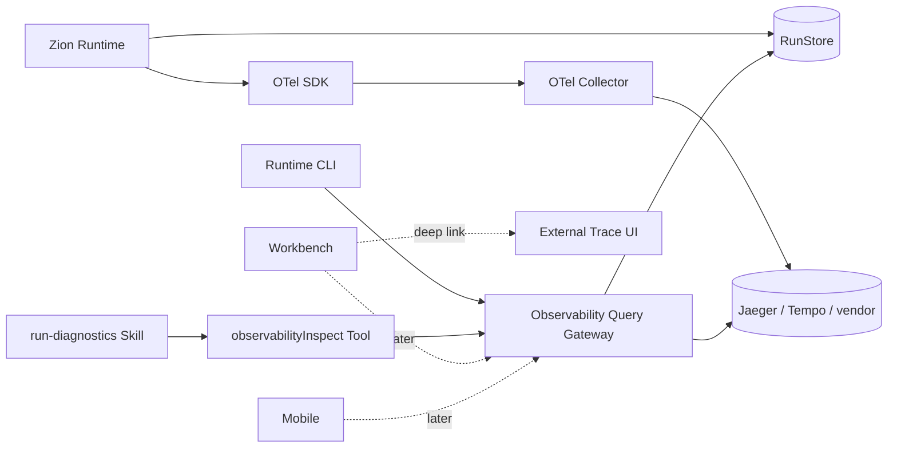

# OTel 消费体验与 Agent 诊断能力设计

> Status: P0 query gateway and P1 Agent Tool/Skill implemented; CLI and UI pending
> Date: 2026-09-16
> Scope: OpenTelemetry 查询边界、Workbench、Mobile、CLI、Runtime Tool/Skill、
> 外部观测平台与权限治理
>
> Related:
>
> - [OPENTELEMETRY-OBSERVABILITY-ROADMAP.md](./OPENTELEMETRY-OBSERVABILITY-ROADMAP.md)
> - [OTEL-JAEGER-ACCESS-CREDENTIAL-DESIGN-20260916.md](./OTEL-JAEGER-ACCESS-CREDENTIAL-DESIGN-20260916.md)
> - [RUNTIME-OPENTELEMETRY.md](../operations/RUNTIME-OPENTELEMETRY.md)
> - [RUN-PROJECTION-PROTOCOL.md](./RUN-PROJECTION-PROTOCOL.md)

## 1. 结论摘要

现阶段不建议在 Workbench 或 Mobile 中直接建设一套 Trace 瀑布图，也不建议
让模型直接访问 Collector、Jaeger 或 Tempo。

推荐采用三层消费模型：

```text
专业观测后端
  保存和检索原始 Trace，面向开发、运维和 SRE

Runtime Observability Query Gateway
  按 Run 查询、脱敏、限流并投影为稳定的诊断摘要

Workbench / Mobile / CLI / Agent Tool
  只消费适合自身场景的摘要或安全跳转链接
```

首个用户价值切片可以完全不新增 Workbench 和 Mobile 入口：

1. 选定可查询的 Trace Backend，而不是只有 Collector debug exporter。
2. 在 Runtime 增加只读、Run-scoped 的诊断查询接口。
3. 增加 `zion run diagnose <runId>` CLI。
4. 增加只读 `observabilityInspect` Tool 和 `run-diagnostics` Skill。
5. 由模型在用户明确询问“为什么慢、为什么失败”时按需分析。

等查询契约、权限、采样和性能稳定后，再给 Workbench 日志行增加一个低干扰的
“诊断”入口。Mobile 最后接入，并只展示结论，不展示完整 Span 树。

### 2026-09-16 实现状态

首批 Runtime 查询边界和 Agent 入口已经按本文方案落地：

- Jaeger `TraceReader`、确定性诊断投影、30 秒有界缓存和 1 秒查询超时；
- `GET /v1/observability/status` 与
  `GET /v1/runs/{runId}/diagnostics`；
- 内置 `dev.observability` Runtime 插件及只读
  `observabilityInspect` Tool；
- 插件内置 `run-diagnostics` Skill；
- sampled、unsampled、active、not-found、backend-unavailable 和
  telemetry-disabled 状态；
- Tool 的同 Run/Session/Project 可见性约束、12 KiB 输出上限和二次字段投影；
- 本地真实 Runtime、DeepSeek、Collector、Jaeger、Tool 调用链验证。

尚未实现 `zion run diagnose` CLI、Workbench 诊断入口、Mobile 摘要和生产
Backend 部署。当前实现保持默认关闭，仅在显式配置查询 Backend 时注册 Tool。

## 2. 当前产品事实

### 2.1 Workbench 底部日志

[`src/core/run-log-projection.ts`](../../src/core/run-log-projection.ts) 从
浏览器 Run Ledger 投影用户可读日志；它：

- 按 Run 和来源分组；
- 展示模型、Token、工具、策略拒绝和终态；
- 丢弃 `message.delta` 等高频噪声；
- 支持搜索、级别/来源筛选、复制和打开会话；
- 最多投影 500 行。

[`src/ui/run-log-view.ts`](../../src/ui/run-log-view.ts) 是产品界面，不是 APM。
它依赖 `zion.runs`，当前没有读取 OTel Backend 的能力。

### 2.2 Mobile Run 详情

[`apps/mobile-client/src/WorkScreens.tsx`](../../apps/mobile-client/src/WorkScreens.tsx)
通过 `GET /v1/runs/{runId}` 和 `/events` 展示：

- Run 状态、模型和策略；
- 输出；
- RunEvent 时间线；
- Token 使用；
- 停止和返回会话操作。

Mobile 当前拿到的 `RunRecord.metadata` 已可能包含 `zionTelemetry`，但它既不应
直接理解该私有结构，也不应持有 Trace Backend 凭证。

### 2.3 Runtime 和插件

Runtime 已提供：

- Run、Event、Projection、Transcript、Artifact 等查询接口；
- `runtime.read` / `runtime.write` 访问控制；
- Runtime Plugin API v2 的 `context.tools.registerTool()`；
- Tool policy、schema 校验、取消和 Run/Attempt 上下文；
- `RunRecord.metadata.zionTelemetry` 中的 Trace 关联信息。

这使诊断能力适合落在 Runtime，而不是分别在 Workbench、Mobile 和 Skill 中
实现三套 Backend 客户端。

### 2.4 当前 OTel 能力边界

当前 Trace 只稳定覆盖：

```text
invoke_agent
├── chat
├── execute_tool
└── chat
```

尚未覆盖：

- Context Provider；
- Session/Yjs Projection；
- HTTP 接收；
- Node Broker 队列和 Device Connector；
- 数据库细分；
- Fleet metrics、Dashboard 和告警。

诊断结果必须明确展示 coverage，不能把“未埋点”误判为“没有耗时”。

## 3. 面向谁展示什么

| 用户 | 核心问题 | 推荐入口 | 不应展示 |
|---|---|---|---|
| 普通用户 | 为什么失败、是否需要重试 | 会话/Run 中的一句话结论 | Span、TraceQL、Resource 属性 |
| 高级用户 | 慢在模型还是工具 | Workbench 诊断详情 | Collector 配置和 exporter 错误 |
| Mobile 用户 | 当前是否异常、下一步做什么 | Run 详情中的结论和建议 | 完整瀑布图 |
| 开发/运维 | 精确调用链和耗时 | Jaeger/Tempo/Grafana | 原始 prompt、tool body |
| Agent | 帮用户解释某次 Run | 只读 Tool + Skill | 任意 Backend 查询、凭证 |
| 自动化系统 | 聚合趋势和告警 | Metrics/Alert API | 单个 Run 的正文 |

产品原则：

> 原始 Trace 面向专业工具；Zion 面向用户展示诊断结论。

## 4. 目标架构



### 4.1 Collector 不是查询服务

Collector 负责接收、处理和转发 telemetry。当前 debug exporter 只输出日志，
没有持久查询能力。

要让用户或模型“查看 OTel”，必须先有 Jaeger、Tempo 或供应商 Backend，并由
Runtime 通过受控 adapter 查询。客户端和模型不能直接连接 Collector。

### 4.2 Runtime Observability Query Gateway

已新增 Runtime 内部接口，首个 adapter 为 Jaeger：

```ts
interface TraceReader {
  getTrace(traceId: string, signal: AbortSignal): Promise<TraceDocument | null>;
  getTraceUrl?(traceId: string): string | null;
  health(signal: AbortSignal): Promise<TraceBackendHealth>;
}
```

不同 Backend 通过 adapter 实现。领域代码只依赖稳定的 `TraceReader`，不依赖
TraceQL、Jaeger JSON 或某个供应商 SDK。

Gateway 的职责：

- 从 RunStore 读取 Run 和 `zionTelemetry`；
- 判断 sampled、active、expired 或 disabled；
- 查询 Backend；
- 限制 timeout、Span 数量和返回大小；
- 再次执行字段白名单；
- 将 Span 投影成稳定的 `RunDiagnosticSummary`；
- 可选生成 Backend 深链接；
- 对短期结果做有界缓存；
- 记录查询健康，但不修改 Run 状态。

Gateway 不应：

- 写入 RunEvent；
- 持久化完整 Trace 到 SQLite；
- 根据 Trace 修复或恢复 Run；
- 接受任意 TraceQL/SQL；
- 将 Backend 响应原样传给客户端或模型；
- 在 Backend 不可用时伪造“运行正常”。

## 5. 稳定诊断契约

建议客户端、CLI 和 Tool 共用一个版本化结果：

```ts
type RunDiagnosticSummary = {
  schemaVersion: 1;
  runId: string;
  attemptId: string;
  availability:
    | "ready"
    | "active"
    | "unsampled"
    | "not-found"
    | "expired"
    | "backend-unavailable"
    | "telemetry-disabled";
  source: {
    runLedger: true;
    trace: boolean;
  };
  correlation?: {
    traceId: string;
    sampled: boolean;
  };
  coverage: Array<
    "attempt" | "model" | "tool" | "context" | "projection" | "device"
  >;
  summary: {
    outcome: "success" | "failed" | "cancelled" | "timeout" | "unknown";
    durationMs?: number;
    headline: string;
    confidence: "high" | "medium" | "low";
  };
  bottleneck?: {
    stage: "model" | "tool" | "runtime-unattributed";
    name?: string;
    durationMs: number;
    share?: number;
  };
  stages: Array<{
    kind: "attempt" | "model" | "tool";
    name: string;
    status: "ok" | "error" | "cancelled" | "unknown";
    durationMs: number;
    firstChunkMs?: number;
    errorType?: string;
    tokenUsage?: {
      input?: number;
      output?: number;
      reasoning?: number;
    };
    receiptHit?: boolean;
    hostKind?: string;
  }>;
  findings: Array<{
    code: string;
    severity: "info" | "warning" | "error";
    message: string;
    evidence: string[];
    recommendation?: string;
  }>;
  limitations: string[];
  externalUrl?: string;
};
```

`headline` 和 `findings` 第一阶段应由确定性规则生成，不调用模型：

- 模型占 Attempt 时间超过阈值：模型阶段主导；
- TTFC 高：模型首包慢；
- 工具占比高：工具执行主导；
- `receipt_hit=true`：结果来自回执复用，不是再次执行；
- `policy_denied`：策略拒绝，不归类为基础设施故障；
- root 自耗时高但 coverage 不完整：标记“未归因”，不猜测；
- Trace 与 Run Ledger 终态不一致：高优先级数据质量告警；
- active Trace：明确“结果尚不完整”。

确定性摘要稳定、便宜、可测试；模型负责把证据解释成自然语言，不负责生成事实。

## 6. Runtime API

首批已新增：

```text
GET /v1/runs/{runId}/diagnostics
GET /v1/observability/status
```

`/diagnostics` 默认只返回 summary，不返回原始 Span。可选参数保持有限：

```text
?include=stages,findings
```

不提供：

```text
?query=<arbitrary TraceQL>
?backend_url=<arbitrary URL>
?include=raw
```

HTTP 状态建议：

| 场景 | HTTP | `availability` |
|---|---:|---|
| Trace 可查 | 200 | `ready` |
| Run 仍在执行 | 200 | `active` |
| head sampler 未采样 | 200 | `unsampled` |
| OTel 未配置 | 200 | `telemetry-disabled` |
| 超出 Backend 保留期 | 200 | `expired` |
| Backend 暂时故障 | 200 | `backend-unavailable` |
| Run 不存在或不可见 | 404 | 无响应体细节泄漏 |

观测不可用不是 Run API 的失败。客户端应能继续显示 Run Ledger。

## 7. Agent Tool 和 Skill

### 7.1 `observabilityInspect` Tool

已通过 Runtime Plugin API v2 注册只读工具：

```json
{
  "name": "observabilityInspect",
  "description": "Inspect a sanitized diagnostic summary for a visible Zion Run.",
  "inputSchema": {
    "type": "object",
    "properties": {
      "run_id": { "type": "string", "minLength": 1 },
      "include_stages": { "type": "boolean" },
      "include_findings": { "type": "boolean" }
    },
    "required": ["run_id"],
    "additionalProperties": false
  },
  "policy": {
    "minimumPreset": "read-only"
  }
}
```

Tool 只调用 Gateway，不直接调用 Backend。输出与 HTTP API 使用同一 schema，
并额外限制：

- 最多 20 个 stage；
- 单次输出建议不超过 12 KiB；
- 不返回 raw attributes、events、links 或 Resource；
- 不返回 exporter endpoint、认证信息和 Backend 响应错误体；
- 不允许查询当前 principal 看不到的 Run；
- Backend 超时建议 1 秒，失败返回结构化 availability；
- 不自动重试，不与 Agent 主任务竞争资源。

### 7.2 当前 Run 的自省边界

模型在自己的 Run 内调用该 Tool 时，当前 `invoke_agent` Span 尚未结束且通常尚未
导出。为了避免循环和误判：

- 默认用于分析已经终止的历史 Run；
- 查询当前 Run 时返回 `availability=active`；
- 可以返回 Run Ledger 已发生的事实，但必须标记 Trace 不完整；
- 不根据当前未结束 Trace 给出最终瓶颈结论；
- 查询 Tool 自己产生的 Span 不纳入当次返回；
- 后续启用 HTTP 自动埋点时，对 Backend 查询使用 instrumentation suppression。

### 7.3 `run-diagnostics` Skill

Skill 负责教模型如何使用工具，而不是再次实现查询：

1. 从用户描述中确定 `runId`；没有时先从当前 Session 的最近 Run 中选择。
2. 调用 `observabilityInspect`。
3. 先陈述 availability 和 coverage。
4. 仅根据 `findings` 和 stage 数字解释结论。
5. 必要时结合 Run Ledger 事件判断业务顺序。
6. 区分失败、用户取消、超时和策略拒绝。
7. 明确哪些阶段尚未埋点。
8. 不要求用户提供 prompt、密钥或 Collector 地址。

模型输出应保留证据，例如：

```text
本次 Run 共 4.2 秒，模型阶段 2.8 秒，read 工具 1.1 秒。
当前 Trace 覆盖 Attempt、模型和工具；尚未覆盖文档投影。
```

不要输出“OTel 判断模型有问题”这类没有量化证据的结论。

### 7.4 后续 Tool

在 metrics 和权限成熟前，不实现自由查询。后续可以增加：

- `observabilityCompareRuns`：比较明确给出的 2～5 个 Run；
- `observabilityServiceHealth`：读取聚合 SLI；
- `observabilityRecentFailures`：限定项目、短时间窗和数量。

这些工具比允许模型执行任意 TraceQL 更安全、稳定和可测试。

### 7.5 Jaeger MCP 的定位

本地验证使用的 Jaeger v2.20 自带 `/api/ai/mcp/`，可提供
`search_traces`、`get_trace_topology`、`get_critical_path`、
`get_trace_errors` 和 `get_span_details` 等工具。它可以显著减少 Backend adapter
的开发成本，也适合作为受信任开发/运维 Agent 的专业入口。

但它不应直接加入普通 Zion Interaction Profile：

- `search_traces` 可以跨服务和时间范围查询；
- `get_span_details` 返回原始 attributes、events 和 links；
- Jaeger 不理解 Zion 的 Session、Project 和 Run 可见性；
- 它无法将未采样、过期、Backend 故障和无权限统一映射为产品状态；
- 直接暴露会让模型绕过 Zion 的二次白名单和输出上限。

推荐把 Jaeger MCP 作为 `TraceReader` 的一种内部实现，或只为受限的运维 Agent
单独启用。面向普通会话的 `observabilityInspect` 仍由 Runtime Gateway 包装。

## 8. Workbench 体验

### 8.1 推荐首批：不增加入口

首批只提供 Runtime API、Tool/Skill 和外部 Trace UI；CLI 仍待实现。理由：

- 当前 Trace coverage 只有 Attempt、模型和工具；
- 本地 Jaeger adapter 已验证，但生产 Backend、保留和认证尚未落定；
- 状态契约已实现，尚未形成面向终端用户的 UI；
- 直接暴露 Trace ID 对普通用户没有意义；
- 底部日志已经能满足业务事实和顺序排查。

这不是“没有用户价值”。用户可以直接问模型：

```text
分析一下 run_abc 为什么慢。
```

模型通过 Tool 读取摘要并解释，用户无需理解 Trace。

### 8.2 第二阶段：底部日志的上下文入口

不要新增常驻 OTel Tab，也不要把 Span 混入 RunEvent 行。建议只在 Run group
header 增加一个图标按钮：

```text
[状态] [模型 · 耗时 · Token] [复制] [打开会话] [诊断]
```

显示规则：

- `ready`：显示“诊断”；
- `active`：显示弱化的“采集中”；
- `unsampled`：不显示按钮，tooltip 可解释未采样；
- `telemetry-disabled`：默认不显示；
- `backend-unavailable`：只对开发模式显示不可用状态；
- 没有外部 Backend UI 时，点击打开 Zion 的摘要抽屉；
- 有安全深链接时，摘要抽屉再提供“在 Trace 平台打开”。

摘要抽屉只展示：

- 总耗时与结论；
- 模型和工具阶段条形时间线；
- TTFC、Token、receipt hit；
- findings 和 limitations；
- Run ID / Trace ID 复制；
- 外部 Trace 链接。

不要在 Workbench 重做：

- Span 树搜索；
- TraceQL；
- Service Map；
- Resource/Process 属性浏览器；
- 原始 Event/Attribute 表格。

这些属于 Jaeger/Tempo/Grafana。

### 8.3 自动提示要克制

只有以下情况可在 Run 行增加低干扰提示：

- Run failed；
- timeout；
- 明确超过产品慢请求阈值；
- Trace 与 Run Ledger 状态冲突。

正常 Run 不弹提示，不自动打开面板。诊断结果也不写进会话文档，除非用户明确
要求模型生成分析报告。

## 9. Mobile 体验

Mobile 不适合展示复杂瀑布图。推荐顺序：

### 第一阶段

不增加入口；继续显示 RunEvent 时间线、状态、输出和 Token。

### 第二阶段

只在失败或明显慢的 Run 详情中增加“诊断摘要”：

```text
主要耗时：模型响应 2.8 秒
首个数据块：1.9 秒
工具执行：1.1 秒
Trace 覆盖：模型、工具
```

提供两个清晰命令：

- “让 Zion 分析”：创建一个新诊断请求，由模型调用 Tool；
- “打开专业 Trace”：仅在有移动端可访问、认证安全的 Backend 深链接时显示。

不在 Mobile 展示：

- 原始 Span 树；
- Trace ID 作为主要信息；
- Backend 健康细节；
- 未归因耗时的猜测。

## 10. CLI 和其他常用入口

### 10.1 CLI

建议优先实现：

```bash
zion run diagnose <run-id>
zion run diagnose <run-id> --json
zion observability status
```

CLI 是第一阶段最合适的人工入口，因为：

- 不需要新增 UI 状态；
- 适合开发、自动化和故障工单；
- JSON 输出可被脚本和其他 Agent 使用；
- 能在 Backend UI 上线前验证查询契约。

### 10.2 外部 Trace UI

Jaeger/Tempo/Grafana 应当是专业诊断的主要入口。Runtime 配置一个深链接模板，
例如：

```text
ZION_OTEL_TRACE_URL_TEMPLATE=https://observe.example/traces/{traceId}
```

Gateway 只在模板经过运维配置、目标 host 在 allowlist、当前 principal 具备权限时
返回 `externalUrl`。客户端不能自行拼接 exporter endpoint。

### 10.3 告警和工单

Metrics 阶段完成后，常用入口应逐步变为：

- 告警消息附 Run/Trace 关联；
- 故障工单附诊断摘要；
- 发布看板展示模型 TTFC、工具 p95、失败率；
- 运维平台从 Trace 跳回 Zion Run，而不是要求用户手工复制 ID。

## 11. 权限和隐私

### 11.1 权限模型

建议分两层：

- Run-scoped 诊断摘要：沿用 `runtime.read`，但必须复用 Run 可见性判断；
- 原始 Trace、跨 Run 搜索和外部深链接：新增 `observability.read`。

当前 [`apps/runtime/src/access-control.mjs`](../../apps/runtime/src/access-control.mjs)
中的 `runtime.read` 是服务级 scope，尚没有单 Run 或项目级过滤。在当前单空间模型
中可以沿用；一旦支持多用户/多项目共享 Runtime，必须先增加 Run visibility resolver，
再开放诊断接口，不能把“持有 runtime.read”永久等同于“可读取所有 Trace”。

Tool 除 principal 权限外，还受 Interaction Profile 的 `allowedTools` 控制。
默认 Profile 不应自动启用跨 Run 搜索工具。

多租户或项目隔离出现后，不能因为知道 `runId` 或 `traceId` 就允许访问。
Gateway 必须先鉴权 Run，再读取 Trace。

### 11.2 双重白名单

写入时已有 exporter 白名单，读取时仍需再次白名单：

- Backend 中可能混有其他服务 Span；
- 历史数据可能来自旧版本；
- 运维人员可能给 Collector 增加自动 instrumentation；
- 第三方 Backend 字段不可直接信任。

客户端和模型永远不接收 prompt、reasoning、tool arguments/result、路径、命令、
URL query、header、cookie、credential、异常正文或堆栈。

### 11.3 审计

跨 Run 查询和外部 Trace 链接访问应产生结构化审计记录，但不要把审计记录写成
被查询 Run 的 RunEvent。否则诊断读取会修改业务历史。

## 12. 状态、采样与保留期

一个 Run 有 Trace ID，不等于 Backend 一定有 Trace：

- `traceFlags=0`：未采样；
- Run active：Span 尚未结束或导出；
- exporter queue 溢出：可能丢失；
- Collector/Backend 故障：暂不可查；
- 超过保留期：已过期；
- Backend 最终一致：短暂 not-found 后可能出现。

UI、CLI 和 Tool 必须把这些状态区分开。禁止统一显示“Trace 不存在”，否则用户会
误认为 OTel 或 Run 执行失败。

建议：

- active Run：最多短轮询 2～5 秒，不阻塞主 Run；
- terminal Run：查询结果缓存 30～60 秒；
- Backend timeout：1 秒；
- Trace 最大 Span：200；
- 查询响应最大：64 KiB；
- Tool 响应最大：12 KiB；
- 不为未采样 Run 临时重跑任务；
- Tail sampling 不能找回 SDK 已 head-drop 的 Trace。

## 13. 与 Run Ledger 的边界

诊断摘要是临时派生视图，不是第二套 Run Ledger。

| 内容 | 权威来源 |
|---|---|
| Run 终态、事件顺序、输出、checkpoint | Run Ledger |
| Span 时长、父子关系、跨服务传播 | OTel Backend |
| `RunDiagnosticSummary` | Gateway 临时投影 |
| 用户确认的事故结论或修复结果 | 独立 Outcome / 工单 |

Gateway 不默认把摘要写回 Run metadata，因为：

- Trace 可能延迟到达或后续补全；
- Backend 保留和采样策略会变化；
- 重复写入会产生两套可漂移事实；
- 查询行为不应修改 Run。

如果未来需要长期保存用户确认的诊断结论，应写入显式、版本化的
`RunOutcome`/Incident 记录，只保存结论和证据引用，不复制原始 Span。

## 14. 推荐实施路线

### P0：可查询基础

状态：**已完成本地实现与验证，生产部署待定。**

工作：

- 选择 Jaeger、Tempo 或正式供应商 Backend；
- 定义 `TraceReader` 和 `RunDiagnosticSummary`；
- 实现 `/v1/runs/{runId}/diagnostics`；
- 实现 `/v1/observability/status`；
- 增加查询白名单、timeout、缓存和状态区分；
- 增加 API/adapter/隐私测试。

验收：

- sampled、unsampled、active、expired、backend unavailable 可区分；
- Backend 故障不影响 Run；
- API 不返回 raw Span 或敏感字段；
- Run 不存在和无权限不泄漏差异；
- coverage/limitations 与实际埋点一致。

建议文件边界：

```text
apps/runtime/src/observability/jaeger-trace-reader.mjs
apps/runtime/src/observability/run-diagnostic-projector.mjs
apps/runtime/src/observability/observability-service.mjs
apps/runtime/src/observability/observability-http-handler.mjs
apps/runtime/tests/observability-*.test.js
```

### P1：CLI 与 Agent 诊断

状态：**Agent Tool/Skill 已完成，CLI 待实现。**

工作：

- 增加 `zion run diagnose`；
- 增加 `observabilityInspect` Runtime Tool；
- 增加 `run-diagnostics` Skill；
- 约束只读、Run-scoped、bounded 输出；
- 测试当前 Run、历史 Run、跨项目拒绝和递归边界。

验收：

- 用户可以只提供 Run ID，让模型解释主要耗时和失败位置；
- 所有结论包含量化证据和 coverage；
- Tool 无法执行任意 Backend 查询；
- Tool 调用不会无限自省或拖慢当前 Run。

建议独立插件，不扩张 `dev.tools` 的职责：

```text
extensions/dev.observability/manifest.json
extensions/dev.observability/runtime.js
extensions/dev.observability/skills/run-diagnostics/SKILL.md
apps/runtime/src/runtime-cli.mjs
```

`main.mjs` 只负责构造 `TraceReader`/Gateway 并通过 Runtime Plugin config 注入；
Backend adapter、诊断规则和 Tool schema 不应堆进入口文件。

### P2：Workbench 轻入口

工作：

- Run 日志 group 增加上下文“诊断”图标；
- 增加摘要抽屉和外部 Trace 深链接；
- 只对失败/慢 Run 展示低干扰提示；
- 不修改 RunEvent 投影语义。

验收：

- 关闭 OTel、未采样或 Backend 故障时日志面板仍完整可用；
- 不增加常驻 Tab；
- 普通用户无需理解 Span 即可获得结论；
- 专业用户可从 Run 跳转到 Backend。

### P3：Mobile 摘要

工作：

- Run 详情按需加载诊断摘要；
- 失败/慢 Run 展示一段结论；
- 增加“让 Zion 分析”；
- 仅在安全时提供外部 Trace 链接。

验收：

- 默认不增加 Run 列表请求；
- 不在移动端渲染完整瀑布图；
- 弱网/Backend 故障不影响 Run 详情。

### P4：常态运营

工作：

- 补齐 Context、Projection、Device spans；
- 增加标准 Metrics、Dashboard、SLO 和告警；
- 支持 Run/Trace 双向跳转；
- 增加有限的趋势分析 Tool；
- 建立保留、采样和权限治理。

## 15. 最终决策

1. 当前不为 Workbench 和 Mobile 新增 OTel 主入口。
2. 外部 Trace UI 是原始 Trace 的主要查看位置。
3. Runtime Query Gateway 是所有 Zion 消费方的唯一查询边界。
4. 首个产品入口是 CLI 和模型只读诊断 Tool/Skill。
5. Workbench 后续只增加 Run 上下文入口和摘要，不复制 APM。
6. Mobile 只展示失败/慢请求结论，不展示完整 Span 树。
7. 模型不能直接访问 Collector、Backend 凭证或任意查询语言。
8. 诊断摘要必须同时声明 availability、coverage 和 limitations。
9. Run Ledger 保持业务事实权威；诊断查询不修改 Run。
10. 原始 Trace 可丢失，用户界面和 Agent 必须优雅回退到 Run Ledger。
