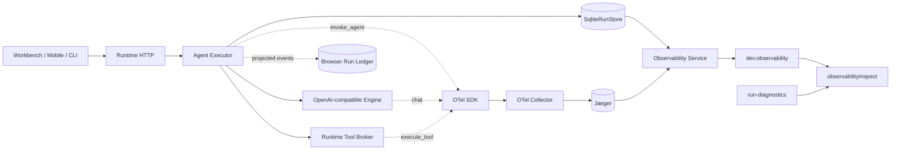

# Runtime OTel、Run Ledger 与 Agent 诊断能力评审

> Date: 2026-09-16
> Scope: `feature/core-observability` worktree 中的 Runtime RunStore、浏览器
> Run Ledger、OpenTelemetry、Collector/Jaeger、Observability Gateway、
> `dev.observability` Tool/Skill 及部署链路
> Method: 代码审查、契约核对、单元/集成测试、真实本地
> `Runtime -> Collector -> Jaeger -> Query API` smoke
> Conclusion: 架构方向正确，首个垂直切片可用于单用户近期 Run 的辅助诊断；
> 但当前还不是完整的“Run Ledger + Trace 联合诊断”，也不应被视为成熟的生产
> Observability 平台。

## 1. 结论摘要

当前最正确的决策不是某一个 Span，而是职责分层：

```text
Runtime SqliteRunStore
  = 执行事实、顺序、恢复、回放、Transcript、Checkpoint、Tool Receipt

Workbench Run Ledger
  = 浏览器侧有界索引和产品日志投影

OpenTelemetry
  = Attempt/模型/工具的时延和调用关系，可采样、可丢失

Runtime Observability Gateway
  = 将 Run 与 Trace 关联并输出脱敏、稳定、有限的诊断结果

dev.observability Tool + Skill
  = 让模型只消费诊断契约，不直接接触 Jaeger、TraceQL 或凭证
```

这一分层是合理的，尤其符合以下原则：

1. OTel 不接管 Run 状态、事务、恢复或 UI 投影。
2. 业务事实先写入 RunStore，再发布给消费者。
3. 遥测失败不改变 Run 结果。
4. 导出采用正向白名单，不采集 prompt、reasoning、工具参数和结果。
5. Agent 通过薄 Tool 和解释型 Skill 使用诊断能力，不直接获得 Backend 能力。

但当前对外宣称的能力比实现多了一层：

- Gateway 只读取 `RunRecord`，没有读取 `RunEvent`；
- 策略拒绝等重要事实虽然已进入 RunEvent 和 OTel root event，却没有进入诊断投影；
- `timeout`、`expired` 等契约状态没有完整实现；
- 当前只保存最新 Attempt 的 Trace 关联，恢复前的 Attempt 无法按 Run API 查询；
- `chat` Span 会包含异步生成器暂停期间的 RunEvent 持久化时间，不能直接解释为
  “模型服务耗时”；
- 线上部署材料仍使用无持久化 Jaeger、100% head sampling 和手工 Caddy 热补丁。

因此，当前成熟度应定义为：

| 维度 | 结论 |
|---|---|
| 架构方向 | 正确，可继续演进 |
| 代码可靠性 | 首个切片较扎实 |
| Agent 诊断准确性 | 可辅助判断，不能自动做完整根因分析 |
| 隐私设计 | 明显优于直接暴露 Jaeger/MCP |
| 多用户安全 | 尚未具备正式隔离模型 |
| 生产运维 | 临时验证级，不是持久化观测平台 |
| 发布成熟度 | 未形成可从 Git 完整复现的独立交付 |

一句话判断：

> 适合定位“最近一次已完成、已采样 Run 大致慢在模型还是某个工具”；不适合承诺
> “自动解释任意历史 Run 为什么失败、为什么慢”，更不能替代审计、指标告警或
> 分布式链路追踪平台。

## 2. 调研范围与验证结果

### 2.1 核心实现

- [`packages/runtime/src/agent-engine.ts`](../../packages/runtime/src/agent-engine.ts)
- [`packages/runtime/src/openai-compatible-engine.ts`](../../packages/runtime/src/openai-compatible-engine.ts)
- [`packages/runtime/src/telemetry.ts`](../../packages/runtime/src/telemetry.ts)
- [`apps/runtime/src/sqlite-run-store.mjs`](../../apps/runtime/src/sqlite-run-store.mjs)
- [`apps/runtime/src/runtime-tool-broker.mjs`](../../apps/runtime/src/runtime-tool-broker.mjs)
- [`apps/runtime/src/telemetry/bootstrap.mjs`](../../apps/runtime/src/telemetry/bootstrap.mjs)
- [`apps/runtime/src/telemetry/export-policy.mjs`](../../apps/runtime/src/telemetry/export-policy.mjs)
- [`apps/runtime/src/observability/`](../../apps/runtime/src/observability/)
- [`extensions/dev.observability/`](../../extensions/dev.observability/)
- [`src/core/run-ledger.ts`](../../src/core/run-ledger.ts)

### 2.2 验证结果

本次重新执行：

| 验证 | 结果 |
|---|---:|
| Runtime TypeScript build | 通过 |
| `packages/runtime` | 43 tests passed |
| `apps/runtime` | 370 tests passed |
| `packages/node-protocol` | 11 tests passed |
| `apps/device-connector` | 29 tests passed |
| 当前源码 compatibility tests | 13 tests passed |
| 当前源码合计 | 466 tests passed |
| `git diff --check` | 通过 |
| 本地 OTLP -> Collector -> Jaeger smoke | 通过 |
| Jaeger 中敏感样例字符串扫描 | 未发现 |

本次 smoke：

```text
runId:     run_mu488jv4_kzqms776
attemptId: attempt_mu488jv4_c560d0t5
traceId:   affedf1b838ba982678eb4977bef4b3f
spans:     chat -> execute_tool -> chat -> invoke_agent
```

Jaeger 返回同一 Trace ID 和 4 个预期 Span。prompt、测试路径、工具结果、
authorization、API key、password 未出现在查询 JSON 中。

当前机器没有可用的 Docker Compose CLI，因此没有重新验证
`deploy/otel-collector/compose.yaml` 的容器启动；本机已有的原生 Collector 和
Jaeger 链路可用。

### 2.3 性能复测

一次隔离的 1,000 delta 微基准结果：

| 模式 | startup | p50 Run | p95 Run | RSS |
|---|---:|---:|---:|---:|
| 未配置 SDK | 70.94 ms | 2.491 ms | 3.287 ms | 137.5 MiB |
| SDK 开启、Collector 不可达 | 1384.56 ms | 3.052 ms | 4.308 ms | 148.7 MiB |

这只是单次微基准，不足以用于容量结论；但它再次证明当前 3% 性能门禁没有通过。
以一个 2～3 ms 的纯内存 Run 为分母计算百分比也不合理。正式门禁应同时看：

- 每 Attempt 增加的绝对 CPU/墙钟时间；
- 真实 SQLite 和 SSE 下的 p95/p99；
- 并发 Run 的 event-loop lag；
- exporter queue 丢弃量；
- RSS 稳态和启动耗时；
- 正常 Collector、慢 Collector、不可达 Collector三种情况。

## 3. 实际数据流



需要避免一个术语误区：代码中有两个不同的“Ledger”。

| 组件 | 位置 | 性质 |
|---|---|---|
| Runtime RunStore | `apps/runtime/src/sqlite-run-store.mjs` | 服务端持久事实源 |
| Workbench Run Ledger | `src/core/run-ledger.ts` | 浏览器本地、有界、面向 UI 的索引 |

后续文档建议统一称前者为“Canonical Run Journal / Runtime RunStore”，后者为
“Client Run Index”。否则“Run Ledger 可审计、可恢复”会被误读为浏览器
`localStorage` 也具有同样保证。

## 4. 当前做得好的地方

### 4.1 RunStore 与 OTel 的职责没有混淆

Runtime 事件先在 SQLite 事务中追加并更新 Run 快照，再通知订阅者：

- 每 Run 严格递增 sequence；
- `runtime_run_events` 与 `runtime_runs` 在同一事务更新；
- WAL、`synchronous=FULL`、foreign key 和 busy timeout 已配置；
- 启动时会把失去 owner 的 active Run 标记为 interrupted；
- checkpoint、transcript、tool receipt、artifact、change set 各有专门存储。

OTel 只观察边界，不参与上述状态转移。即使 Collector 或 Jaeger 全部不可用，
Run 的执行、持久化和恢复仍成立。这是本方案最重要的优点。

### 4.2 Attempt 作为 Trace 边界是正确选择

一个 Run 可以恢复多次，而一个进程死亡前的 Span 不应跨进程继续保持打开。
当前实现：

- 每个 Attempt 新建一个 `invoke_agent` root trace；
- 恢复时用 SpanLink 关联前一个 Attempt；
- 当前 Attempt 的 trace/span/flags 作为非权威 metadata 写入 Run；
- 用户传入的 `metadata.zionTelemetry` 会先被删除，不能伪造关联；
- 无效或缺失旧 metadata 不阻断恢复。

这比“一条 Trace 横跨多个进程生命周期”可靠，也符合异步后台任务使用 link 而非
强行继承 parent 的思路。

### 4.3 Span 生命周期处理认真

当前实现覆盖了容易出错的边界：

- Attempt 在业务终态持久化后结束；
- 创建/追加持久化失败也会关闭 root Span；
- model stream 正常结束、HTTP 错误、解析错误、不完整 stream、取消、
  consumer 提前关闭、credential release 失败都有收尾；
- 异步生成器每次 `next`/`return` 都显式绑定 model Span context；
- 并发 Attempt 的上下文有测试验证；
- Tool Span 覆盖 receipt lookup、路由、执行、artifact enrichment 和 receipt
  persistence；
- receipt hit 与实际二次执行可区分；
- 未真正执行的 executor policy denial 不伪造成 Tool Host Span。

### 4.4 隐私策略是当前实现的强项

应用侧 `MetadataOnlyExporter` 不是对字段做模糊黑名单，而是重建一个只含允许
字段的新 Span：

- 仅允许 3 个固定 Span 名；
- 仅允许 `@zion/runtime` instrumentation scope；
- attributes、events、links、resource 分别做 allowlist；
- 删除 status message、exception body、tracestate、link attributes；
- 关闭 Resource 自动探测；
- 不启用自动 HTTP、日志和 metrics instrumentation。

Collector 又做了一次 attributes allowlist。该方向符合 OTel 对敏感数据最小化和
Collector 二次处理的建议：

- [OpenTelemetry: Handling sensitive data](https://opentelemetry.io/docs/security/handling-sensitive-data/)
- [OpenTelemetry: Collector configuration best practices](https://opentelemetry.io/docs/security/config-best-practices/)

### 4.5 Query Gateway 比模型直连 Jaeger 更合理

Gateway 有以下正确边界：

- 只接受 Run ID，不接受任意 TraceQL 或 Backend URL；
- Trace ID 来自服务端 Run metadata，不由调用者直接指定；
- Jaeger adapter 只访问固定 `/api/traces/{traceId}` 和 `/api/services`；
- Backend error body 不向上返回；
- 查询超时、响应大小、缓存条目数、输出 stage 数和 Tool 字符数都有上限；
- 原始 Span attributes/events/links/resource 不进入 Tool 输出；
- Tool 不返回外部 Trace URL；
- HTTP 深链接仅对 owner 级 `device.manage` 开放。

这使 Backend 可替换、模型权限可控、输出契约可测试。直接开放 Jaeger MCP 给普通
Agent 会绕过这些边界，当前没有这样做是正确的。

### 4.6 Plugin + Tool + Skill 的拆分合理

`dev.observability` 没有复制查询逻辑：

- Runtime Service 负责数据访问、关联、缓存和投影；
- Plugin 只注册 `observabilityInspect`；
- Tool 只接受明确 Run ID，并做会话/项目可见性检查；
- Skill 只约束使用流程和解释方式；
- 默认交互 Profile 只把它作为 read-only Tool；
- scheduled profile 不自动启用它。

这是可扩展的能力交付方式。未来增加 CLI、Workbench 按钮或 Mobile 摘要时可以复用
同一个诊断契约，不需要让每个端分别理解 Jaeger JSON。

这里需要进一步明确：**Tool 是核心能力，Skill 只是可选的解释说明**。
`run-diagnostics` 不会自动观察、调用或修复系统；`dev.skills.available` 只向模型
注入它的名称、描述和位置，模型判断相关后才会读取完整 `SKILL.md`。当前 Skill
相对简单的一次 Tool 调用偏长，且包含尚未由 Tool 提供的 RunEvent/状态能力，
应在 P0 中缩短为解释护栏。安全、脱敏、权限和正确性必须全部由 Tool/Gateway
代码保证，不能依赖模型遵循 Skill。

Observability 插件也不应增加修复或部署 Tool。它只提供结构化证据；后续修改、
测试和发布由调用方模型组合已有工程工具完成。具体收敛方案见
[Runtime OTel P0 修复方案](./RUNTIME-OTEL-P0-FIX-PLAN-20260916.md)。

## 5. 主要问题与风险

### P0-1：当前并不是真正的 Run Ledger + Trace 联合诊断

`RuntimeObservabilityService.diagnoseRun()` 只调用 `runs.get()`，没有调用
`runs.getEvents()`。`source.runLedger=true` 实际只表示读取了一个 RunRecord
终态，不代表读取了事件账本。

直接后果：

- 看不到 `tool.requested -> tool.denied` 的事实顺序；
- 看不到 `context.failed`；
- 看不到 checkpoint 和 attempt 切换；
- 看不到业务事件上的工具错误摘要；
- Trace 不可用时，只能返回状态和总时长，连 RunRecord 的
  `terminalReason`、`error`、`usage` 都没有投影；
- Skill 第 7 步要求“结合 Run Ledger events”，但 Tool 没有提供这些事实。

更具体地说，executor policy denial 只写为 root Span event `tool.denied`，而
`run-diagnostic-projector.mjs` 只读取 Jaeger span tags，不读取 span logs/events。
因此 Skill 声称可以区分 policy denial，但主要拒绝路径上做不到。

建议：

1. 新增纯函数 `projectRunFacts(run, events)`。
2. Gateway 同时读取 `runs.get(runId)` 与 `runs.getEvents(runId)`。
3. 只投影安全事件类型和字段，不返回 prompt、delta、参数或结果。
4. 输出 `ledger`：

```ts
{
  status,
  terminalReason,
  errorClass,
  attemptCount,
  lastSequence,
  modelUsage,
  toolSummary,
  policyDenials,
  contextFailures
}
```

5. `source` 改成 `{ runRecord: true, runEvents: true, trace: boolean }`，避免继续
   用模糊的 `runLedger` 布尔值。

### P0-2：`chat` Span 的总时长不能直接等同于模型耗时

`OpenAICompatibleEngine.streamTurn()` 在异步生成器外层打开 `chat` Span，然后
逐项 `yield` 给 Agent Executor。每次 yield 后，Executor 会等待
`runs.append()` 持久化 `model.request`、`message.delta`、`reasoning.delta` 和
`model.usage`，之后才拉取下一项。

因此 `chat` Span 的 wall time 包含：

```text
模型/网络时间
+ credential acquire/release
+ SSE 解析
+ 每次 yield 后的调用方等待
+ 每个 delta 的 SQLite FULL 事务
+ 其他 consumer backpressure
```

诊断投影现在把整个 `chat` Span 标记为 `kind=model`，并用它判断
`dominant_stage`。当 SQLite 或消费方变慢时，系统可能错误地告诉用户
“模型阶段主导”。

TTFC 属性相对可信，因为它从 transport 发起到首个解析 chunk 计算；但总
`chat.duration` 不是纯 provider latency。

最小修正：

- 立即把文案从“模型耗时”改为“模型调用链 wall time”；
- 增加 `zion.model.consumer_wait.duration`，累计每次 yield 到 resume 的时间；
- 在诊断中展示 `observedProviderMs = chat.duration - consumerWaitMs`，并标注为估算。

更彻底的修正：

- 用有界内部队列将响应读取与 RunEvent 消费解耦；
- 让 provider/transport Span 在响应真正读完时结束；
- 单独观测事件持久化或 projection backpressure。

### P0-3：仓库中的生产部署不是可复现配置

当前 OTel 核心文件和测试仍是 untracked，大量相关修改也未提交。线上部署记录明确
来自 worktree 快照，而不是某个可重建 commit。

同时，访问设计要求 `configure-runtime-deployment.mjs` 生成：

```text
/observability/*
  -> forward_auth
  -> strip Cookie/Authorization
  -> Jaeger
```

但当前生成器仍只输出一个通用 `reverse_proxy 127.0.0.1:8766`。现有 Jaeger
路由依赖服务器手工热补丁或临时部署脚本，下一次运行正式配置脚本可能覆盖它。

建议在继续功能扩展前先完成：

1. 把 OTel、Gateway、插件、Skill、测试和运维配置形成独立 commit；
2. 把 Caddy observability route 纳入
   `scripts/configure-runtime-deployment.mjs`；
3. 为生成的 Caddyfile 增加 snapshot/behavior test；
4. 将生产发布 manifest 记录为 commit SHA + artifact digest，而不是
   “某个 dirty worktree 的快照”。

### P0-4：当前 ECS 形态是短期调试栈，不是持久生产后端

仓库中的 compose：

- 使用单进程 Jaeger；
- 没有配置持久存储或 volume；
- 没有 retention；
- 没有 backend backup；
- Collector debug exporter 仍启用；
- Collector 自身 metrics 只监听容器内 `127.0.0.1:18888`，没有实际监控；
- 没有 healthcheck；
- 没有 exporter queue/drop 告警。

现有 post-deploy 脚本还把生产 head sampling 设置为 `1`，而当前性能门禁明确未
通过。官方 Jaeger 文档也明确指出 all-in-one + memory 适合开发测试，重启会丢失
数据：

- [Jaeger v2 architecture](https://www.jaegertracing.io/docs/2.20/architecture/)

对当前单用户、低流量、近期调试用途，这可以作为明确标注的临时方案；如果要称为
生产 observability，至少要二选一：

- 单机低流量：Jaeger + 持久 Badger/受支持存储，明确容量与备份；
- 正式环境：外部 Tempo/Jaeger storage/vendor backend，明确 retention。

### P1-1：诊断状态契约与实现不一致

当前存在以下偏差：

| 契约/文档 | 实际实现 |
|---|---|
| `expired` | 从未产生 |
| timeout outcome | `aborted + terminalReason=timeout` 被投影为 `cancelled` |
| 默认只返回 summary | HTTP handler 默认包含 stages 和 findings |
| policy denial 可区分 | root span event 和 RunEvent 都未读取 |
| Backend query 有最大 Span 数 200 | 只限制原始响应 1 MiB，未限制输入 Span 数 |
| stage 最多 20 | 会静默截断，不返回 total/truncated |
| not-found 表示无保留 Trace | 同时可能是刚结束尚未索引、export 丢失、Collector 故障、过期 |

建议先缩小并诚实定义状态：

```text
active
pending-index
ready
unsampled
trace-missing
query-backend-unavailable
telemetry-disabled
```

只有 Backend 能提供 retention 边界，或 Runtime 配置了可信 retention 并能根据
Attempt 时间判断时，才返回 `expired`。

### P1-2：只保存最新 Attempt 关联

`RunRecord.metadata.zionTelemetry` 在 resume 时被新 Attempt 覆盖。虽然 Trace
之间有 SpanLink，Gateway 仍只能从 RunStore 找到最新 Trace ID。

后果：

- API/Tool 不能选择历史 Attempt；
- 第一次失败、第二次恢复成功后，失败 Trace 从产品入口消失；
- 用户不能比较同一 Run 的多个 Attempt；
- Jaeger 中虽然可以按 `zion.run.id` 搜索，普通 Agent 不具备该查询能力。

建议增加有界 Attempt correlation 索引：

```ts
type RunAttemptCorrelation = {
  attemptId: string;
  traceId: string;
  spanId: string;
  sampled: boolean;
  startedAt: number;
  completedAt?: number;
}
```

Gateway 默认诊断最新 Attempt，同时允许显式 `attempt_id`；Run 级摘要应显示
Attempt 数和恢复链。

### P1-3：健康状态只覆盖 Jaeger Query，不覆盖导出链路

`GET /v1/observability/status` 实际只调用 Jaeger `/api/services`。它无法回答：

- Runtime SDK 是否已启用；
- Runtime 到 Collector 是否可达；
- exporter queue 是否溢出；
- Collector 是否拒绝或丢弃 Span；
- Collector 到 Jaeger 是否成功；
- 最近一次成功导出是什么时候。

因此 `available=true` 只能解释为“Jaeger Query 可访问”，不能解释为
“Telemetry pipeline 健康”。

建议返回分层状态：

```ts
{
  emission: { enabled, sampledRatio, lastSuccessAt, lastFailureAt, droppedSpans },
  collector: { reachable, queueUtilization, refusedSpans },
  query: { backend, reachable, lastSuccessAt },
  retention: { mode, expectedWindowMs }
}
```

应用进程不应同步探测 Collector；可以由 exporter 回调维护有界内存状态，Collector
指标由运维抓取后再聚合。

### P1-4：查询边界有上限，但内存和并发仍不够严格

当前 `boundedJson()` 在无 `Content-Length` 时会先 `response.text()` 读完整响应，
再检查 1 MiB，不能真正限制峰值内存。

另外：

- cache 保存 raw Trace，不是小型诊断结果；
- 100 条、每条最多 1 MiB 的 JSON 在解析后可能明显超过 100 MiB heap；
- HTTP endpoint 没有 rate limit 或并发上限；
- not-found 和 Backend failure 不缓存，重复请求会直接打到 Jaeger；
- 没有显式限制 Backend 返回的 Span 数。

建议：

1. 流式读取 response body，超过字节上限立即 abort；
2. 在解析后限制 Span 数；
3. 缓存版本化的 sanitized projection，而不是 raw Trace；
4. 以总字节数而非条目数限制缓存；
5. 增加按 principal + Run ID 的并发合并、短期负缓存和速率限制。

### P1-5：权限模型适合 single-space，不适合多用户

当前边界：

- HTTP diagnostics 只要求服务级 `runtime.read`，可读取任意已知 Run ID；
- Tool 额外要求目标 Run 与当前 run/session/project 至少一个匹配；
- external URL 要求 `device.manage`。

这对当前单空间部署可以接受，但不是对象级 ACL。另一个基础问题是 Plugin
manifest 的 `requiredScopes` 目前只被规范化和展示，Runtime Plugin invoke 并未
执行这些 scope。

多用户前必须：

1. 引入统一 `RunVisibilityResolver(principal, run)`；
2. HTTP 和 Tool 调用同一个 resolver；
3. 在 Runtime Plugin Host 强制执行 `requiredScopes`；
4. 增加独立 `observability.read`，不再借用 `device.manage`；
5. 审计跨 Run 查询和外部 Trace 链接访问，但不写回被查询 Run 的 RunEvent。

### P1-6：Agent 输出仍包含不必要的内部关联 ID

Tool 返回 `runId`、`attemptId` 和 `traceId`。Tool 结果会进入后续模型上下文，
因此这些内部标识符可能被发送给外部模型提供方。

它们不是凭证，但对自然语言诊断不是必需字段。建议区分两个 DTO：

- Operator/API projection：保留 correlation 和 external URL；
- Agent projection：默认移除 traceId/spanId/service instance，只保留 Run ID、
  Attempt 序号和诊断事实。

### P1-7：Skill 的可用性与 Tool 的注册状态可能脱节

当 Query Backend 未配置时，Runtime Plugin 不注册 `observabilityInspect`；
但插件 manifest 仍声明 `run-diagnostics`，`dev.skills` 会按 manifest 物化该
Skill。结果可能是模型看到一个要求调用不存在 Tool 的 Skill。

建议：

- 最优：Gateway 即使没有 Trace Backend，也注册 Tool，并返回真实 RunEvent
  fallback；
- 或者：Skill catalog 支持 capability availability，Tool 未注册时隐藏/禁用 Skill；
- Skill 中应允许使用当前 Run 上下文自动解析目标，而不是要求用户复制不可见的 ID。

### P2-1：当前仍不是分布式追踪

W3C propagator 已配置，但没有 HTTP server/client 自动埋点，也没有在 Node Broker
命令中 inject、在 Device Connector 中 extract。

当前只能看到 Runtime 进程内：

```text
invoke_agent
├── chat
├── execute_tool
└── chat
```

远端 Tool 只表现为一个总 `execute_tool` wall time，无法拆分：

```text
策略 -> 路由 -> 排队 -> command delivery -> 远端执行
     -> result upload/retry -> receipt persistence
```

所以现在不能判断是设备离线、队列等待、网络、远端命令、上传重试还是 Runtime
落库慢。

### P2-2：还没有聚合可观测性

当前只实现 traces，没有业务 metrics、dashboard、alert 和结构化日志关联。
它适合查一个已知 Run，不适合回答：

- 最近一小时失败率是否上升；
- 哪个模型的 p95 TTFC 最差；
- 哪个 Tool/Node 最慢；
- 某版本发布后是否回归；
- Collector 是否正在丢 Span；
- Session projection 是否持续积压。

OpenTelemetry JavaScript 当前 traces/metrics 已稳定，logs 仍是 Development，
所以“先上 traces，暂缓 OTel Logs”的选择合理；下一阶段应优先 metrics，而不是
继续扩充单 Trace 规则：

- [OpenTelemetry JavaScript status](https://opentelemetry.io/docs/languages/js/)
- [OpenTelemetry sampling](https://opentelemetry.io/docs/concepts/sampling/)

### P2-3：GenAI 语义需要显式版本化

当前字段与最新 GenAI 约定大体一致，但该约定仍是 Development。还存在有意或无意
的差异：

- 官方推荐 `chat {model}`，当前固定为 `chat`；
- 官方推荐 `execute_tool {tool}`，当前固定为 `execute_tool`；
- projector 按 operation name 判断 stage，而不是按
  `gen_ai.operation.name`；
- 异常结束时没有写 `gen_ai.response.finish_reasons=["error"]`；
- providerId 直接作为 `gen_ai.provider.name`，不保证是官方枚举语义；
- 部分合法模型标识会因当前 identifier 正则而退化为 `unknown`。

固定 Span 名有控制基数和稳定查询的好处，可以保留；但应明确它是 Zion profile，
并增加：

```text
zion.telemetry.schema.version
zion.gen_ai.semconv.version
```

projector 优先按 `gen_ai.operation.name` 识别，Span name 只作为兼容回退。

参考：

- [OpenTelemetry GenAI semantic conventions](https://github.com/open-telemetry/semantic-conventions-genai/tree/main/docs/gen-ai)
- [GenAI model spans](https://github.com/open-telemetry/semantic-conventions-genai/blob/main/docs/gen-ai/gen-ai-spans.md)
- [GenAI agent spans](https://github.com/open-telemetry/semantic-conventions-genai/blob/main/docs/gen-ai/gen-ai-agent-spans.md)

## 6. 当前能做什么

### 6.1 RunStore / RunEvent

- 持久保存 Run、Attempt、事件顺序、输出、usage、Transcript 和 checkpoint；
- 在进程重启后识别并中断失去 owner 的 Run；
- 从 checkpoint 恢复同一 Run 的新 Attempt；
- 用 tool receipt 避免同一 invocation 的重复副作用；
- 保存 artifact/change set；
- 为 Workbench、Mobile 和 CLI 提供回放基础。

### 6.2 OTel / Jaeger

- 查看已完成且已采样的最新 Attempt；
- 查看模型调用与实际 Tool 执行的先后关系；
- 查看 Attempt、`chat`、`execute_tool` 的 wall time；
- 查看模型 TTFC、input/output/reasoning token；
- 查看 Tool host kind、receipt hit、成功/失败；
- 区分一般取消与 timeout 的 Span 属性；
- 发现 RunStore 终态与 Trace root 终态不一致；
- 从 Run ID 定位最新 Trace；
- 在 Owner 权限下跳到完整 Jaeger UI。

### 6.3 Agent Tool / Skill

- 在当前 Run、同 Session 或同 Project 边界内诊断一个明确 Run ID；
- 得到最多 20 个脱敏 stage 和最多 10 个确定性 finding；
- 对 sampled、unsampled、active、backend unavailable 做基本降级；
- 不接触原始 prompt、reasoning、工具参数、工具结果或 Backend 凭证；
- 让模型把结构化事实解释成用户可读结论。

## 7. 当前做不了什么

### 7.1 无法可靠回答的根因问题

- “模型为什么慢”：只能看到 TTFC 和混有 consumer/persistence wait 的 wall time；
- “为什么 429/401/5xx”：HTTP status 在 Trace 中，但 Agent projection 没有返回；
- “为什么工具被拒绝”：主要 policy denial 路径没有进入 projection；
- “为什么 Runtime 空转”：Context、SQLite、projection 没有独立 Span；
- “为什么远端工具慢”：Node/Device 子阶段未埋点；
- “为什么界面晚出现/顺序错”：浏览器、Yjs 和文档投影未埋点；
- “为什么这次和上次不同”：没有 Run 列表、Attempt 历史或聚合比较 API。

### 7.2 无法提供的平台能力

- 不能对未采样 Trace 做时延分析；
- 不能保证刚结束的 Trace 已索引；
- 不能区分过期、导出丢失和 Backend 尚未最终一致；
- 不能在 Jaeger 重启后保留当前 memory storage 中的数据；
- 不能做 SLI/SLO、趋势、分位数和告警；
- 不能做日志到 Trace 的关联；
- 不能作为合规审计；
- 不能分析模型回答质量、幻觉或任务语义正确性；
- 不能自动修复、重试或恢复 Run；
- 不能安全开放任意 TraceQL 或 Jaeger MCP 给普通 Agent。

### 7.3 产品入口限制

- Workbench 没有诊断按钮或摘要面板；
- Mobile 没有诊断摘要；
- CLI 没有 `zion run diagnose`；
- 用户通常看不到可复制的 Run ID，只能在 Run 日志 title tooltip 或开发接口中找；
- 当前 Run 尚未完成时，Tool 只能返回 `active`，不能自诊断完整 Trace；
- Query Backend 未配置时 Tool 不注册，但 Skill 仍可能被发现。

## 8. 推荐目标架构

不要改动“RunStore 权威、OTel 非权威”的基本方向。建议把 Gateway 明确拆成四个
可测试层：

```text
RunFactReader
  读取 RunRecord + allowlisted RunEvents + Attempt correlations

TraceReader
  只负责 Backend 查询和原始响应边界

DiagnosticProjector
  合并 Run facts + trace facts，输出版本化 DTO

DiagnosticPolicy
  统一 HTTP/Tool 的 visibility、字段级 projection、限流和审计
```

建议结果契约：

```ts
type RunDiagnosticSummaryV2 = {
  schemaVersion: 2;
  runId: string;
  attempt: {
    attemptId: string;
    index: number;
    sampled: boolean;
  };
  availability:
    | "active"
    | "pending-index"
    | "ready"
    | "unsampled"
    | "trace-missing"
    | "query-backend-unavailable"
    | "telemetry-disabled";
  sources: {
    runRecord: true;
    runEvents: boolean;
    trace: boolean;
  };
  ledger: {
    status: string;
    terminalReason?: string;
    errorClass?: string;
    eventCount: number;
    lastSequence: number;
    usage?: object;
    tools?: object[];
    policyDenials?: object[];
    contextFailures?: object[];
  };
  trace?: {
    totalMs: number;
    coveredMs: number;
    unattributedMs: number;
    largestSpan?: object;
    aggregateByKind?: object;
    stages?: object[];
  };
  findings: object[];
  limitations: string[];
}
```

核心规则：

1. RunStore 决定 status、sequence、terminal reason 和业务错误。
2. Trace 决定 operation wall time、父子关系和跨服务路径。
3. 两者不一致时报告 data-quality finding，不让 Trace 覆盖 RunStore。
4. “最大单 Span”和“按类别累计耗时”分别计算，不混称 bottleneck。
5. 每个截断都返回 `totalCount` 和 `truncated=true`。
6. Agent DTO 默认不带 Trace ID。

## 9. 分阶段改进建议

### P0：先修诊断正确性和部署可复现性

预计是小范围、低风险改动，不需要重做架构。

1. Gateway 读取并脱敏投影 RunEvents。
2. 解析 OTel root events，补齐 policy denial 和 checkpoint。
3. 修正 timeout outcome；删除未实现的 `expired`，或真正实现。
4. 将 `not-found` 拆为 recent `pending-index` 与长期 `trace-missing`。
5. 修正文案，不再把 `chat.duration` 直接称为纯模型耗时。
6. API 默认只返回 summary；显式 `include=stages,findings` 才扩展。
7. 返回 stage/findings 的 total 和 truncated 状态。
8. 把 Caddy observability route 纳入正式配置生成器和测试。
9. 提交所有 OTel 相关源码、配置、测试和文档，形成可重现发布。

### P1：提升可用性和生产可靠性

1. 保存有界的每 Attempt correlation 历史。
2. 为终态 Trace 增加 1～3 秒有界重试或 `pending-index`。
3. 缓存 sanitized projection，不缓存 raw 1 MiB Trace。
4. 增加流式响应字节上限、Span 数上限、并发合并和 rate limit。
5. 分离 emission、Collector、query backend 三类健康状态。
6. 增加 Collector queue/refused/export 指标和告警。
7. 去掉生产 debug exporter。
8. 将 Jaeger 切换到明确的持久化存储和 retention。
9. 为 Agent 输出移除不必要的 trace/attempt 内部 ID。
10. Query Backend 不可用时提供 RunEvent-only Tool，或同步隐藏 Skill。
11. 增加 `zion run diagnose`，并在 Run 日志提供复制 Run ID/诊断入口。

### P2：补齐真正端到端观测

1. Context Provider spans。
2. Run event persistence、checkpoint 和 transcript persistence 的聚合耗时。
3. Session/Yjs/document projection linked spans 和 lag metrics。
4. Node Broker -> Device Connector W3C context propagation。
5. route、queue、delivery、remote execute、upload retry、receipt persistence 子阶段。
6. GenAI、Run、Tool、Device、projection 的低基数 metrics。
7. Dashboard、SLO、release marker 和告警。
8. 结构化日志增加 trace/run/attempt 关联；继续暂缓 OTel Logs signal。
9. 版本化 GenAI semantic mapping 和迁移测试。

## 10. 建议验收矩阵

| Case | RunStore 事实 | Trace 事实 | Agent 应得结论 |
|---|---|---|---|
| 正常模型 Run | completed | model span | 模型调用链耗时和 TTFC |
| 模型 429 | failed + error class | HTTP 429 + model error | 提供方限流，不归因于 Tool |
| Tool 返回 `ok=false` | tool.completed | tool_result_error | Tool 业务失败 |
| Tool 抛异常 | tool.completed/error | tool_error | Tool 执行异常 |
| Policy deny | tool.denied | root event | 策略拒绝，不是基础设施失败 |
| 用户取消 | aborted/user | cancelled | 用户取消 |
| Timeout | aborted/timeout | timeout | 超时，不显示为普通取消 |
| Collector down | Run 正常终结 | 无 Trace | Run 成功，遥测链路异常 |
| Unsampled | Run 正常终结 | traceFlags=0 | 仅使用 Run facts |
| 刚结束未索引 | terminal | 暂时 404 | pending-index，可重试 |
| 超过保留期 | terminal/old | 后端无数据 | 只有已知 retention 时标 expired |
| Resume | 多 Attempt | 多 Trace + links | 可选择并比较每个 Attempt |
| Remote Tool | tool event | Runtime + Device spans | 拆分队列、网络、执行和回传 |
| Projection 慢 | Run completed | linked projection span | 不误归因为模型慢 |

每个 Case 都应同时断言：

- Run 业务结果不受 telemetry 故障影响；
- Tool/API 不返回敏感内容；
- Agent 不把“未知”表述为“正常”；
- stage 缺失会进入 limitations；
- 采样、缓存和截断状态对调用者可见。

## 11. 最终判断

### 应保留

- RunStore 与 OTel 双轨但职责分离；
- 一 Attempt 一 Trace，resume 使用 SpanLink；
- SDK 在应用层配置、Runtime package 仅依赖 OTel API；
- 手工语义 Span，不对 token/delta 建 Span；
- metadata-only、双层 allowlist；
- Runtime Query Gateway；
- 薄插件 + read-only Tool + Skill；
- Jaeger/MCP 不直接暴露给普通 Agent；
- loopback OTLP/Jaeger 端口和 Owner-only Web 入口。

### 应立即修正

- “Run Ledger + Trace”名不副实；
- policy denial、timeout、expired、pending-index 契约缺口；
- `chat.duration` 的归因口径；
- dirty worktree 和手工 Caddy 配置造成的不可复现发布；
- production 脚本使用 100% sampling 与 memory Jaeger；
- Gateway raw Trace 缓存和缺少 rate/concurrency limit。

### 暂时不要做

- 不要用 OTel 替换 RunStore；
- 不要把 prompt、reasoning、工具参数或结果写入 Trace；
- 不要为每个 token、SSE frame 或轮询建 Span；
- 不要把 Jaeger MCP 直接加入普通 Profile；
- 不要先造 Workbench Trace 瀑布图；
- 不要在没有 metrics 和 retention 前宣称生产观测闭环。

当前最有价值的下一步不是增加更多 Span，而是先让现有诊断结果“事实完整、口径准确、
状态诚实、部署可复现”。完成 P0 后，这套方案可以从“可用原型”升级为可信的
单 Run 诊断能力；完成 P1/P2 后，才具备真正的生产可观测性和 Agent 自助诊断价值。
