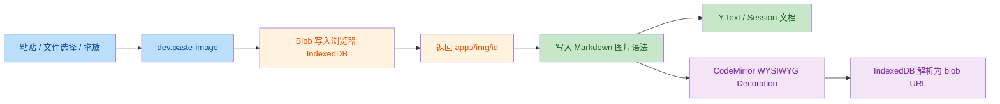
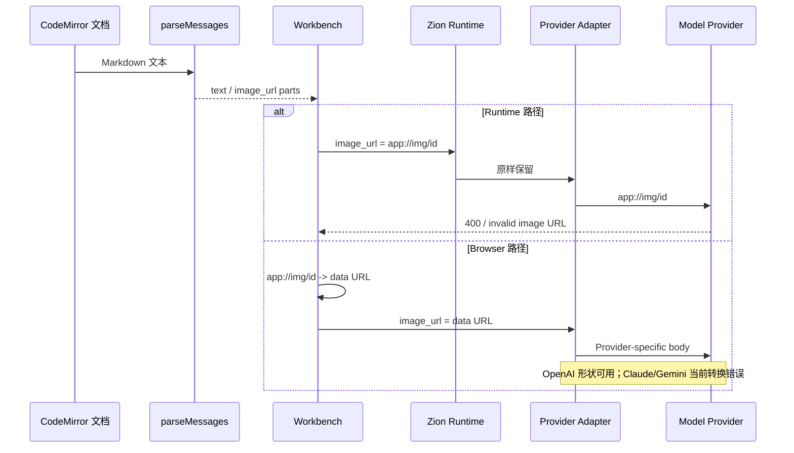

# Workbench CodeMirror 对话编辑器与图片链路评审

日期：2026-09-19

研究基线：`feature/core-observability`，HEAD `db361e1c` 加当前工作区改动。

范围：桌面 Workbench 的 CodeMirror 对话文档、图片导入与交互、Prompt 编译、Browser/Runtime 执行分流、Provider 多模态格式、Session 持久化与测试覆盖。

性质：代码审计与方案建议。本轮未修改产品实现。

关系：这是对 [2026-09-16 对话编辑器综合评审](./WORKBENCH-CONVERSATION-EDITOR-EXPERIENCE-AND-MODULARITY-REVIEW-20260916.md) 的图片专项复核，结论以 2026-09-19 当前工作区为准。图片、音频、视频及未来二进制输入的目标存储和执行边界见 [对话多模态资产架构](./CONVERSATION-MULTIMODAL-ASSET-ARCHITECTURE-20260919.md)。

## 1. 结论

**CodeMirror 不是当前问题的根因，也没有理由替换。**

当前产品最有价值的能力仍然是：一份可编辑 Markdown 文档同时承载用户输入、模型回答、思考/工具 marker 和下一轮上下文。CodeMirror 的事务、选区、Decoration、Yjs binding 都适合这个模型。

图片问题来自另一个边界：

> 同一个 `` 同时被当作可视 Markdown、浏览器本地资产引用、模型 `image_url` 和 Session 可移植内容，但系统没有一个统一的 Attachment 语义层负责这些转换。

这使“编辑器里能看到图片”与下面四件事相互独立：

1. Prompt Compiler 是否把它识别为图片；
2. 当前模型是否支持图片；
3. Runtime 或外部 Harness 是否能读取图片字节；
4. Provider adapter 是否生成正确的供应商协议。

当前四项均有明确缺口。用户观察到的“有图片时发起对话容易失败”并非单一正则 Bug，而是多条失败路径叠加：

- Runtime 会把只在浏览器 IndexedDB 中有效的 `app://img/...` 原样发给 Provider；
- Runtime 不执行 `supportsImage` capability admission；
- Claude 与 Gemini 的 Browser adapter 生成了错误的图片内容格式；
- 文档渲染和 Prompt 编译使用不同图片语法，行内图、缩进图、代码围栏和 assistant 图片的语义不一致；
- 图片仍在导入或导入失败时，发送操作不会等待或阻断。

本轮识别 9 项 P1 行为缺陷和 2 项 P2 风险/测试缺口。最优先的不是继续润色图片 Widget，而是先建立一条可验证的：

```text
Image Asset -> Conversation Part -> Runner Capability -> Provider Payload
```

## 2. 当前实现

### 2.1 图片插入与展示



关键实现：

- [图片导入插件](../../extensions/dev.paste-image/main.js#L12-L95) 从 clipboard/file/drop 取得图片。
- [本地图片资产库](../../src/media/image-assets.ts#L49-L65) 使用固定的浏览器 IndexedDB。
- [图片资产写入](../../src/media/image-assets.ts#L109-L140) 返回 `app://img/<id>`。
- [图片事务](../../src/editor/image-transactions.ts#L237-L325) 在异步导入完成后写 Markdown。
- [图片模型](../../src/editor/image-model.ts#L22-L128) 区分 inline、solo 和 gallery。
- [WYSIWYG 图片 Widget](../../src/editor/wysiwyg.ts#L1185-L1455) 将 Markdown 替换为图片、gallery 和拖拽交互。
- [图片增强插件](../../extensions/dev.image-enhanced/main.js#L839-L1004) 提供预览、复制、下载和删除。

这个设计有三个合理基础：

- 图片字节没有直接写入 Y.Text，避免每次协作更新携带大段 base64；
- 导入期间使用 transient Decoration，未完成内容不会提前污染文档；
- inline、solo、gallery 已经有独立展示密度和拖放目标。

问题是 `app://img/<id>` 只是一个浏览器本地句柄，不是 Runtime、其他设备、归档或 Provider 可解析的资产引用。

### 2.2 对话发送链路



提交入口从光标所在行末之前的文档调用 [parseMessages](../../extensions/dev.langchain-chat/main.js#L2037-L2047)，随后优先尝试 Runtime。

Runtime 分支：

1. [Runtime eligibility](../../extensions/dev.langchain-chat/runtime-backend.js#L276-L317) 只检查 `image_url.url` 是非空字符串；
2. [消息准备](../../extensions/dev.langchain-chat/runtime-backend.js#L430-L457) 不解析浏览器资产；
3. [Run 请求](../../extensions/dev.langchain-chat/runtime-backend.js#L728-L827) 原样复制 `message.content`；
4. [Runtime 规范化](../../apps/runtime/src/server.mjs#L194-L229) 继续原样保留 URL；
5. [OpenAI-compatible engine](../../packages/runtime/src/openai-compatible-engine.ts#L393-L456) 最终将其序列化给 Provider。

Browser 分支则在 [chat-service.js](../../extensions/dev.langchain-chat/chat-service.js#L1154-L1173) 中读取当前浏览器 IndexedDB，把 `app://` 展开为 data URL。两条路径因此具有不同语义。

## 3. 已确认问题

| ID | 严重度 | 问题 | 直接后果 | 置信度 |
| --- | --- | --- | --- | --- |
| IMG-01 | P1 | Runtime 透传 `app://img` | 本地图片进入 Runtime 后 Provider 无法读取 | 高，2/2 复核 |
| IMG-02 | P1 | 图片能力只展示、不准入 | 不支持图片的模型仍收到图片请求并晚失败 | 高，2/2 复核 |
| IMG-03 | P1 | Claude/Gemini 图片协议错误 | Browser fallback 对两类 Provider 仍可稳定失败 | 高，2/2 复核 |
| IMG-04 | P1 | 显示语法与 Prompt 语法分裂 | 用户看到图片，但模型收到 Markdown 文本或错误图片 | 高，2/2 复核 |
| IMG-05 | P1 | 图片顺序和角色语义被改写 | 图文对应关系变化；assistant 图片可使请求形状非法 | 高，2/2 复核 |
| IMG-06 | P1 | 异步插入锚点扩张 | 上传期间同位置输入的文字会被图片完成事务删除 | 高，2/2 复核及探针 |
| IMG-07 | P1 | pending/error 不参与发送门禁 | 快速发送时图片被静默遗漏 | 高，2/2 复核 |
| IMG-08 | P1 | 绝对坐标过期和多实例共享状态 | 删除图片可能删除错误正文或使用另一面板坐标 | 高，2/2 复核 |
| IMG-09 | P1 | 图片资产不可迁移 | 跨设备、清站点数据和 Session 导入后图片失效 | 高，2/2 复核 |
| IMG-10 | P2 | 无大小、类型、尺寸和压缩策略 | 大图延迟/内存不可控；朴素内联会撞 1 MiB 限制 | 高，2/2 复核 |
| IMG-11 | P2 | 测试只覆盖分层 happy path | 所有跨边界问题都能在测试全绿时存在 | 高，2/2 复核 |

### 3.1 IMG-01：Runtime 无法解析浏览器本地资产

本地图片写入 IndexedDB 后，文档只保存 `app://img/<id>`。[readImageAssetDataUrl](../../src/media/image-assets.ts#L156-L165) 是唯一能从该引用取回字节的实现，它依赖浏览器 `indexedDB` 和 `FileReader`。

Browser 路径显式调用了这个 resolver：

```text
app://img/id
  -> readImageAssetDataUrl()
  -> data:image/png;base64,...
  -> OpenAI image_url
```

Runtime 路径没有调用 resolver，却把任意非空 URL 判定为支持并原样传输。服务端既没有该 IndexedDB，也没有 `app://` protocol handler。Provider 最终看到的是内部 URI。

这是当前最符合“带图片发起对话失败”现象的主因。

不建议用“在 Workbench 中展开 data URL 后塞进 `/v1/runs`”作为最终修复。Runtime 默认 JSON 请求限制为 1 MiB，[配置入口](../../apps/runtime/src/main.mjs#L435-L440)；普通截图经过 base64 后很容易超过这个限制。

### 3.2 IMG-02：`supportsImage` 没有成为执行约束

模型 profile 保存了 `capabilities.supportsImage`，例如内置 DeepSeek profile 明确为 false。[model-registry.mjs](../../apps/runtime/src/model-registry.mjs#L3-L49)

但：

- `ModelRef` 只有 profile/provider/model/label，没有执行能力；
- Runtime admission 没有扫描消息中的图片并校验 profile；
- Agent Engine 和 OpenAI-compatible Engine 不消费该能力；
- Workbench Runtime eligibility 也没有接收当前模型能力。

因此 capability 目前只是模型切换器中的展示信息。它不满足项目已经确立的原则：

> Runner 不满足 required capability 时必须明确拒绝或显式降级。

正确行为应在 Run 受理前返回结构化错误，例如：

```text
CAPABILITY_UNSUPPORTED
required: ["image-input"]
runnerProfileId: "..."
modelProfileId: "..."
```

不能等 Provider 返回模糊的 HTTP 400，也不能把图片静默转换成 `[image:app://...]` 文本。

### 3.3 IMG-03：Claude 与 Gemini Browser adapter 格式不正确

Browser 路径会先把本地资产转为 data URL，但后续 Provider 转换仍有问题。

Claude 分支只移除 system message、转换 tools，没有转换图片 block。[Claude body](../../extensions/dev.langchain-chat/chat-service.js#L163-L195) 仍保留：

```json
{
  "type": "image_url",
  "image_url": { "url": "data:image/png;base64,..." }
}
```

Anthropic Messages API 要求 `type: "image"` 和 `source: { type, media_type, data/url/file_id }`。官方参考：[Claude Vision](https://platform.claude.com/docs/en/build-with-claude/vision)。

Gemini 分支当前生成：

```json
{
  "inlineData": {
    "mimeType": "image/jpeg",
    "data": "data:image/png;base64,AAAA"
  }
}
```

[当前转换](../../extensions/dev.langchain-chat/chat-service.js#L33-L58) 同时存在两个问题：

- `mimeType` 固定为 JPEG，不读取实际 data URL/Blob 类型；
- `inlineData.data` 收到完整 data URL 或 HTTP URL，而不是纯 base64 字节。

Gemini 的 `inlineData` 要求真实 MIME 和纯 base64 data；远端 URI 应使用对应 file data 能力或先读取字节。官方参考：[Gemini Generate Content](https://docs.cloud.google.com/gemini-enterprise-agent-platform/reference/models/inference)。

本轮函数探针直接得到：

```text
claude.content = [{type:"image_url", image_url:{url:"data:image/png;base64,AAAA"}}, ...]
gemini.inlineData = {mimeType:"image/jpeg", data:"data:image/png;base64,AAAA"}
```

Model Gateway 只转发请求流，不转换 body。[model-gateway-http-handler.mjs](../../apps/runtime/src/model-gateway-http-handler.mjs#L97-L179)

### 3.4 IMG-04：WYSIWYG 和 Prompt Compiler 不是同一语法

显示层：

- 独立图片允许首尾空白；
- 支持 inline 图片；
- 会排除 fenced code、数学块和工具/思考行。

证据见 [image-model.ts](../../src/editor/image-model.ts#L22-L83) 和 [wysiwyg.ts](../../src/editor/wysiwyg.ts#L2149-L2179)。

Prompt Compiler 则使用：

```ts
const IMAGE_LINE_RE = /^!\[.*\]\((.*)\)$/;
```

[parseMessages](../../src/chat/doc.ts#L255-L318) 只识别顶格、占满整行的图片，而且不维护 Markdown fence 状态。

本轮实际函数探针结果：

| 文档输入 | 编译结果 |
| --- | --- |
| `user before  after` | 整行作为普通文本，模型没有图片 |
| `  ` | 作为普通文本 |
| 围栏内 `` | 被错误提取为真实图片输入 |
| `` | 图片被直接丢弃 |

这不是单纯扩大正则可以彻底解决的问题。角色、围栏、转义、URL 括号、图片 title、inline 顺序都要求结构化解析。仓库已经依赖 `mdast-util-from-markdown` 和 GFM 扩展，应让显示与编译共享一套语法政策或共享 AST/IR。

### 3.5 IMG-05：图片顺序和角色语义被改变

[buildMessageContent](../../src/chat/doc.ts#L192-L205) 维护两个数组：

- 所有文本行放进 `textLines`；
- 所有图片放进 `images`。

最后固定生成“一个合并文本 part + 所有 image parts”。例如：

```text
user before

after
```

会被编译为：

```json
[
  { "type": "text", "text": "before\nafter" },
  { "type": "image_url", "image_url": { "url": "https://example.com/a.png" } }
]
```

文档中的 `before -> image -> after` 顺序已经改变。图片比较、逐图说明和截图下方指令都会受到影响。

图片提取也不限制 `currentRole === "user"`。assistant 回答中的独立 Markdown 图片会变为 assistant 的 content array。Workbench Runtime eligibility 只允许 user 数组，[runtime-backend.js](../../extensions/dev.langchain-chat/runtime-backend.js#L113-L159) 会退回 Browser；Runtime API 直接接收时也会在 [server.mjs](../../apps/runtime/src/server.mjs#L194-L200) 拒绝。

这意味着模型只要在历史回答中生成一张 Markdown 图片，下一轮的执行路径就可能改变或失败。

### 3.6 IMG-06：异步插入会覆盖上传期间的新输入

导入开始时，空插入点保存为 `from = to = p`。文档变化后，[StateField update](../../src/editor/image-transactions.ts#L174-L184) 使用：

```text
from = mapPos(from, -1)
to   = mapPos(to, +1)
```

若用户在同一位置继续输入，空范围会扩张成覆盖新输入的范围。导入完成后，[completeImageInsertion](../../src/editor/image-transactions.ts#L305-L325) 用该范围执行替换。

本轮使用真实 CodeMirror `EditorView` 的隔离探针：

```text
初始文档: before
开始图片导入，锚点: 6
导入期间在位置 6 输入: NEW
完成图片导入

实际结果:
before

```

`NEW` 被确定性删除。现有测试只覆盖“在锚点之前插入 X”，没有覆盖同点输入。[image-transactions.test.ts](../../tests/image-transactions.test.ts#L42-L53)

插入锚点和替换选区需要使用两种状态：

- 纯插入只保存一个带明确 affinity 的点；
- 替换操作保存原始选区，并定义遇到本地/远端并发修改时是取消、重试还是重新确认。

### 3.7 IMG-07：导入状态与发送状态互不感知

loading/error 只存在于 `imageInsertionField` 的 Decoration 中，文档保持不变。[image-transactions.ts](../../src/editor/image-transactions.ts#L174-L210)

发送入口只读取 `ed.getValue()` 并调用 `parseMessages`，没有查询 pending image operations。[main.js](../../extensions/dev.langchain-chat/main.js#L2037-L2047)

因此：

- 粘贴后立即发送，图片可能完全不在请求中；
- 导入失败占位仍在屏幕上，但发送会继续；
- 点击“移除”只删除 pending 状态，不取消已经开始的 FileReader/IndexedDB 工作；
- async 完成时若 operation 已不存在，已写入的 Blob 会成为 orphan。

产品上应把“图片是否可发送”变成明确状态，而不是只显示一个不参与命令约束的 spinner。

### 3.8 IMG-08：图片操作仍依赖易过期绝对坐标

图片 Widget 在创建 DOM 时写入：

```text
data-image-from
data-image-to
```

见 [setImageSourceMetadata](../../src/editor/wysiwyg.ts#L1187-L1196)。

WYSIWYG 的快速路径会只执行 `DecorationSet.map()`，[wysiwyg.ts](../../src/editor/wysiwyg.ts#L3213-L3217)；Decoration 位置变化，但 Widget 闭包和 DOM dataset 仍保存旧位置。

图片增强插件读取这些旧 offset，并在删除时直接 dispatch。[读取](../../extensions/dev.image-enhanced/main.js#L452-L474)、[删除](../../extensions/dev.image-enhanced/main.js#L977-L985)

此外，`current` 定义在插件 activate 作用域，被所有 editor decorator 共用。[共享状态](../../extensions/dev.image-enhanced/main.js#L839-L860) 多面板中可能组合成：

```text
A 面板的 toolbar + B 面板最后点击图片的 from/to
```

正确做法：

- UI 状态按 `editorId/view` 隔离；
- DOM 只保存稳定 image/asset ID，不保存权威 offset；
- 执行动作时从当前 EditorState 重新解析 ID 对应范围；
- 删除前验证当前 slice 仍等于预期 Markdown。

### 3.9 IMG-09：图片不是 Session 的可持久化资产

当前 Yjs、Runtime snapshot 和 Session export 都只保存 Markdown 文本。图片字节留在原浏览器 IndexedDB。

[Session export](../../extensions/dev.session-manager/main.js#L3557-L3579) 输出 `{ meta, doc }`，没有 asset manifest 或 Blob；import 重新保存 doc 后，其中的 `app://img/<id>` 仍指向导出浏览器的本地数据库。

因此以下操作会留下可读文本但损坏图片：

- 换浏览器或换设备打开同一 Session；
- 清理站点数据；
- 导出后在另一环境导入；
- Runtime、Scheduler 或外部 Harness 在无 Workbench 浏览器时执行；
- 未来从个人账号切换到协作部署。

媒体 API 只有 put/read/metadata，[registry.ts](../../src/ext/registry.ts#L2426-L2431) 没有 delete、引用计数或 GC。删除 Markdown 不删除 Blob；失败、取消和重试也会产生 orphan。

这与 Zion 的“事实账本和连续性平台”定位冲突。图片不能只是某个 View 的私有缓存。

### 3.10 IMG-10：资源限制尚未定义

导入入口只检查声明的 `image/*` MIME 或 data URL 前缀，没有：

- 最大文件字节；
- 解码后的最大像素；
- 支持格式 allowlist；
- magic number 校验；
- EXIF 方向处理；
- 压缩/缩放策略；
- 多图总预算；
- 动图和 SVG 政策。

[putImageAsset](../../src/media/image-assets.ts#L109-L139) 原样保存 Blob。HTML clipboard 中任意 `` 也会进入 fetch/store 路径。

若把图片直接内联到 Runtime：

- base64 约增加三分之一体积；
- `/v1/runs` 默认 1 MiB 请求上限会拒绝普通截图；
- 多轮请求会重复携带历史图片；
- Run transcript/checkpoint 会重复保存内容数组。

正确解法是资产引用和执行时物化，不是单纯调大 request body limit。

### 3.11 IMG-11：现有测试验证的是局部，不是闭环

本轮相关自动化：

- 前端 5 个文件，35 项通过；
- Runtime package 5 个文件，47 项通过；
- `npm run build` 通过。

但当前测试分层如下：

| 测试 | 实际验证 |
| --- | --- |
| `image-model.test.ts` | standalone/group/format 纯算法 |
| `image-transactions.test.ts` | pending、前方编辑映射、undo |
| `editor-image-wysiwyg.test.ts` | inline/solo/gallery DOM 存在 |
| `interactive-runtime-backend.test.js` | 已经是 data URL 的 `image_url` 被透传 |
| `openai-compatible-engine.test.ts` | 已经是 data URL 的 content parts 被透传 |
| `server.test.js` | data URL 在 Runtime transcript 中保留 |

没有任何测试覆盖：

```text
Blob -> IndexedDB -> app:// -> CodeMirror doc -> parseMessages
-> Runtime -> model profile capability -> provider payload
```

也没有覆盖 inline/缩进/fence、同点输入、pending 发送、多面板删除、导出导入或资源上限。

## 4. 图片交互体验评估

以下是产品优化项，不等同于前面的 P1 正确性缺陷。

### 4.1 插入结果过度依赖光标几何

[getImageInsertTarget](../../src/editor/image-model.ts#L85-L114) 自动决定：

- 行中间：inline；
- 空行：solo 或 gallery；
- 多图：gallery，并可能移到当前行尾；
- 靠近已有独立图片：gallery。

这个策略实现简洁，但用户无法在提交前明确选择“行内、独立、图片组”。拖放提示只说明系统已经替用户做出的决定。

建议：

- 单图默认作为独立 attachment block；
- 只有明确拖到文字内部时才使用 inline；
- 多图先形成 attachment group，提供“拆分/合并”操作；
- 在图片完成前保持稳定占位尺寸，避免导入完成后内容跳动。

### 4.2 图片预览尺寸偏小且 gallery 会裁切

当前 solo 图片最大高度只有 96px，[styles.css](../../src/styles.css#L4888-L4897)；gallery cell 为 88px 并使用 `object-fit: cover`，[styles.css](../../src/styles.css#L4908-L4931)。

这适合保持对话密度，但不适合检查截图、报错文本和 UI 细节。用户需要先点击图片，再点击浮动工具栏中的“预览”才能进入完整查看。

建议：

- solo 默认提供 160-240px 的受约束预览；
- 单击打开 viewer，选择/拖拽使用明确 handle；
- gallery 保留裁切缩略图，但 hover/focus 显示完整比例；
- viewer 记住每张图的缩放，不在切图时无条件重置。

### 4.3 缺少“会发给模型”的可见状态

当前图片只展示本地渲染状态，没有以下信息：

- 已保存到本地；
- 已同步到 Runtime；
- 当前模型支持/不支持；
- 将以 URL、上传文件还是内联字节发送；
- 文件过大或格式需要转换。

用户看到图片后自然会假定模型也能看到，这正是当前最危险的认知错位。

建议在图片角标或发送前状态区仅显示异常：

```text
同步中
当前模型不支持图片
图片已丢失
文件过大
需要重新上传
```

正常状态无需增加噪音。

### 4.4 图片操作主要是鼠标路径

图片 toolbar 通过 click/contextmenu 出现，[main.js](../../extensions/dev.image-enhanced/main.js#L876-L923)；图片本身没有统一的 keyboard focus/action 协议。viewer 也没有 dialog role、焦点陷阱和可读按钮标签。

建议：

- 图片 Widget 可聚焦；
- `Enter` 预览，`Delete/Backspace` 删除，`Shift+F10` 打开菜单；
- 图标按钮使用 tooltip 和 `aria-label`；
- viewer 使用标准 dialog/focus-return；
- 多图左右切换同时支持键盘和可见按钮。

### 4.5 `复制链接` 对本地图片没有外部价值

复制 `app://img/<id>` 只在当前浏览器数据库中有效。它看似是 URL，实际不是可分享链接。

建议按资产类型显示不同动作：

- 本地未同步：复制图片、另存为、上传；
- Runtime asset：复制可授权引用或下载；
- HTTP URL：复制原始链接；
- 不对本地资产提供误导性的“复制链接”。

## 5. 根因

### 5.1 一个 Markdown 字符串承担四种职责

当前 `` 同时承担：

1. 文档源码；
2. 图片稳定身份；
3. 资源定位；
4. Provider 输入协议。

Markdown 适合作为可读投影，但不适合作为资产权威记录。`from/to` 更不能承担图片身份。

### 5.2 Renderer 与 Prompt Compiler 各自实现语法

当前至少有三套图片解析：

- `src/editor/image-model.ts`；
- `src/chat/doc.ts`；
- `extensions/dev.context-compression/main.js`。

它们的缩进、fence、role、URL 和排序规则不同。任何一处加新语法，都可能只改变“看见的内容”或只改变“模型收到的内容”。

### 5.3 多模态适配发生得太晚且分散

图片转换分别发生在：

- Browser `chat-service`；
- Runtime OpenAI-compatible engine；
- 未来外部 Runner/Harness。

没有统一的 semantic attachment IR，也没有执行前 capability negotiation。Provider adapter 只能猜测传入 URL 的类型。

### 5.4 transient 状态没有进入提交协议

图片 pending 是纯 View State；chat submit 只认识文档文本。两个状态机没有共享 barrier。

## 6. 建议目标架构

### 6.1 引入 Attachment 领域对象

建议的语义模型：

```ts
type AttachmentRef = {
  id: string;
  kind: "image";
  contentHash: string;
  mimeType: "image/png" | "image/jpeg" | "image/gif" | "image/webp";
  byteLength: number;
  width?: number;
  height?: number;
  owner: {
    accountId: string;
    sessionId?: string;
  };
  state: "local" | "uploading" | "ready" | "missing" | "failed";
};

type ConversationPart =
  | { type: "text"; text: string }
  | { type: "image_ref"; attachmentId: string; alt?: string; detail?: "auto" | "low" | "high" };
```

文档仍可保存可读 Markdown，例如：

```text

```

但 parser 输出 `image_ref`，而不是立刻输出 Provider 的 `image_url`。

### 6.2 Runtime Attachment Service 成为资产权威

推荐流程：

1. Workbench 对图片解码并验证；
2. 计算 content hash，按账号权限上传到 Runtime asset store；
3. Runtime 返回稳定 asset ID；
4. 文档事务提交 asset ref；
5. 本地 IndexedDB 只作为缓存；
6. 删除、归档和 GC 基于引用扫描；
7. 多设备通过 Runtime 获取同一资产。

二进制内容不进入 Yjs、RunEvent、Session transcript 或 checkpoint。以上位置只保存引用和必要 metadata。

### 6.3 Prompt Compiler 输出 Provider 无关 IR

建议：

```text
Document snapshot
  + card snapshot
  + context boundary
  + attachment manifest
  -> ExecutionBundle
```

`ExecutionBundle` 中声明：

- `requiredCapabilities: ["image-input"]`；
- 有序 `ConversationPart[]`；
- attachment ID、MIME、尺寸和 detail；
- 不携带浏览器 blob URL 或 `app://`。

这与 Harness integration 已经确立的 Extension IR 原则一致：插件表达语义，Runner adapter 负责映射。

### 6.4 Runner/Provider 在执行边界物化

| Adapter | 目标格式 |
| --- | --- |
| OpenAI-compatible | `image_url`，使用受支持 data URL、授权 URL 或 Provider file ID |
| Anthropic | `type: image` + `source: base64/url/file` |
| Gemini | `inlineData` 的真实 MIME + 纯 base64，或 `fileData` |
| 不支持图片的 Runner | Run admission 明确拒绝，或由用户确认后的 OCR/描述降级 |

每个 adapter 都必须声明：

- 支持 MIME；
- 单图和总大小；
- 最大图片数；
- 是否支持远端 URL；
- 是否支持 Provider file upload；
- 是否需要把图片放在 text 前。

### 6.5 提交前建立 barrier

`chat.run` 在读取文档后、创建 Run 前执行：

```text
collect attachments
-> await pending imports
-> resolve refs
-> validate ownership
-> validate model/runner capability
-> validate limits
-> compile ordered parts
-> create Run
```

任一图片失败时，保持用户文本不变并把焦点定位到问题图片。不能创建一个注定失败的 Run，也不能静默删掉图片后继续。

## 7. 实施顺序

### Phase 0：先修当前发送失败

1. 禁止 `app://` 进入 Runtime/Provider，遇到时在 Run admission 前返回可操作错误。
2. 在 Workbench 与 Runtime 同时执行 `supportsImage` 校验，避免客户端绕过。
3. 修正 Claude/Gemini adapter，并增加真实 payload contract tests。
4. 修复纯插入锚点映射，补同点输入和 Yjs 远端编辑回归。
5. 暴露 pending image state，发送时等待或阻断。

临时兼容方案可以在 Browser 端展开小图，但必须有严格大小上限；它不能替代 Runtime asset store。

### Phase 1：统一文档和 Prompt 语义

1. 用共享 Markdown AST/IR 替代三套图片正则。
2. 保留 text/image 原始顺序。
3. 只允许 user role 产生 image input；assistant Markdown 图片保持文本/展示语义。
4. 明确 fence、缩进、inline、escaped destination 和 image title 规则。
5. 让 context compression 消费同一个 compiler，而不是再次 parse 文档。

### Phase 2：资产权威与可迁移性

1. 实现 account-scoped Runtime Attachment Service。
2. 引入 content-addressed dedupe、引用扫描和 GC。
3. Session export 使用版本化 asset manifest，可选内嵌二进制包。
4. 跨设备加载、权限拒绝、缺失资产和离线缓存有明确状态。
5. Runtime observability 记录 hash/MIME/bytes，不记录原始图片内容。

### Phase 3：交互质量

1. 图片操作状态按 `EditorView/editorId` 隔离。
2. 用稳定 asset ID 在动作发生时解析当前范围。
3. 单击预览、键盘操作、alt 编辑、替换和下载统一到一个组件。
4. 提高 solo 预览可读性，保留密集 gallery。
5. 发送前只展示异常状态，不暴露内部存储或多租户概念。

## 8. 必须补齐的测试矩阵

| 层级 | 必测场景 |
| --- | --- |
| 文档编译 | inline、solo、gallery、缩进、fence、escaped `]`/`)`、data/HTTP/asset ref |
| 顺序 | text-image-text、多图逐项标签、图片前后指令 |
| 角色 | user 图片可编译；assistant/system/tool Markdown 图片不成为 image input |
| 插入事务 | 同点输入、前后输入、选区替换、撤销、取消、重试、远端 Yjs 变更 |
| 提交门禁 | pending、failed、missing、unsupported model、too large |
| 多实例 | A/B 面板各自预览、删除、拖动，不共享 current/offset |
| Runtime | asset ref 上传、鉴权、解析、失效、跨账号拒绝 |
| Provider | OpenAI、Anthropic、Gemini golden payload |
| 持久化 | 刷新、换浏览器、导出导入、删除与 GC |
| 容量 | 单大图、多图、长历史重复图片、请求和数据库增长 |
| 可访问性 | 键盘打开/删除、dialog focus、读屏名称、错误定位 |

至少应增加一条真正的闭环测试：

```text
File
-> putImage
-> document marker
-> Prompt Compiler
-> Runtime asset resolver
-> Provider adapter payload
-> fake vision provider assertion
```

## 9. 本轮验证

已执行：

- `npx vitest run`：5 个前端相关文件、35 项通过；
- `npm --prefix packages/runtime test`：5 个 Runtime package 文件、47 项通过；
- `npm run build`：通过；
- `parseMessages` 隔离探针：确认 inline/缩进/fence/data URL/顺序/assistant role 问题；
- CodeMirror `EditorView` 隔离探针：确认 pending 插入同点输入被删除；
- Provider body 隔离探针：确认 Claude 与 Gemini 的实际错误结构；
- 两个独立代码审计代理逐项复核 11 个候选问题，全部确认；IMG-10 定位为部分当前健壮性缺陷、部分后续架构风险。

本轮没有调用真实外部模型，因此没有依赖某家 Provider 的在线错误文本来得出结论。失败在发送前后的结构和资源边界上已经可以确定。
