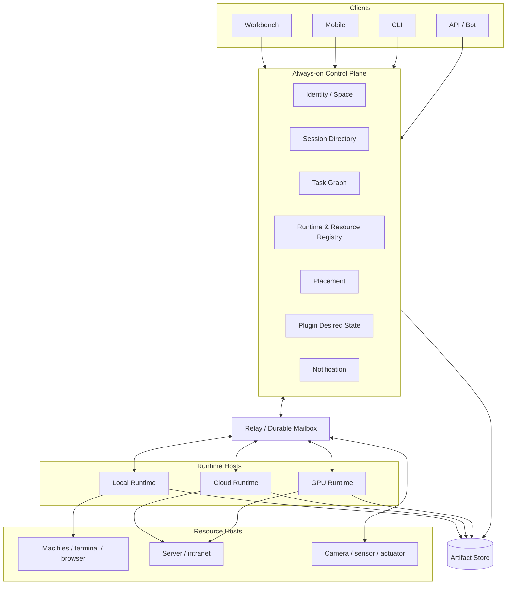

# Zion 分布式 Runtime 产品架构

> 状态：未来扩展架构草案
> 日期：2026-09-02
> 范围：产品边界、逻辑角色、状态所有权、部署方式、任务放置、
> Runtime 间协作、插件开发与安装，以及当前代码的演进方向。
>
> 近期交付以
> [ZION-CLIENT-RUNTIME-SEPARATION.md](./ZION-CLIENT-RUNTIME-SEPARATION.md)
> 为准，只推进 Workbench Client 与独立 Runtime 分离。
>
> 本文不引入任何外部 Agent 平台作为前提。发生概念或职责冲突时，
> 本文对 Control Plane、Runtime Host、Resource Host、Relay 和插件模型的定义
> 优先于早期讨论文档。

文档阅读顺序：

1. [ZION-CLIENT-RUNTIME-SEPARATION.md](./ZION-CLIENT-RUNTIME-SEPARATION.md)
   定义当前交付边界和迁移顺序；
2. 本文保留未来分布式扩展和硬约束；
3. [ZION-RUNTIME-PLATFORM-BLUEPRINT.md](./ZION-RUNTIME-PLATFORM-BLUEPRINT.md)
   保留论证过程和 standalone Runtime 实现记录；
4. [AGENT-RUNTIME-MIGRATION-CHECKLIST.md](./AGENT-RUNTIME-MIGRATION-CHECKLIST.md)
   维护执行进度；
5. [RUNTIME-ZION-NEXT-COMPATIBILITY.md](./RUNTIME-ZION-NEXT-COMPATIBILITY.md)
   维护 Workbench 接入兼容矩阵；
6. [ADR-0001-MODULAR-MONOLITH-AGENT-RUNTIME.md](./ADR-0001-MODULAR-MONOLITH-AGENT-RUNTIME.md)
   记录最初的 Core 独立决策。

## 1. 核心结论

Zion 的产品目标不是提供另一个聊天页面，也不是把一个本地 Agent 强制搬到云端。
它要解决的问题是：

> 用户从任意 Client 发出目标，Zion 将工作放置到拥有所需数据、算力和能力的
> Runtime Host 上执行，并让进度、审批、证据和结果持续跟随用户。

这个目标要求把过去统称为“Runtime”的职责拆成不同逻辑角色：

1. **Control Plane** 持有用户级全局状态和任务放置决策；
2. **Runtime Host** 持有一个 Attempt 的 Agent 执行；
3. **Resource Host** 持有本机工具、数据和最终授权；
4. **Relay** 只负责跨网络认证与消息投递；
5. **Artifact Store** 持有大型结果和可验证证据；
6. **Client** 只负责交互和投影。

这些角色可以部署在同一进程，也可以分布在多台机器。逻辑边界不能因为共进程部署
而消失。

## 2. 产品承诺与非目标

### 2.1 产品承诺

Zion 应向用户提供以下稳定能力：

- 同一 Session 可由 Workbench、Mobile、CLI 和 API 观察与继续；
- 浏览器关闭不影响非浏览器任务；
- 每个 Attempt 有明确且唯一的执行 owner；
- 任务尽量靠近其主要数据和工具运行；
- 资源离线时显式等待，不静默切换到错误副本；
- 高风险动作必须经过可验证的策略与 Approval；
- 模型、Runtime Host、Resource Host 和 Client 可以独立替换；
- Run、Event、Checkpoint、Artifact 和审批记录可恢复、可审计；
- 本地路径、凭证和设备能力由 Resource Host 保持最终控制。

### 2.2 非目标

近期不把 Zion 建设成：

- 通用分布式计算平台；
- Kubernetes 或工作流引擎替代品；
- 强制所有用户使用云端 Runtime 的 SaaS；
- 依赖节点数量制造价值的设备网络；
- 在模型上下文中暴露全部 Node 和资源清单；
- 让公网 Control Plane 直接穿透本机安全边界的远程桌面；
- 先建设插件市场，再寻找真实任务场景的平台项目。

## 3. 统一术语

### 3.1 Client

Client 是交互和展示表面：

- `zion-next` Workbench；
- Mobile；
- CLI；
- Web；
- Bot；
- API 调用方。

Client 不拥有 Agent loop，不保存权威 Run 状态，不直接安装远端代码，也不直接调用
设备上的私有工具。

### 3.2 Control Plane

Control Plane 是始终可寻址的全局协调层，负责：

- Identity 与 Space；
- Session Directory；
- Task Graph；
- Runtime/Resource Registry；
- Placement；
- Approval 路由；
- Plugin Desired State；
- Notification；
- 全局可见的 Event/Artifact 索引。

Control Plane 不应执行每个底层 Tool Call，也不应持有 Resource Host 的本地凭证。

### 3.3 Runtime Host

Runtime Host 是 Agent 执行宿主，负责：

- Agent Engine；
- Context Providers；
- Run/Attempt 执行；
- Checkpoint；
- 模型调用；
- 本地 Tool Broker；
- Attempt timeout、cancel 和恢复；
- 将 Event、Usage 和 Artifact 元数据提交给权威存储。

`@zion/runtime` 是 Runtime Host 的纯 Core，不是 Control Plane，也不是 Workbench
后端兼容层。

### 3.4 Resource Host

Resource Host 持有真实能力：

- 文件系统；
- Terminal/Bash；
- GPU；
- 浏览器登录态；
- 摄像头、麦克风、传感器；
- SSH、邮件、MCP；
- 业务内网服务。

Resource Host 必须执行本机策略，不得完全信任上游 Runtime。

### 3.5 Relay

Relay 是公网消息中转层，负责：

- Runtime/Resource Host 连接认证；
- Presence；
- 消息路由；
- ACK、重试和离线信箱；
- 连接限流；
- 推送通知。

Relay 不运行 Agent，不读取本地文件，也不拥有 Tool 或 Session 业务语义。端到端加密
启用时，Relay 只需看到路由元数据和密文。

### 3.6 Artifact Store

Artifact Store 保存不适合进入 Event Stream 的大型或结构化结果：

- 文件和压缩包；
- 视频、图片和音频；
- Diff、Patch 和 ChangeSet；
- 测试报告；
- 模型评估结果；
- 可视化数据；
- Provenance 和校验摘要。

Event 只引用 Artifact ID，不复制大对象。

### 3.7 Node

Node 是已注册的宿主端点，不等同于完整 Zion：

- `runtime` Node：可以拥有 Attempt；
- `resource` Node：提供 Capability；
- `client` Node：提供交互表面；
- `gateway` Node：代表一组轻量设备。

一台机器可以同时承担多个 Node 角色。

旧文档和当前代码中的术语按下表理解：

| 旧术语 | 当前术语 |
|---|---|
| Agent Runtime / Runtime Service | Runtime Host；不得再隐含 Control Plane |
| Tool Host / Device Node | Resource Host，或其 Connector |
| Backend Runtime | 必须拆开说明是 Control Plane 还是 Runtime Host |
| Browser Runtime | Workbench 内的旧 Agent loop，不是目标 Runtime owner |

## 4. 逻辑架构



Control Plane 逻辑上唯一，但可以从本地单进程开始。近期不需要分布式共识。

## 5. 部署模式

同一组协议和 Core 支持不同部署，不强制所有用户使用云端。

### 5.1 本地一体化

```text
Laptop
  Client
  Control Plane
  Runtime Host
  Resource Host
  SQLite
```

适用：

- 单机任务；
- 零账户、零公网依赖；
- 隐私优先；
- 用户接受关机后任务停止。

### 5.2 本地优先 + Relay

```text
Cloud Relay
  认证 / Presence / 离线信箱

Laptop
  Runtime Host + Resource Host
```

适用：

- 手机远程控制本机 Agent；
- Agent loop 和工具都靠近本地项目；
- 不希望云端拥有完整 Runtime 状态。

限制：Laptop 关机后本地 Attempt 不能继续。

### 5.3 Always-on Control Plane + 多 Runtime Host

```text
Cloud
  Control Plane + Relay
  optional Cloud Runtime

Laptop
  Local Runtime + Resource Host

Server
  Runtime Host + GPU/Project Resource
```

适用：

- 跨端 Session；
- 长任务；
- 定时任务；
- 多台机器；
- 需要设备离线等待和重新放置。

这是 Zion 中期目标形态。

### 5.4 单租户自托管

Control Plane、Relay、Artifact Store 和 Cloud Runtime 部署在用户自己的服务器。
个人版与托管版必须共享协议，不能形成两套产品。

## 6. 数据模型与所有权

```text
User
  -> Space
    -> Session
      -> Run
        -> Attempt
        -> Child Run (Subrun)
        -> Approval
        -> Artifact Reference

Space
  -> RuntimeHost[]
  -> ResourceHost[]
  -> ProjectBinding[]
  -> PluginInstallation[]
```

### 6.1 所有权表

| 对象 | 权威 Owner |
|---|---|
| User / Space | Control Plane |
| Session identity / transcript index | Control Plane |
| Task Graph / Placement | Control Plane |
| Run / Attempt identity、state、lease | Control Plane Run Ledger |
| Active Attempt execution | 一个 Runtime Host |
| Event sequence / ledger | Control Plane；当前 Attempt owner 追加 |
| Attempt Checkpoint bytes | Runtime Host 生成，Checkpoint/Artifact Store 保存 |
| Approval state | Control Plane；Human Identity 签署 |
| Local resource policy | Resource Host |
| Capability presence | Resource Host 发布，Registry 索引 |
| Artifact bytes | Artifact Store |
| Plugin desired version | Control Plane |
| Plugin actual state | 各 Host |
| Client projection | Client cache，不是权威状态 |

这里的 Owner 指逻辑权威，不等于必须持有明文。敏感 Transcript、Event 和 Checkpoint
可以端到端加密后由 Control Plane 或 Artifact Store 持久化；Control Plane 仍负责
identity、sequence、lease 和索引，不能因加密而产生第二套 Run 状态。

### 6.2 单 Owner 约束

- 一个 Run 可以有多个 Attempt；
- 一个 Attempt 在任一时刻只有一个 Runtime Host owner；
- Owner 由 lease 和 epoch 标识；
- 失去 lease 的旧 owner 不得继续提交 Event 或 Artifact；
- 跨 Runtime 工作必须创建 Child Run/Subrun，不共享可变 Agent loop。

## 7. Run 与 Attempt 生命周期

```text
Run:
  queued
  placing
  running
  waiting_for_runtime
  waiting_for_resource
  waiting_for_approval
  suspended
  completed
  failed
  cancelled

Attempt:
  created
  leased
  running
  checkpointed
  completed
  failed
  expired
  superseded
```

典型流程：

1. Client 在 Space 中创建 Run；
2. Control Plane 根据需求生成 Placement；
3. 选中的 Runtime Host 获得 Attempt lease；
4. Runtime Host 加载 Session、Context、Engine 和可用 Capability；
5. Agent loop 优先调用同机 Resource Host；
6. 需要其他信任域时创建 Subrun；
7. Side-effect 前创建 Approval；
8. 大型结果写入 Artifact Store；
9. Runtime Host 提交终态和最后 Checkpoint；
10. Client 从 Event sequence 继续投影。

## 8. Placement 与资源连续性

### 8.1 Placement 输入

```typescript
interface PlacementRequirement {
  projectId?: string;
  requiredCapabilities: string[];
  requiredResources: string[];
  preferredRuntimeIds?: string[];
  trustZone?: string;
  dataResidency?: string;
  minimumMemoryMb?: number;
  minimumGpuMemoryMb?: number;
  deadline?: number;
  estimatedCostLimit?: number;
}
```

模型只声明需求，不接收全部 Node 清单。Placement Scheduler 负责选择具体 Host。

### 8.2 资源类型

```text
exclusive-local
  只有一个 Resource Host，离线只能等待

replicated
  多个 Host 有明确版本的副本，可以重新放置

cloud-available
  云端 Runtime 可直接访问

portable
  可打包成 Artifact 后迁移
```

### 8.3 电脑关机语义

- Control Plane 和 Session 仍可访问；
- Cloud Attempt 可以继续；
- 依赖该电脑的 Attempt 进入 `waiting_for_resource`；
- Resource 有兼容副本时创建新 Attempt；
- 原 Attempt lease 失效后不得双写；
- 电脑重新上线时按 checkpoint 和 resource revision 恢复；
- 不得静默使用版本未知的另一个项目副本。

## 9. Runtime 间协作

Runtime 间协作采用粗粒度 Subrun，不以跨公网转发每个 `read`、`grep` 或 `Bash`
作为默认方式。

```text
Parent Runtime
  -> subrun.create
      capability + policy + deadline + artifact refs

Child Runtime
  -> 本地 Agent loop
  -> 本地 Tool execution
  -> subrun.event / artifact.offer / final result
```

### 9.1 Runtime Envelope

```typescript
interface RuntimeEnvelope {
  version: 1;
  messageId: string;
  sourceRuntimeId: string;
  targetRuntimeId: string;
  type:
    | "capability.query"
    | "subrun.create"
    | "subrun.event"
    | "subrun.cancel"
    | "artifact.offer";
  correlationId: string;
  issuedAt: number;
  expiresAt: number;
  payloadCiphertext: string;
  signature: string;
}
```

要求：

- Runtime 独立身份；
- mTLS 或签名身份；
- 端到端加密；
- durable outbox/inbox；
- at-least-once delivery；
- `messageId` 去重；
- ACK、重试、过期和取消；
- Delegation Policy 在接收端再次收窄。

### 9.2 Relay 边界

Relay 不拥有 Parent Run 或 Child Run，仅保存待投递 Envelope 和最小路由元数据。

```text
同进程：内部接口
同机器：Unix Socket / Named Pipe
同局域网：mTLS WebSocket / QUIC
跨公网：Relay
```

首版使用 HTTPS long polling 或 WebSocket 即可，不引入 P2P、Kafka 或分布式共识。

## 10. Capability 与 Tool 执行

### 10.1 Capability 描述

Resource Host 发布：

- capability name/version；
- risk class；
- input/output schema；
- resource references；
- availability；
- local policy summary；
- runtime compatibility；
- estimated cost。

Capabilities 是声明，不是授权。

### 10.2 最终授权

```text
最终权限 =
User Policy
∩ Space Policy
∩ Run Policy
∩ Runtime Host Policy
∩ Resource Host Policy
∩ Physical Safety Policy
```

任何一层都只能收窄权限。

### 10.3 调用粒度

- Runtime 与同机 Resource Host 可以使用细粒度 Tool Call；
- 跨网络但低成本、幂等的查询可以远程 Tool Call；
- 长任务、高频工具循环和大数据任务应放置整个 Attempt；
- 跨信任域优先创建 Subrun；
- Side-effect 使用稳定 operation ID、Approval 和 durable receipt。

## 11. 插件统一模型

### 11.1 插件类型

| 类型 | 职责 | 执行位置 |
|---|---|---|
| Shared Contract | Schema、类型、纯领域逻辑 | 所有 Host 可依赖 |
| Skill | 如何使用已有能力 | Runtime Host |
| Runtime Entry | Context、Policy、Workflow、Engine hook | Runtime Host |
| Resource Entry | Tool、MCP、GPU、设备能力 | Resource Host |
| Renderer | Event、Tool Result、Artifact 投影 | Client |
| Workbench Entry | 面板、命令、交互 | Workbench |
| CLI Entry | 命令与文本投影 | CLI |

Adapter 是 Zion 第一方基础设施，不属于用户插件：

- Runtime protocol adapter；
- Workbench compatibility adapter；
- Provider adapter；
- Host transport adapter。

### 11.2 多宿主插件包

```text
plugin/
  zion.package.json
  shared/
  skill/
  runtime/
  resource/
  renderer/
  workbench/
  cli/
```

示例：

```json
{
  "id": "com.zion.video-evaluation",
  "version": "1.0.0",
  "entries": {
    "skill": "./skill",
    "runtime": "./dist/runtime.js",
    "resource": "./dist/resource.js",
    "renderer": "./dist/renderer.js",
    "workbench": "./dist/workbench.js"
  },
  "compatibility": {
    "runtimeProtocol": 1,
    "pluginApi": 1
  },
  "permissions": {
    "runtime": ["context.read", "artifact.write"],
    "resource": ["gpu.execute", "workspace.read"],
    "workbench": ["panel.register"]
  }
}
```

一个包可以只声明部分 Entry。浏览器插件不得因为同包存在 Runtime Entry 而导入它。

### 11.3 开发流程

1. 先定义 Shared Contract；
2. 用 fake Host 测试纯领域逻辑；
3. 开发 Resource Entry 并执行本机策略测试；
4. 开发 Runtime Entry，使用 fake Resource Host；
5. 开发 Renderer 和 Workbench Entry；
6. 运行跨 Host contract test；
7. 用真实 Runtime/Resource 做 E2E；
8. 构建不可变发布包和 manifest；
9. 生成权限、SBOM、digest 和签名；
10. 发布到 Registry。

### 11.4 安装不是浏览器复制文件

Workbench 中的“安装”只是发起 Install Request：

```text
1. Control Plane 获取 package manifest
2. 验证来源、签名、digest、版本和依赖
3. 生成 Install Plan
4. 用户确认权限和目标 Host
5. 各 Host 独立 stage 对应 Entry
6. 各 Host 验证并返回 receipt
7. Control Plane 更新 Desired/Actual state
8. 满足激活条件后启用
9. 失败时回滚或进入 degraded
```

### 11.5 Desired 与 Actual

```text
Desired:
  com.zion.video-evaluation@1.0.0

Actual:
  Workbench        1.0.0 ready
  Cloud Runtime    1.0.0 ready
  GPU Node         1.0.0 ready
  Laptop Node      not-required
```

不能使用一个全局 `installed: true` 表示多宿主安装完成。

### 11.6 插件安全

- Skill 是不可信指令，不授予 Tool 权限；
- Runtime Entry 是可信代码，首版仅允许 allowlist；
- 第三方高风险能力优先使用 out-of-process Resource Entry；
- 权限按 Entry 和 Host 分别审批；
- 更新不得自动扩大权限；
- 版本必须 pin，支持 rollback；
- 卸载必须停止服务、撤销 Capability、释放资源；
- 安装记录、权限变更和执行版本必须进入审计；
- UI/Renderer 不得读取 Runtime 或 Resource 凭证。

## 12. Identity、Pairing 与信任域

必须区分三类身份：

```text
Human Identity
  谁创建、查看、审批任务

Runtime Identity
  谁拥有并执行 Attempt

Resource Identity
  哪台设备提供哪些 Capability
```

要求：

- Runtime 和 Resource Host 各自生成非对称密钥；
- 通过一次性 pairing code 加入 Space；
- 私钥进入 OS Keychain/TPM/安全存储；
- Token 短期有效并可轮换；
- 支持单设备吊销；
- Capability 扩权必须重新审批；
- Trust Zone 之间使用显式 Delegation；
- 物理设备保留本地 kill switch。

## 13. 可靠性语义

### 13.1 Event

- Event 在发布给 Client 前持久化；
- 每个 Run 内 sequence 单调递增；
- Client 按 sequence 补拉；
- 失去 Attempt lease 的 owner 不能继续 append；
- Event Stream 不承载大型 payload。

### 13.2 消息

- 网络投递按 at-least-once 设计；
- Outbox/Inbox 持久化；
- Stable message ID；
- 接收端去重；
- ACK 与业务完成分离；
- 超时、取消和 lease 都是显式终态。

### 13.3 Side-effect

- 使用稳定 operation ID；
- Approval 绑定 canonical plan；
- Device 先保存 receipt，再确认完成；
- 重试返回原 receipt；
- 无法幂等的动作必须提供补偿或禁止自动重试。

### 13.4 Checkpoint 与恢复

- Checkpoint 只恢复声明过的稳定状态；
- 不假设可以恢复第三方 Engine 的隐藏内部状态；
- 新 Attempt 必须有新 lease/epoch；
- Resource revision 不匹配时禁止静默恢复。

## 14. 当前代码映射

| 当前模块 | 当前角色 | 目标角色 |
|---|---|---|
| `zion-next` | 浏览器 UI + 部分执行 owner | Workbench Client |
| `@zion/runtime` | 无 DOM Agent Core | Runtime Host Core |
| `apps/runtime` | Runtime + 部分 Control Plane | Runtime Host composition root |
| `SqliteRunStore` | Run/Session/Event store | Runtime durable store |
| `NodeBroker` | Registry、Binding、路由、pending 调用 | 拆为 Control Plane Registry/Placement 与 Relay dispatch |
| `node-protocol` | Device command protocol | Runtime ↔ Resource Host invocation contract |
| `device-connector` | 出站设备连接 | Resource Host Connector |
| `local-tools-client` | Tool adapter | Resource Entry adapter |
| `zion-local-tools` | 本地能力和数据 | Resource Host implementation |
| `src/runtime/http-runtime-client.ts` | Workbench 侧可选 HTTP/SSE 客户端 | Workbench RuntimeClient |
| `src/runtime/zion-next-compatibility.ts` | 旧 UI 投影 | Workbench Adapter |
| `extensions/dev.scheduler/runtime-backend.js` | `auto` 模式 Runtime 桥接与断线续接 | 过渡 Workbench Adapter |
| `extensions/dev.langchain-chat/runtime-backend.js` | `auto` 模式多模态 Chat Runtime 桥接 | 过渡 Workbench Adapter |
| `extensions/*/runtime.js` | Runtime Tool / Context / post-processor 插件 | 过渡 Runtime Entry |

当前仍缺少：

- 独立 Control Plane；
- Runtime Placement；
- Relay durable mailbox；
- Artifact Store；
- Approval Provider；
- durable Device-side receipts；
- `waiting_for_runtime/resource/approval`；
- Plugin Install Plan；
- Runtime-to-Runtime Subrun；
- Claude/Gemini Runtime adapter 与附件传输；OpenAI-compatible 多模态 Chat、
  Runtime Context Provider 和 Scheduler 已支持 `auto` 模式与 sequence 续接。

## 15. 近期交付顺序

### Phase A：巩固 Standalone Runtime

- 保持 `@zion/runtime` 无 DOM；
- 完成当前只读 Runtime 回归；
- 不继续扩大 Core API；
- 明确 `apps/runtime` 只是一个 Host 组合根。

### Phase B：Workbench Opt-in Client

- 将现有 `HttpRuntimeClient` 接到 Workbench；
- Session/Event projection；
- feature flag；
- 保留旧执行路径；
- 验证浏览器关闭后的 Run。

### Phase C：单用户 Control Plane

- Space；
- Runtime/Resource identity；
- Pairing；
- Registry；
- durable queue；
- `waiting_for_resource`；
- Notification。

### Phase D：可用执行闭环

- Approval；
- Artifact Store；
- `write/edit/Bash`；
- Device-side operation receipt；
- Local/Cloud Runtime Placement；
- checkpoint suspend/resume。

### Phase E：多宿主插件

- `zion.package.json`；
- Install Plan；
- per-Host receipt；
- Desired/Actual state；
- Runtime/Resource/Renderer Entry；
- update、rollback、uninstall。

### Phase F：Runtime Federation

- Runtime identity；
- durable outbox/inbox；
- Relay；
- Delegated Subrun；
- Artifact exchange；
- cross-runtime policy lease。

Phase F 不能阻塞前四个阶段的产品验证。

## 16. 硬性架构约束

1. `@zion/runtime` 不导出 Workbench 兼容代码；
2. `@zion/runtime` 不依赖 DOM、浏览器存储或具体传输；
3. 一个 Attempt 同时只有一个 Runtime Host owner；
4. Client 永远不是 durable Run owner；
5. Resource Host 对本地权限有最终否决权；
6. 跨网络优先委托 Subrun，不默认转发每个 Tool Call；
7. Capability advertisement 不等于授权；
8. 大型结果进入 Artifact Store；
9. Side-effect 不宣称 exactly-once；
10. 插件按 Host Entry 拆分，UI 代码不进入 Runtime；
11. Workbench 发起安装，但各 Host 自己验证和执行；
12. 本地、云端和自托管部署共享同一协议；
13. 不因未来可能有大量 Node 而提前引入分布式共识；
14. Runtime、Resource 或 Plugin 替换不得破坏 canonical Run/Event contract。

## 17. 已明确拒绝的方向

- 把 `zion-next-compatibility` 放入 Runtime Core；
- 把浏览器插件函数序列化到 Runtime 执行；
- 将 `zion-local-tools` 暴露公网；
- 让公网 Runtime 绕过 Device 本地策略；
- 能力未补齐前替换现有默认 Agent 路径；
- 用一个共享布尔值表达多 Host 插件安装状态；
- 因为 Runtime 在远端就让所有 Tool Call 跨公网；
- 让模型直接选择一千个 Node；
- 把 Relay 误当成 Agent Runtime；
- 把所有硬件都升级成完整 Runtime。

## 18. 仍需产品验证的问题

- 用户是否真的需要 Local/Cloud Runtime Placement，还是本地 Host 已足够；
- 哪个任务值得成为第一个多 Host 样板；
- Control Plane 保存完整 Event，还是保存端到端加密镜像；
- Session 的跨 Runtime handoff 是否需要迁移未提交工作区状态；
- Artifact Store 的最小形态是本地 CAS、对象存储还是二者适配；
- Approval 的默认粒度是 Tool、operation plan 还是 Subrun；
- 插件 Registry 是否需要自建，还是先支持私有 Git/npm；
- 单用户 private alpha 需要多少身份和审计能力；
- 视频/CV、开发任务和个人自动化中，哪个场景有最高重复使用率。

第一个产品验证场景必须包含真实的资源放置、等待、审批和 Artifact，而不能只证明
跨端聊天。
