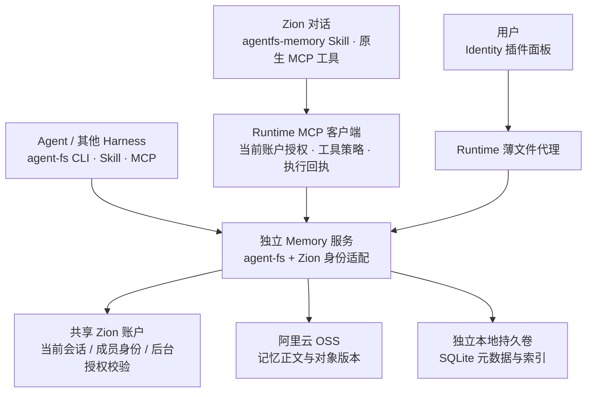

# Zion 项目群与独立记忆服务

2026-10-22。本次交付是 agent-fs 记忆试用代码与部署配置，网站域名与生产迁移尚未执行。

Zion 可以作为总品牌与项目入口。Runtime、Identity、ADC、Workbench、Mobile
分别承担清楚的职责，并复用同一账户服务。总网站介绍产品关系、提供入口；
各子项目有自己的文档、版本、网站与交付方式。

## 记忆访问关系

Identity 面板继续编辑 Markdown/JSONL。它的 HTTP 请求经 Runtime 验证当前
账户后，转成短期、绑定请求内容的委托。Memory 服务校验原始身份后调用
agent-fs。后台蒸馏使用同一文件 API，但保留 durable grant 的权限复核。
这些操作不要求创建或恢复计算沙箱。

Agent 使用公开的 agent-fs 协议。切换 Harness 时，文件内容、版本和用户
身份不变；客户端只需要配置服务地址、登录凭据和 Skill/MCP。上游内部 Key
仅由服务端保存其哈希，不交给客户端，也不形成第二套用户登录体系。

`/memory/dev.identity` 是服务内路径，默认不在原生 Bash 的文件系统中。
未来需要透明 Shell 操作时，可以接 just-bash 或显式挂载；这些执行能力
与长期记忆存储分别管理。

## 子项目职责

| 项目 | 职责 | 可独立交付内容 |
| --- | --- | --- |
| Zion 账户 | 登录、稳定用户身份、角色与授权 | 共享 IdP/账户 API，未来从 Runtime 提取 |
| Runtime | 模型执行、Run、调度、工具生命周期 | 服务、CLI、SDK、API |
| Identity / Memory | 身份、用户画像、项目记忆、自传文件 | agent-fs 服务、API、CLI Skill、MCP、管理插件 |
| ADC | 受账户和设备策略约束的本地资源访问 | Connector、工具协议、CLI/MCP、设备网站 |
| Workbench | 以编辑器为中心的交互与插件管理 | Web/PWA，消费 Runtime 和子项目接口 |
| Mobile | 移动端交互 | 独立客户端，复用账户和后端接口 |
| Zion 总站 | 品牌、产品关系、文档与入口导航 | 总网站，链接各子项目 |

先按这些边界整理目录、文档和发布入口，保留现有仓库协作方式。无需先拆成
多个仓库或迁移现有域名，才能获得模块解耦。

`runtime.zioon.tech` 与 `adc.zioon.tech` 已有用途，继续保留。
Memory 的 `memory.zioon.tech` 仅作为部署模板中的建议名；Identity、Workbench、
Mobile 及 Zion 总站的具体域名由后续网站工作决定。

## 本次实现与验证

- `apps/memory-service` 复用固定版本的 desplega-ai/agent-fs，独立 Bun 进程。
- `ali-oss` 通过上游 StorageAdapter 接口存储正文，避免上游强制 S3 path-style
  地址带来的 OSS 兼容问题。真实 Bucket 的兼容性仍需实测。
- Runtime 增加可选 Memory API client 与短期委托校验，不把记忆存回 Runtime。
- Identity 的数据位置声明支持服务 backend；上下文不再宣称未挂载的服务
  路径可由 Bash 直接读写。
- Identity 0.1.13 已移除专用自传查询工具；对话直接使用 `mcp__agentfs__cat`、
  `mcp__agentfs__grep` 等原生 MCP 工具。Schema 和说明来自上游 MCP 的
  `tools/list`，执行使用 `tools/call`；Runtime 保留账户授权、策略与回执。
  plugin-data/local-tools 回退和 Python 查询入口已移除，无旧目录镜像。
- `agentfs-memory` Skill 在 Zion 中贡献，随插件分发；外部 CLI/MCP 复用
  Zion 会话。共享同一 user+Space
  对应的私有 drive；UI 保持账户优先，不新增内部存储概念。
- 46 项本地集成检查通过，包括实际 Runtime 面板接口、上游 CLI/MCP、
  同版本/内容哈希并发冲突、JSONL 追加去重、会话/授权撤销、备份，以及
  相同逻辑路径下的账户缓存隔离、MCP 原生转发、只读/路径授权、复制目标检查，
  以及服务完成写入但响应丢失时的未知结果处理。
- 147 项针对性 Identity/Skills/项目记忆、客户端策略与 Runtime 工具回归通过。较大回归中另有协作锚点断言失败
  与 OIDC 超时，未把全量测试标为通过。
- 真实 DeepSeek 对话 `run_mvj6aeqn_jn3bbplp` 已读取 Skill 正文并调用
  MCP `ls`、`cat`、`grep`、`stat`，读取 6 条事件，引用其中 3 个真实 ID。
  6 条工具调用均有 PostgreSQL 回执，事件文件哈希保持一致。

## 试用边界

上游仍依赖 SQLite 元数据；本次不重新实现 PostgreSQL 存储层。
第一阶段仅单实例，所有客户端的同账户请求共用串行保护，防止异步对象写入
与版本校验之间出现覆盖。多实例扩容前需要共享的 transactional claim。

OSS 正文和本地 SQLite 都是 authoritative storage，必须分别持久化与备份。
对象版本应与 SQLite 中的版本/哈希匹配后才能完成恢复。
本地 Runtime 已启用 agent-fs 试用，正文使用本地对象存储后端。
目前未提供真实 OSS 凭据，因而没有宣称 OSS 已接通，也没有迁移旧文件
或部署生产服务。完成探针、迁移核对与 ECS 容量评估后，再切换 OSS。

完整启动、客户端、备份、迁移说明见 [Memory README](../../apps/memory-service/README.md)。
