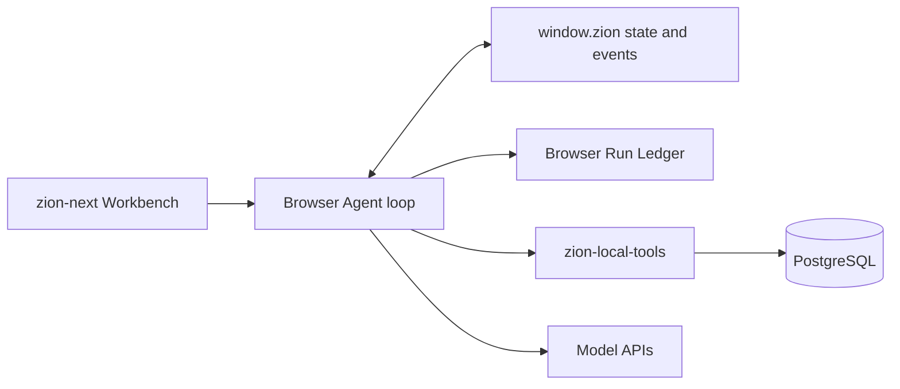
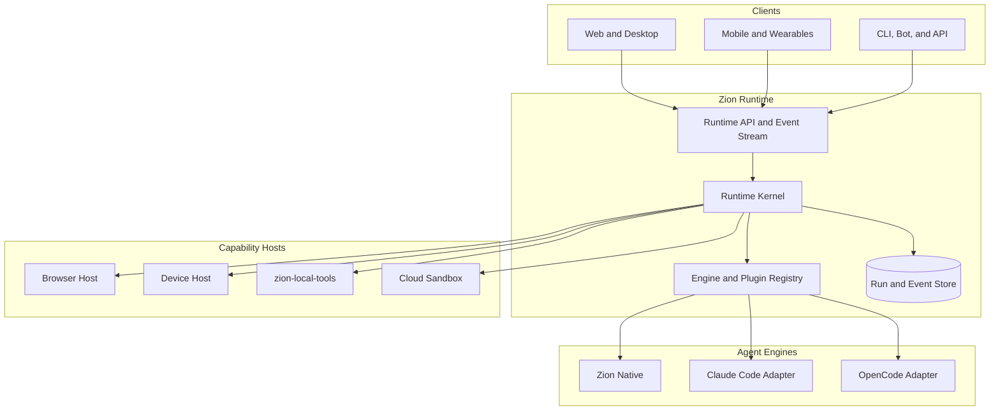

# Zion Runtime Platform Blueprint

> Status: Supporting blueprint and implementation history
> Date: 2026-08-30
> Scope: Product shape, runtime boundary, replaceable engines, multi-surface clients,
> device nodes, plugins, external access, and incremental migration from the current
> `zion-next` architecture.
>
> Architecture authority:
>
> - [ZION-DISTRIBUTED-RUNTIME-PRODUCT-ARCHITECTURE.md](./ZION-DISTRIBUTED-RUNTIME-PRODUCT-ARCHITECTURE.md)
>   is the current canonical definition of Control Plane, Runtime Host, Resource
>   Host, Relay, placement, Runtime collaboration, and multi-host plugin lifecycle.
> - This blueprint remains useful as the discussion history and standalone Runtime
>   implementation record. When the two documents conflict, the canonical
>   architecture document takes precedence.
>
> Related documents:
>
> - [ZION-DISTRIBUTED-RUNTIME-PRODUCT-ARCHITECTURE.md](./ZION-DISTRIBUTED-RUNTIME-PRODUCT-ARCHITECTURE.md)
> - [ADR-0001-MODULAR-MONOLITH-AGENT-RUNTIME.md](./ADR-0001-MODULAR-MONOLITH-AGENT-RUNTIME.md)
> - [AGENT-RUNTIME-BOUNDARY-STRATEGY.md](./AGENT-RUNTIME-BOUNDARY-STRATEGY.md)
> - [AGENT-RUNTIME-MIGRATION-CHECKLIST.md](./AGENT-RUNTIME-MIGRATION-CHECKLIST.md)
> - [MULTI-SURFACE-AGENT-PLATFORM.md](./MULTI-SURFACE-AGENT-PLATFORM.md)
> - [SESSION-PERSISTENCE.md](./SESSION-PERSISTENCE.md)
> - [TERMINAL-RESOURCE-MANAGEMENT-DESIGN.md](./TERMINAL-RESOURCE-MANAGEMENT-DESIGN.md)

## 1. Executive Summary

Zion should not evolve into a larger browser application that happens to contain
an Agent. Its durable product identity should be:

> A stable execution and continuity layer that preserves a user's objectives,
> project context, runs, permissions, evidence, and history while allowing clients,
> Agent engines, tools, stores, plugins, and devices to be replaced independently.

The main consequences are:

1. `zion-next` becomes a Workbench Client and optional Browser Tool Host. It is no
   longer the canonical Runtime owner.
2. Zion itself owns protocols, identity, project bindings, Task/Run state,
   capability policy, approval, routing, and durable history.
3. Model loops and coding agents are replaceable `AgentEngineProvider`
   implementations. A native Zion engine is optional rather than privileged by
   architecture.
4. Claude Code, OpenCode, or future engines can execute a Zion Run through adapters
   without requiring the Workbench to understand their internal implementations.
5. File, terminal, SSH, mail, MCP, browser, device, and cloud capabilities are
   supplied by Tool Hosts through a Tool Broker.
6. Web, Desktop, Mobile, CLI, bots, and APIs are different interaction surfaces over
   the same Runtime protocol and canonical state.
7. A Node is an authenticated execution or capability endpoint, not another full
   copy of Zion. Node count is not a product goal.

This document is a discussion synthesis. It does not mark every proposed component
as approved or implemented.

### 1.1 Near-term delivery decision

The multi-surface platform described in this document is a long-term direction. The
near-term project is narrower:

> Build Runtime as an independently runnable and testable module first. Do not
> integrate it into the production path of `zion-next` until the standalone
> validation gate passes.

The first Runtime version remains in the same repository or worktree, but must be
independent in build, tests, process lifecycle, storage, and execution. The current
browser implementation is a behavioral reference and fixture source, not the host
that the new Runtime depends on.

Included in standalone v0:

- versioned `RunRequest`, `RunEvent`, tool, policy, and engine contracts;
- a DOM-free TypeScript Agent Engine or a minimal reference engine;
- fake Model, Tool Host, Context, Credential, and Store adapters;
- at least one real model adapter behind an injected transport;
- a local-tools Tool Host adapter for a narrow read-only tool set;
- ordered event persistence in a local PostgreSQL Run Store;
- abort, timeout, restart recovery, and idempotent tool invocation;
- a headless CLI or test harness that can create and attach to a Run.

Explicitly deferred until after standalone validation:

- changing `window.zion.chat` or the default Workbench execution path;
- mobile UI and public remote access;
- cloud placement and thousand-Node scheduling;
- canonical transcript migration;
- full plugin installation and marketplace behavior;
- migration of every current browser plugin;
- compatibility UI for every existing tool card.

The integration decision is therefore gated rather than assumed. A failed
standalone design can be changed or discarded without destabilizing the current
Workbench.

### 1.2 Current implementation checkpoint

The first standalone code checkpoint now exists under `packages/runtime`:

- compatibility contract:
  [RUNTIME-ZION-NEXT-COMPATIBILITY.md](./RUNTIME-ZION-NEXT-COMPATIBILITY.md);
- package-local TypeScript build with `lib: ["ES2022"]` and no DOM types;
- host-neutral Run, Event, Engine, Tool Broker, Context Provider, policy, and store
  contracts;
- a bounded multi-turn Agent executor;
- ordered event persistence before client publication;
- cancellation and injected timeout scheduling;
- invalid-tool feedback to the next model turn;
- deterministic invocation IDs for idempotent Tool Host execution;
- an in-memory Run Store;
- a Node 22 PostgreSQL Run Store with atomic event and terminal-state commits;
- a loopback-only Runtime Host with Run create, lookup, abort, event catch-up, and
  SSE endpoints;
- an OpenAI-compatible Engine adapter with an injected Node transport;
- an allowlisted environment Credential Provider with per-turn credential leases;
- a policy-scoped local-tools Tool Broker for files, Bash, search, mail, and MCP;
- startup reconciliation that marks ownerless active Runs interrupted;
- durable post-tool-turn checkpoints and explicit same-Run/new-Attempt resume;
- durable Session records and ordered canonical user/assistant transcripts;
- one immutable Run per Session message with idempotent completion projection;
- a headless interactive CLI that can create a project/policy-scoped Session or
  reconnect to an existing Session;
- staged Context Providers matching current pre-once/post-per-turn contributors;
- a policy-scoped headless Terminal Manager plugin entry using the shared
  inventory domain and local-tools `/sessions` plus `/machines`;
- canonical reasoning lifecycle events and Workbench projection parity for
  reasoning, usage, completion, failure, and abort;
- RunPolicy normalization and tool/event adapters covered against current
  `zion-next` code by dual-execution tests;
- a local Model Registry with sanitized `/v1/models` profile discovery;
- a DeepSeek V4 Flash profile with thinking configuration and environment-backed
  credentials;
- an explicit Echo Engine used only for protocol and process smoke tests;
- Node-environment tests for completion, tools, invalid arguments, discovery
  failure, abort, timeout, maximum-turn termination, PostgreSQL reopen, HTTP requests,
  and SSE resume.
- an end-to-end local smoke path covering OpenAI-compatible tool-call output,
  policy-scoped execution through the real `zion-local-tools` service, a second
  model turn, and durable ordered events.
- a process-level crash/restart smoke path covering durable checkpoint recovery,
  startup interruption reconciliation, same-Run/new-Attempt resume, continuous
  event sequencing, credential isolation, and stable tool invocation IDs.
- a real DeepSeek smoke path covering persisted multi-turn Session context,
  reasoning and usage events, Runtime restart, and a policy-scoped `read` call
  through the real `zion-local-tools` service.
- a PostgreSQL-backed Device registry, persistent project/resource bindings, and
  completed invocation receipts, with restored Devices kept offline until they
  reconnect.

It is now integrated with `zion-next` through the HTTP/SSE RuntimeClient in
`auto` mode. Identity, Skills, Memory, Compression, Terminal Inventory, file
Artifact/ChangeSet projection, and Runtime Plugin API v2 are implemented. The
remaining production boundaries are asynchronous approval, an external binary
Artifact Store, OS Keychain/Vault model credentials, isolated third-party plugin
execution, and authenticated remote deployment.

## 2. Why This Is Not Just a Multi-Device Chat App

The real user problem is not synchronizing chat bubbles. Long-running professional
work has the following properties:

- It spans hours or days.
- Relevant data lives on different machines and private networks.
- Model behavior is probabilistic and must be supported by evidence.
- Some actions may continue unattended while others require explicit approval.
- A browser tab, process, model, or device may disappear during execution.
- The result is often an artifact, change set, report, or verified state rather than
  a final assistant message.
- Decisions need to remain understandable weeks or months later.

A concrete example is a sensitive-video processing workflow:

1. A server completes an overnight batch and detects unstable results.
2. Zion runs a second detector on an available GPU host.
3. A project-specific stability check runs on the workstation that owns the test
   data.
4. The system records model versions, parameters, trajectories, representative
   frames, and comparison artifacts.
5. A production-affecting change is paused for approval.
6. The user reviews a compact summary on a phone or watch.
7. The same Objective is opened later in the desktop Workbench with full evidence,
   diffs, tests, and execution history.

The value is continuity of intent and governed execution, not the number of devices
involved.

## 3. Current Baseline

The current system is best described as:

> A browser-hosted plugin modular monolith plus a Python local capability and
> persistence sidecar.



Important current ownership:

| State or behavior | Current owner |
|---|---|
| Editor, cards, panels, interaction | `zion-next` |
| Interactive and supported programmatic Agent loops | `apps/runtime` |
| Runtime Tool Broker and policy | `@zion/runtime` plus Tool Host adapters |
| Canonical Run/Event/Attempt ledger | Runtime PostgreSQL |
| Model profiles and credentials | Runtime registry and credential store |
| Session document and metadata durability | Runtime PostgreSQL |
| Scheduler Task, occurrence, Run, and lease | Runtime PostgreSQL |
| Scheduler Agent and command execution | Runtime worker |
| Files, Bash, terminal, SSH, mail, and MCP | `zion-local-tools` |

This produces several forms of coupling:

- The Agent loop directly writes CodeMirror and UI state.
- Plugins register Runtime tools through `chat.tools` and `chat.toolHandlers`.
- Message contributors are arbitrary browser functions.
- Session Markdown acts as both editable view and model transcript.
- Run state exists in browser Run Ledger, Scheduler state, Session documents, and
  plugin-local state.
- Browser focus can leak into execution decisions unless every resource is passed
  explicitly.

## 4. Terminology

The word "Runtime" is overloaded. The following terms should be used consistently.

### 4.1 Zion Client

An interaction surface that sends commands, subscribes to events, displays
projections, and collects approvals.

Examples:

- Zion Workbench (`zion-next`)
- Desktop shell
- Mobile client
- CLI
- Bot or webhook adapter

A Client does not own a canonical Run.

### 4.2 Zion Runtime Kernel

The stable orchestration layer that owns:

- identity and principals;
- Project and Workspace bindings;
- Objective, Task, Run, Attempt, and Event records;
- capability policy and approval;
- Agent Engine selection;
- Tool Host routing;
- checkpoint and recovery;
- durable event publication.

The Kernel should be small. It should own contracts and invariants rather than every
implementation.

### 4.3 Agent Engine

The component that owns the reasoning and tool loop inside one Run Attempt.

Examples:

- Zion Native Agent Core
- Claude Code adapter
- OpenCode adapter
- a specialized research engine
- a workflow engine

An Agent Engine is similar in category to Claude Code or OpenCode. It is not the
whole Zion Runtime.

### 4.4 Tool Host

An authenticated process that advertises and executes capabilities.

Examples:

- Python `zion-local-tools`
- Browser Tool Host
- Desktop Device Host
- MCP server
- cloud sandbox
- database or SaaS gateway

### 4.5 Node

A Node is a registered Client, Runtime, Tool Host, worker, store, or combined device
endpoint. A Node does not imply that the full Zion stack is installed.

### 4.6 Projection

A view derived from canonical state or events:

- Markdown Session document;
- tool card;
- reasoning card;
- Run log;
- CLI output;
- mobile approval view.

A Projection is replaceable and must not silently become a second source of truth.

## 5. Product Thesis

Zion's durable promise should be:

> Work that has been entrusted to Zion remains understandable, controllable, and
> resumable as interfaces, devices, models, tools, and execution locations change.

The product should be organized around:

```text
Identity
  -> Space / Project
    -> Objective
      -> Task
        -> Run
          -> Attempt
            -> Event
            -> Artifact
```

Session and Chat remain important, but they are interaction and context containers,
not the only canonical unit of work.

The primary product surfaces should eventually be:

1. **Inbox**: decisions, approvals, failures, and attention requests.
2. **Objectives**: commitments, progress, completion conditions, and evidence.
3. **Workbench**: deep interaction with sessions, code, documents, artifacts, and
   project context.
4. **Runs**: execution history, model and tool attribution, cost, policy decisions,
   errors, checkpoints, and outcomes.

Device and Node administration should remain an advanced surface rather than become
the ordinary user's home page.

## 6. Target Architecture



## 7. What Zion Owns and What Is Replaceable

Zion should directly define only the stable contracts and invariants.

### 7.1 Zion-owned contracts

- `Identity` and `Principal`
- `ProjectRef`, `WorkspaceRef`, and `ProjectBinding`
- `Objective`, `Task`, `Run`, `Attempt`, and `RunEvent`
- `Capability`, `CapabilityPolicy`, and `Approval`
- `EngineDescriptor` and `EngineRunRequest`
- `ToolDefinition`, `ToolInvocation`, and `ToolResult`
- `Artifact` and `ChangeSet`
- plugin manifest and compatibility rules
- event ordering, idempotency, lease, and ownership rules

### 7.2 Replaceable providers

```typescript
interface AgentEngineProvider {}
interface ToolHostProvider {}
interface ContextProvider {}
interface RunRepository {}
interface SessionRepository {}
interface ArtifactStore {}
interface CredentialProvider {}
interface ModelRegistry {}
```

Implementations do not need to originate inside Zion:

- Agent execution can come from Claude Code, OpenCode, or a native engine.
- Tools can come from local-tools, MCP, SaaS APIs, or device bridges.
- Persistence can use PostgreSQL, Postgres, or another compliant store.
- Clients can be first-party, third-party, CLI, or automation clients.

## 8. Agent Engine Integration

If the Runtime only implements model calls, tool loops, terminal access, and context
compression, it overlaps strongly with existing coding agents. Zion should not
rebuild mature engines merely to own every layer.

Use a provider boundary:

```typescript
interface AgentEngine {
  describe(): Promise<EngineDescriptor>;
  execute(request: EngineRunRequest): EngineRunHandle;
  resume?(checkpoint: EngineCheckpoint): EngineRunHandle;
}

interface EngineRunHandle {
  attemptId: string;
  events: AsyncIterable<EngineEvent>;
  completion: Promise<EngineResult>;
  abort(reason: string): Promise<void>;
}
```

Adapters normalize engine-specific output into Zion Run Events:

```text
run.started
turn.started
message.delta
reasoning.started
reasoning.delta
reasoning.completed
tool.requested
approval.requested
tool.completed
artifact.created
checkpoint.created
model.usage
run.completed
run.failed
```

One Attempt must have one Agent Engine owner. The default architecture must not
create a Zion Agent loop that calls another full Agent loop as an opaque tool. Nested
loops make cancellation, policy, context, attribution, and cost difficult to reason
about.

Opaque subprocess engines remain usable, but their support level depends on whether
they expose structured events, cancellation, approval, usage, resume, and
non-interactive execution.

## 9. Multi-Surface Continuity

The system should preserve the same logical work while presenting different
interaction densities:

| Surface | Primary responsibility |
|---|---|
| Mac, Windows, Linux Workbench | Deep editing, inspection, comparison, and takeover |
| CLI | Automation, CI, remote operation, JSONL, and composition |
| Phone | Start or continue work, monitor, review artifacts, and approve |
| Tablet | Reading, annotation, project organization, and richer artifact review |
| Watch | Notifications, status, short voice input, and narrow approval |
| Vehicle | Voice-only summaries and safe, restricted commands |
| Server | Headless Runtime, scheduling, webhooks, and durable execution |
| Raspberry Pi or edge device | Local data processing, sensors, and private device access |

The rule is:

> Share state and protocol, not one universal UI.

### 9.1 Continuing a desktop Session from a phone

The phone connects to the same Runtime and attaches to the same Session or Run. It
does not remote-control the Workbench DOM.

```text
Phone Client
  -> authenticated Runtime API
  -> canonical Session and Run
  -> Tool Broker
  -> Mac Device Host
  -> bound Workspace
```

The Runtime resolves the project through explicit identities:

```typescript
interface ProjectBinding {
  projectId: string;
  nodeId: string;
  resourceId: string;
  repository?: {
    remote?: string;
    revision?: string;
  };
}
```

The Runtime-visible binding uses an opaque `resourceId`. An absolute workspace
root remains private to the selected Device Host and must not be required by a
phone or another client.

The phone can always continue discussion when canonical Session state is available.
It can operate on local project files only when:

- the owning Device Host is online; or
- an explicitly authorized Workspace replica exists elsewhere.

If the device is offline, the Runtime must expose `waiting_for_device`, allow the
operation to queue, or ask the user to select a replica. It must not silently use a
different checkout.

### 9.2 External Runtime API

Only the Runtime API should be exposed to mobile, CLI, bots, or webhooks:

```text
POST /v1/runs
GET  /v1/runs/{runId}
GET  /v1/runs/{runId}/events?after={sequence}
POST /v1/runs/{runId}/abort
POST /v1/approvals/{approvalId}
GET  /v1/projects
GET  /v1/devices
```

SSE or WebSocket supplies resumable events. A client reconnects from the last
persisted sequence rather than reconstructing an active Run from UI state.

`zion-local-tools` must remain private. Exposing its file, Bash, SSH, and mail
endpoints directly to the public network is not an acceptable remote-access design.

### 9.3 Device connection checkpoint

The first implemented Device protocol slice preserves three layers:

```text
@zion/node-protocol
  -> transport-neutral registration and command envelopes

Runtime Host NodeBroker + authenticated HTTP adapter
  -> presence, project/resource placement, invocation routing, cancellation

Device Connector
  -> outbound long polling and loopback zion-local-tools invocation
```

Runtime Node mode is opt-in. A Node advertises versioned capabilities and opaque
resources; Runtime selects an online Node by `projectId`, while Device Host remains
the final policy enforcement point. For the current absolute-path compatibility
slice, Device Host resolves `resourceId` to a local root and terminal-session
allowlist, intersects both with Runtime policy, and rejects an unknown resource,
disjoint scope, or unauthorized tool before calling local-tools. Device-local
paths are not advertised in registration. Delivered but unfinished invocations
are redelivered when a new Node process instance registers, the stale Connector
stops polling and cancels local work, and completed invocation IDs return their
existing PostgreSQL-backed Runtime receipt. Device registrations and project/resource
bindings share the Runtime database and survive process restart; restored Devices
remain offline until their Connector registers again. Every invocation also carries a Runtime-issued
`leaseExpiresAt`: queued work is removed at expiry, delivered work receives a
cancel command, and Device refuses to start a command whose deadline has passed.
Because this first protocol uses an absolute timestamp, participating hosts must
maintain reasonably synchronized clocks until signed relative leases are added.

This checkpoint deliberately uses authenticated HTTP long polling rather than
making WebSocket transport part of the semantic contract. It is suitable for
loopback and private validation only. Device pairing, asymmetric device identity,
durable Device-side operation receipts, waiting-for-device state, and a public
authenticated gateway remain required before remote deployment.

## 10. Nodes and Scale

More Nodes do not make Zion automatically more intelligent. Node count is useful
only when it supplies one or more of:

- parallelizable compute;
- unique data locality;
- a private network position;
- a physical sensor or actuator;
- specialized hardware;
- resilience or local autonomy.

For a personal deployment, three to ten Nodes may be sufficient. One thousand Nodes
is relevant to fleets, factories, stores, laboratories, edge networks, or compute
clusters, not ordinary personal use.

### 10.1 Node roles

```text
Client Node       user interaction
Runtime Node      Agent execution
Capability Node   tools, sensors, and actuators
Compute Node      CPU, GPU, and batch workloads
Storage Node      database and artifact storage
Control Node      scheduling, identity, and policy
```

Most Nodes should run a small outbound-connecting `zion-node-agent`, not the full
Workbench and Runtime stack.

### 10.2 Placement at scale

An Agent must not receive a raw inventory of one thousand Nodes. It declares
requirements:

```typescript
interface ExecutionPlacement {
  mode: "browser" | "device" | "cloud" | "any";
  preferredDeviceId?: string;
  requiredCapabilities: string[];
  minimumResources?: Record<string, number>;
  dataLocation?: string;
  trustZone?: string;
  requiresOnlineClient: boolean;
}
```

The Registry and Placement Scheduler select a suitable Runtime and Tool Host.

At larger scale:

- health and inventory may be eventually consistent;
- Task assignment, Run ownership, permission, and lease must be strongly
  coordinated;
- delivery should assume at-least-once semantics;
- side-effecting operations require `operationId` idempotency;
- large outputs belong in Artifact storage, not the event stream;
- a Node should establish an outbound authenticated channel to work through NAT and
  firewalls.

### 10.3 New problems introduced by scale

- device identity, certificates, and revocation;
- network partitions, sleep, mobility, and stale health;
- version and plugin compatibility drift;
- duplicate delivery and repeated side effects;
- scheduling fairness, quotas, and cost;
- data residency and cross-region restrictions;
- compromised Node blast radius;
- observability cardinality;
- software rollout, rollback, and supply-chain security;
- physical safety for actuators.

Zion should preserve a path to this scale without building a distributed fleet
platform before real workloads require it.

## 11. Plugin Model

> This section records the early multi-entry plugin direction. The canonical
> plugin taxonomy, Install Plan, per-Host receipts, and Desired/Actual state are
> now defined in
> [ZION-DISTRIBUTED-RUNTIME-PRODUCT-ARCHITECTURE.md](./ZION-DISTRIBUTED-RUNTIME-PRODUCT-ARCHITECTURE.md#11-插件统一模型).

A plugin should become a multi-host capability package rather than a browser bundle.

```text
plugin/
  shared/       schemas, types, and pure domain logic
  runtime/      Context Providers, policies, and engine hooks
  tools/        capability implementations or host adapters
  ui/           Workbench or mobile UI
  renderer/     Artifact and RunEvent projection
  cli/          optional commands and formatting
```

Example manifest shape:

```json
{
  "zion": {
    "entries": {
      "ui": "./dist/ui.js",
      "runtime": "./dist/runtime.js",
      "tools": "./dist/tools.js",
      "renderer": "./dist/renderer.js"
    },
    "runtime": {
      "apiVersion": 1
    }
  }
}
```

Rules:

- `@zion/runtime` cannot import client adapters, plugin domains, or plugin entry
  modules.
- Runtime Host is the composition root and may load declared Runtime plugin
  entries through the plugin lifecycle.
- Workbench's browser loader excludes Runtime, Tool Host, and CLI entry paths from
  its module graph.
- Runtime Plugin Service discovers manifests, but only imports entries named by an
  explicit Host allowlist. It validates the manifest API version and canonical
  entry path before executing plugin code.
- Runtime Plugin API v1 accepts Context Provider contributions and an optional
  dispose hook. Tools, engines, storage, and arbitrary service mutation are not
  part of this contract.
- A UI-only plugin is not loaded into Runtime.
- A Runtime plugin cannot access DOM.
- A tool-only plugin uses generic client rendering unless it contributes a renderer.
- Browser-only tools declare that a connected Browser Tool Host is required.
- Plugins declare supported hosts, protocol versions, permissions, risks, and
  resource requirements.
- Installation is coordinated by Control Plane through an Install Plan. Each Host
  plugin service independently verifies, stages, activates, rolls back, and reports
  its own Entry; Workbench and CLI are installation clients rather than package
  authorities.
- Installed Entries from the same package can expose Runtime and Resource
  capabilities to CLI without requiring its Workbench UI.

The current Runtime Plugin Service implements trusted, same-process discovery,
activation, failure isolation, rollback, and reverse-order disposal. It does not
yet install packages, persist enablement, resolve plugin dependencies, or sandbox
third-party code. Those are Host/platform responsibilities and must not be moved
into `@zion/runtime`.

Existing plugins should be split by responsibility rather than copied wholesale:

| Existing plugin area | Runtime or shared part | Client-only part |
|---|---|---|
| LangChain Chat | providers, stream normalization, reasoning policy, Agent loop | token insertion, scrolling, model UI |
| Tools | schemas, policy, result contracts | cards, diff preview, actions |
| Memory and Skills | Context Providers and resource loading | management panels |
| Identity | identity and project context | Biography UI |
| Scheduler | Task protocol and execution policy | management panel |
| Terminal Manager | resource inventory and queries | list and terminal UI |
| Comments | context and workflow | editor anchors and thread UI |

## 12. Protocol and State Ownership

### 12.1 RuntimeClient

Clients depend on a stable interface:

```typescript
interface RuntimeClient {
  createRun(request: RunRequest): Promise<RunHandle>;
  subscribe(runId: string, after?: number): AsyncIterable<RunEvent>;
  abort(runId: string, reason?: string): Promise<void>;
  approve(approvalId: string, decision: ApprovalDecision): Promise<void>;
}
```

Initial implementations:

- `InProcessRuntimeClient` for compatibility and tests;
- `HttpRuntimeClient` for the independent Runtime;
- a CLI standalone adapter when needed.

The existing `window.zion.chat` facade can remain while delegating to
`RuntimeClient`, allowing the Workbench to migrate without forcing all plugins to
change at once.

### 12.2 Tool Host

```typescript
interface ToolHostRegistration {
  hostId: string;
  tools: ToolDefinition[];
  availability: HostAvailability;
}

interface ToolBroker {
  invoke(request: ToolInvocation): Promise<ToolResult>;
}
```

The Broker owns:

- schema validation;
- policy enforcement;
- host availability and placement;
- invocation idempotency;
- timeout and cancellation;
- approval;
- Artifact and ChangeSet handling;
- audit attribution.

### 12.3 State ownership

| State | Canonical owner |
|---|---|
| Objective and Task | Control Plane |
| Run metadata and ordered events | Runtime Run Store |
| Attempt checkpoint and engine owner | Runtime |
| Session transcript | Session Store |
| Project and Workspace binding | Project Registry |
| Artifact bytes and metadata | Artifact Store |
| Tool execution state | Selected Tool Host, reported to Runtime |
| UI layout, selection, and drafts | Client |
| Cards, Markdown, logs, and notifications | Client projections |

Each Run Attempt has exactly one Runtime owner. Runtime transfer occurs only through
a durable checkpoint followed by a new Attempt.

## 13. Security and Trust

Remote operation requires a stronger boundary than the current local browser-to-
sidecar connection.

Minimum requirements:

- user identity and short-lived access tokens;
- stable `deviceId`, `runtimeId`, `toolHostId`, and `workspaceId`;
- per-device keys and revocation;
- outbound mTLS or equivalent authenticated Device Bridge;
- per-Run capability policy;
- workspace, command, recipient, network, and secret scope;
- approval tokens with expiry and replay protection;
- immutable audit events for side effects;
- credential vault or OS keychain;
- no model or service secrets returned to UI plugins;
- signed plugin packages and explicit compatibility metadata.

The user should be able to answer:

- Which engine made this decision?
- Which model and configuration were used?
- Which device and Workspace executed the tool?
- Which permission allowed the action?
- What changed?
- Which evidence supports completion?

## 14. Standalone and Package Shape

The Runtime should be independently buildable, testable, and runnable while
remaining in the same monorepo during migration.

```text
packages/
  protocol/
  agent-core/
  runtime-plugin-sdk/
  runtime-client/

apps/
  web/
  runtime/
  cli/

services/
  local-tools/
```

`agent-core` is a pure TypeScript package:

- no `window`;
- no `document`;
- no `localStorage`;
- no CodeMirror;
- no UI events;
- no direct dependency on a concrete store, HTTP client, credential store, or Tool
  Host.

`apps/runtime` is a Node process that combines the Kernel with concrete adapters:

```text
Runtime API
Run Store
Plugin Host
Engine Registry
Tool Broker
Credential Provider
Session and Artifact adapters
```

Example standalone forms:

```text
zion-runtime serve --listen 127.0.0.1:8766
zion run --engine claude-code "fix the failing tests"
zion attach <run-id>
```

The monorepo boundary permits protocol, Runtime, Web, and local-tools changes in one
atomic commit. Publishing packages or splitting repositories can happen after the
contracts stabilize.

## 15. Incremental Migration from the Current Worktree

The migration should use a strangler pattern rather than a rewrite.

### Phase 0: Behavioral baseline

- Capture representative provider streams and tool loops as golden fixtures.
- Cover reasoning, parallel tools, invalid arguments, retries, abort, usage, and
  provider errors.
- Record current Session projection behavior.

### Phase 1: Build protocol and Agent Engine as standalone packages

```text
Golden fixtures
  -> packages/protocol
  -> packages/agent-core
  -> fake adapters
  -> headless scenario runner
```

The first extraction seam is the current programmatic runner and policy code:

- `extensions/dev.langchain-chat/programmatic-runner.js`
- provider-neutral portions of `chat-service.js`
- `reasoning-policy.js`
- `context-health.js`
- `src/core/run-policy.ts`

Keep in the Workbench:

- CodeMirror edits;
- token buffering and scrolling;
- tool and reasoning cards;
- panels and notifications;
- browser selection and clipboard.

The pure engine must pass Node tests without DOM or `jsdom`.

`zion-next` remains unchanged in this phase. Extracted code is exercised through
fixtures and a headless harness rather than through Workbench integration.

### Phase 2: Build the independent Node Runtime

- Add Runtime API and resumable event stream.
- Add PostgreSQL Run Store and checkpoint persistence.
- Add Engine Registry and a native engine adapter.
- Add a narrow local-tools Tool Host adapter.
- Add a standalone command that creates, observes, aborts, and resumes Runs.
- Test process restart, duplicate delivery, Tool Host failure, and event resume.

### Standalone validation gate

Do not integrate Runtime into `zion-next` until all of the following are true:

- `agent-core` has no DOM, CodeMirror, `window.zion`, or browser storage dependency;
- the Runtime starts and stops without the Workbench;
- a headless caller can complete a multi-turn tool Run;
- ordered events survive Runtime restart;
- abort and timeout reach the selected engine and Tool Host;
- duplicate tool delivery does not duplicate a declared idempotent side effect;
- engine, model, Tool Host, policy, usage, and outcome attribution are persisted;
- golden fixtures prove that supported provider and tool-loop behavior is stable;
- failure states are explicit rather than reported as successful completion.

Passing this gate validates the Runtime as a product module. It does not yet make it
the Workbench default.

### Phase 3: Integrate through RuntimeClient

```text
zion-next
  -> RuntimeClient
    -> InProcessRuntimeClient
    -> HttpRuntimeClient
```

- Preserve `window.zion.chat` as a compatibility facade.
- Add `HttpRuntimeClient` without moving UI projection code.
- Use persisted Run Events as the client projection contract.
- Start with an opt-in development flag and explicit fallback.
- Compare browser and standalone Runtime behavior against the same fixtures.
- Keep the existing browser path as default until the integration gate passes.

### Phase 4: Move Scheduler first

Current:

```text
Python Scheduler -> online browser claims -> browser Agent loop
```

Target:

```text
Python Scheduler -> Node Runtime claims -> selected Agent Engine
                                      -> Web observes events
```

This is the first meaningful durable vertical slice. It proves that a Run can finish
after the browser closes.

### Phase 5: Tool Host protocol

- Register local-tools as a Tool Host.
- Add explicit host, risk, timeout, cancel, idempotency, and result contracts.
- Add Browser Tool Host for genuinely browser-only capabilities.
- Stop adding new Runtime tools through `chat.toolHandlers`.

### Phase 6: Interactive Chat

- Route ordinary `chat.run` through Runtime.
- Make the Runtime Run Store canonical.
- Rebuild cards, logs, and Session projections from ordered events.
- Keep old browser execution available only as an explicit compatibility fallback
  during migration.

### Phase 7: Runtime plugins and external engines

- Split selected built-in plugins into shared, Runtime, Tool, and UI entries.
- Add Claude Code and OpenCode adapters where their structured interfaces permit.
- Route one Run Attempt to one selected engine.

### Phase 8: CLI, mobile, and secure remote access

- Implement `zion run`, attach, resume, abort, JSONL, and approval.
- Add authenticated relay or private-network access.
- Register the desktop as a Device Host.
- Support phone continuation and `waiting_for_device`.

Detailed task tracking belongs in
[AGENT-RUNTIME-MIGRATION-CHECKLIST.md](./AGENT-RUNTIME-MIGRATION-CHECKLIST.md).

## 16. Testing Strategy

### 16.1 Pure package tests

- Agent loop state transitions;
- Tool Broker policy and idempotency;
- context and compression;
- checkpoint and resume;
- event ordering;
- malformed provider and engine output.

### 16.2 Golden compatibility tests

- OpenAI-compatible streams;
- Claude streams;
- Gemini streams;
- reasoning and interleaved tools;
- usage-only final chunks;
- abort and retry;
- existing Session and card projections.

### 16.3 Contract tests

- Agent Engine adapters;
- RuntimeClient implementations;
- RunRepository implementations;
- local-tools Tool Host;
- Browser and Device Host registration;
- plugin manifest and protocol compatibility.

### 16.4 Fault tests

- Runtime process restart;
- client disconnect and event resume;
- Tool Host disconnect;
- duplicate invocation delivery;
- expired lease;
- delayed approval;
- device sleep and reconnect;
- partial Artifact upload.

### 16.5 End-to-end proof

The critical E2E case is:

1. Start a Run from `zion-next`.
2. Close the browser.
3. Let Runtime finish using non-browser tools.
4. Open Workbench, CLI, or mobile client.
5. Resume from the persisted event sequence.
6. Verify transcript, tools, artifacts, usage, policy, and outcome.

## 17. Product and Architecture Guardrails

Zion should not become:

- a Kubernetes replacement;
- a generic distributed-compute marketplace;
- a separate personality on every device;
- a duplicated desktop Workbench on every screen;
- a mandatory native Agent implementation for every workload;
- a public proxy to unrestricted local-tools endpoints;
- a platform that builds thousand-Node scheduling before proving personal durable
  execution.

The first valuable deployment is intentionally small:

```text
one personal computer
+ one reliable local Runtime
+ one durable Run Store
+ CLI
+ phone approval and continuation
+ a small set of real Runtime and Tool plugins
```

## 18. Acceptance Criteria

The direction is successful when:

- closing or refreshing Workbench does not interrupt an eligible Run;
- Web, CLI, and mobile can attach to the same canonical Run;
- replacing the Agent Engine does not require Workbench changes;
- Runtime plugins are not bundled into the Web application;
- UI plugins cannot mutate canonical Run or transcript state;
- tools can come from local-tools, MCP, cloud, or another authenticated device;
- every side effect identifies engine, model, Runtime, Tool Host, Workspace, policy,
  and operation;
- device-offline behavior is explicit and recoverable;
- plugin installation is authoritative outside an individual browser;
- the system remains useful with one Runtime and one Device Host before any
  distributed deployment exists.

## 19. Open Decisions

The following remain discussion items:

1. Which exact responsibilities belong to Runtime Kernel versus a separate Control
   Plane service?
2. Should the first Node Runtime own PostgreSQL directly or use a persistence service
   behind `RunRepository`?
3. What is the first supported structured interface for Claude Code and OpenCode
   adapters?
4. When should canonical structured transcript replace Markdown as the Session
   source of truth?
5. Which current plugins provide the first Runtime entries?
6. What remote topology comes first: private-network access, a Zion relay, or a
   self-hosted gateway?
7. Which operations require synchronous user presence versus asynchronous approval?
8. How are Workspace replicas created and selected without silently changing the
   user's execution environment?
9. What minimum protocol compatibility window is required for clients, engines,
   Tool Hosts, and plugins?

These decisions should be resolved through narrow vertical slices and failure-mode
tests rather than by expanding the platform surface first.
