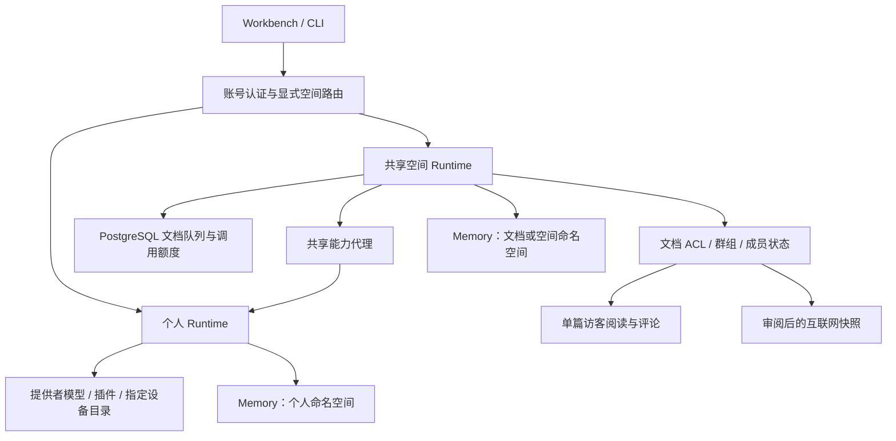

# Zioon 共享空间：本地交付

2026-11-21。此版本在独立 worktree 实现，沿用现有账号、Runtime、会话文档、插件和 Memory 架构。机器人／数字人留待后续。

## 用户可以完成什么

用户保留自己的账号和个人空间；另建一个共享空间，邀请指定的人加入，逐项分享模型、技能、已验证的插件工具和设备目录。对方登录自己的账号使用这些能力。共享空间不会复制提供者的密钥、个人设置、个人 Memory 或工作会话。

Workbench 保持现有文档聊天方式。顶部增加空间选择、联系人、空间管理和分享文档入口。空间管理包含成员、群组、资源、知识与记忆、用量、设置和活动记录。每个窗口固定当前空间；另一个窗口可以打开个人空间。

CLI 保持原有聊天和 Markdown 输出，增加 `--space` 与 `/space`，并提供空间、联系人、资源和文档分享命令。会话、草稿和续接记录按账号与空间隔离。

## 权限边界

| 对象 | 规则 |
| --- | --- |
| 个人空间 | 仅本人可用；会话和资料默认私密 |
| 新建共享文档 | 默认向该空间的成员开放，受空间角色限制 |
| 受限文档 | 仅明确授权的人或群组可访问；空间管理员也不能绕过文档授权 |
| 空间文档 | 可采用空间成员继承，或改为指定成员／群组 |
| 外部文档 | 空间允许外部分享时，给指定账号单篇查看／评论权限 |
| 互联网副本 | 管理者审阅正文和选中图片后，发布固定阅读版本；有效期和撤销独立管理 |
| 联系人 | 只是自己的联系人名单，不自动获得空间或文档权限 |

空间角色为所有者、管理员、成员、访客；文档角色为管理、编辑、评论、查看。空间治理权与文档阅读权分开。所有权转移需要指定成员接受，不能通过普通角色编辑直接产生第二位所有者。

互联网发布先要求空间允许公开发布、文档允许外部分享。发布内容为审阅副本，不随原文编辑而更新。文档授权变化、删除、有效期到期或主动撤销会使链接失效。互联网副本不意味着匿名用户获得空间访问权。

## 架构



使用现有 PostgreSQL Account Store、Run Store、Workbench Store 和 Hocuspocus 协作服务。增加空间策略、成员群组、文档 ACL、共享资源绑定、调用账本、文档队列、知识摘要、评论、公开版本及审计记录。

资源通过绑定代理使用。提供者必须拥有个人来源空间、仍保有来源资源权限，并仍是目标空间成员。请求以短期服务授权执行，携带请求者、目标文档和目标空间用于追踪。资源配置变更、提供者被移除或授权暂停／撤销后，旧绑定不会继续执行。

设备共享需要专用目录与明确工具集合。成员和模型看到 `/shared`；代理转换到提供者目录。路径越界、遍历和相冲突的设备目标会被拒绝。提供者的私有产物 ID、接口配置和错误详情不透传。

现有 Workbench 文档读写、目录搜索、版本、分支、附件和协作连接都接入 ACL。内容与授权在同一事务内保存，避免失败留下孤立授权。操作回执按请求者隔离；审阅转移的稳定请求 ID 可以安全重试。

共享回答在文档队列中串行执行，取得位置后才写入回答占位。调用前预留额度，获得确定结果后结算。结果未知时保留占用，重启不会自动再次执行外部调用。额度单位为“模型或工具调用次数”，并记录已确认的 token 用量；本轮没有货币计费。

Memory 沿用独立服务及固定版本 agent-fs。Runtime 通过签名委托指定命名空间、文档和操作。Gateway 先验证签名，再送到相应空间 Runtime 检查当前授权；Memory 排队前后也重新检查。共享文档不会使用个人 Identity 缓存。人工维护的文档 Memory 与审阅知识摘要可用；共享对话的自动事实提炼未启用。

## 本地运行

代码：`.worktrees/zioon-spaces-20261121`，分支 `feat/shared-spaces-20261121`，基于 main `c133e779`。

Memory：`.worktrees/zioon-spaces-memory-20261121`，分支 `feat/shared-spaces-namespace-20261121`，基于 main `5bb2e7f`。

进入产品 worktree 后：

```sh
node scripts/spaces-preview.mjs start
node scripts/spaces-preview.mjs status
node scripts/spaces-preview.mjs accounts
node scripts/spaces-preview-cli.mjs partner chat
node scripts/spaces-preview.mjs stop
```

启动器使用独立本地端口：数据库 55671、Workbench/Runtime 55672、登录 55673、Memory 55674、测试模型 55675。仅监听本机。数据保存在 `.runtime-data/spaces-preview`，固定依赖在 `.vendor/spaces-preview`，均不纳入 Git。停止应用保留数据库和数据，再次启动可继续使用。

本机已安装 PostgreSQL 16.16；固定 Memory 运行时为 Bun 1.4.1、agent-fs 0.18.5。启动脚本是这台 Mac 的交付预览启动器，不是生产部署脚本。

## 验证与限制

原生 PostgreSQL 核心验证 135 项通过，覆盖授权、事务、转移、附件、账号、执行、队列、恢复、调度及 CLI。联调补充验证覆盖：

- 真实签名 OIDC 登录与双空间路由。
- 提供者模型代理、真实 DeviceConnector 及共享目录读取。
- 模型目录投影、额度拦截／恢复、文档并发队列。
- 独立 Memory 文件与原生 MCP 读取、文档／个人／访客隔离。
- 单篇访客附件、评论、撤销及无关附件拒绝。
- 原生 CLI 审阅移动与原清单重试。
- 互联网快照审阅和撤销、资源暂停恢复、审计记录。
- Workbench 控件连接真实接口的 DOM 验收。
- macOS 原生 PTY 的共享聊天、空间切换与退出。
- 整个 Runtime／Memory 重启后，同一文档、ACL、成员、资源和 Memory 内容与 hash 保持一致。

Workbench 与 Runtime 构建通过。根项目完整 `tsc --noEmit` 仍有原基线的 25 项诊断；新增空间代码未增加诊断，不把它报告成全量类型检查通过。

预览模型明确标注为确定性本地测试模型，用来验证链路，不代表真实模型能力。第三方真实模型、插件及实物设备还需在接入相应资源后验证其供应商行为。本轮未运行浏览器或 Windows／Linux 原生终端；视觉、滚动手感及跨平台终端仍需人工检查。没有提交、推送或发布生产环境。
